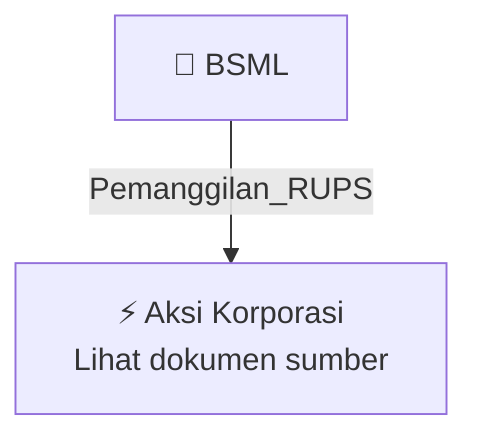

# 📢 Pemanggilan RUPS / RUPSLB — [[BSML]]

⬅️ [[knowledge-base/daily-digests/Daily_Digest_20261009|Kembali ke Daily Digest]] | 📅 **2026-10-09** | 🎛️ [[Dashboard|Ke Dashboard Utama]]

> [!IMPORTANT]
> Laporan ini disusun secara otomatis oleh **Corporate Action Intelligence Agent** pada **2026-10-09**.
> Sumber dokumen: `20261008_BSML_20261008_BSML_Pemanggilan RUPS_32164919_lamp1.pdf`

---

## 📌 1. Ringkasan Eksekutif & Tujuan Strategis

- **Kode & Nama Emiten**: `[[BSML]]`
- **Kategori Aksi Korporasi**: `Pemanggilan_RUPS`
- **Dokumen Sumber**: `20261008_BSML_20261008_BSML_Pemanggilan RUPS_32164919_lamp1.pdf`
- **Tanggal Laporan**: `2026-10-09`

[Analisis LLM tidak tersedia — isi manual]

---

## 📊 2. Fakta Material & Parameter Keuangan

| Parameter Utama | Nilai / Keterangan |
| :--- | :--- |
| **Nama Perseroan** | `PT Bintang Samudera Mandiri Lines Tbk` |
| **Jenis Rapat** | `Rapat Umum Pemegang Saham Luar Biasa (RUPSLB)` |
| **Hari/Tanggal Rapat** | `Jumat, 30 Oktober 2026` |
| **Waktu Rapat** | `10.00 WIB - selesai` |
| **Tempat Rapat** | `Royal Kuningan Hotel, Jl. Kuningan Persada No.2 (Kav. 2), RT.1/RW.6, Guntur, Kecamatan Setiabudi, Kota Ibukota Jakarta 12980` |
| **Mata Acara 1** | `Persetujuan Perubahan Susunan Pengurus Perseroan` |
| **Mata Acara 2** | `Perubahan atas keputusan RUPS Tahunan tanggal 24 Juni 2026 mengenai penunjukan Akuntan Publik dan/atau Kantor Akuntan Publik untuk mengaudit Laporan Keuangan Tahun Buku yang berakhir 31 Desember 2026, serta pelimpahan kewenangan kepada Dewan Komisaris untuk menunjuk Akuntan Publik dan/atau Kantor Akuntan Publik pengganti` |
| **Mata Acara 3** | `Persetujuan atas Penjaminan Sebagian Besar atau Seluruh Aset Perseroan` |
| **Dasar Hukum Mata Acara 1** | `Pasal 111 ayat (1) UUPT dan POJK Nomor 33/POJK.04/2014 tentang Direksi dan Dewan Komisaris Emiten atau Perusahaan Publik` |
| **Dasar Hukum Mata Acara 2** | `Pasal 68 Anggaran Dasar Perseroan, UU Nomor 40 Tahun 2007 tentang Perseroan Terbatas, dan POJK Nomor 9/POJK.04/2021 tentang Jasa Akuntan Publik di Kegiatan Pasar Modal` |
| **Dasar Hukum Mata Acara 3** | `POJK No.17/POJK.04/2020 tentang Transaksi Material dan Perubahan Kegiatan Usaha` |
| **Tanggal RUPS Tahunan Sebelumnya** | `24 Juni 2026` |
| **Tahun Buku Audit** | `31 Desember 2026` |

---

## 👥 3. Struktur Kepemilikan, Pengendali & Pembeli Siaga

- **Emiten**: `BSML` | Informasi kepemilikan mengacu pada dokumen resmi sumber.

---

## 🎯 4. Alokasi & Rencana Penggunaan Dana

- Informasi alokasi dana belum tersedia — lihat prospektus / dokumen resmi.

---

## 📅 5. Timeline & Jadwal Pelaksanaan

| Tahapan / Event | Tanggal |
| :--- | :---: |
| **Jadwal** | Lihat dokumen sumber. |

---

## 📈 6. Diagram Visual Flowchart (Mermaid)

---

## 💡 7. Rekomendasi Investor & Strategi Trading

[Analisis LLM tidak tersedia — isi manual]

---

## 🔗 8. Hubungan Note Terkait (Knowledge Graph)

- [[knowledge-base/daily-digests/Daily_Digest_20261009|📄 Daily Digest 2026-10-09]]
- [[knowledge-base/trading-signals/Trading_Signals_20261009|🎯 Sinyal Cuan 2026-10-09]]
- [[BSML|🏬 Halaman Emiten BSML]]
- [[Dashboard|🎛️ Kembali ke Dashboard Utama]]

---

*Laporan dibuat otomatis oleh Corporate Action Intelligence Agent · 2026-10-09*