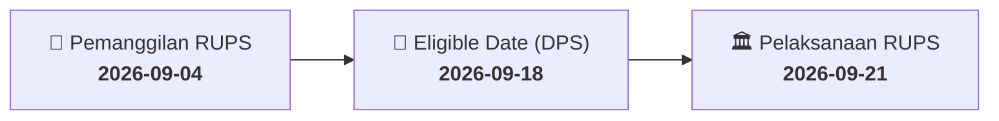

# ⚡ Laporan Intelijen Aksi Korporasi: [[BTPS]] - RUPS

⬅️ [[knowledge-base/daily-digests/Daily_Digest_20260904|Kembali ke Daily Digest]] | 📅 **2026-09-04** | 🎛️ [[Dashboard|Ke Dashboard Utama]]

> [!IMPORTANT]
> Laporan ini disusun secara otomatis oleh **Corporate Action Intelligence Agent** untuk memetakan implikasi strategis, rasio keuangan, alokasi dana, jadwal penting, dan panduan investor.

---

## 📌 1. Ringkasan Eksekutif & Katalis Strategis
- **Kode & Nama Emiten**: `[[BTPS]]`
- **Kategori Aksi Korporasi**: `RUPS`
- **Dokumen Resmi Bursa**: `Pengumuman RUPS lamp3`
- **Ringkasan Inti Aksi**: PT Bank BTPN Syariah Tbk mengumumkan akan menyelenggarakan Rapat Umum Pemegang Saham Luar Biasa (RUPSLB) pada Selasa, 13 Oktober 2026. Pemegang saham yang berhak hadir adalah yang tercatat dalam Daftar Pemegang Saham pada 18 September 2026 pukul 16:00 WIB. Pemanggilan RUPS akan diumumkan pada 21 September 2026. Pengumuman ini disampaikan pada 4 September 2026.

---

## 📊 2. Matriks Parameter Material & Angka Kunci
| Parameter Utama | Nilai / Keterangan Resmi |
| :--- | :--- |
| **Jenis Rapat** | `Rapat Umum Pemegang Saham Luar Biasa (RUPSLB)` |
| **Tanggal Pelaksanaan RUPS** | `2026-10-13` |
| **Tanggal Pemanggilan RUPS** | `2026-09-21` |
| **Tanggal Pencatatan Pemegang Saham (Recording Date)** | `2026-09-18` |
| **Batas Waktu Pencatatan Pemegang Saham** | `16:00 WIB` |
| **Batas Akhir Pengajuan Usulan Agenda RUPS** | `7 hari sebelum pemanggilan RUPS` |
| **Biro Administrasi Efek** | `PT Datindo Entrycom` |
| **Batas Akhir Penyerahan Kuasa Konvensional** | `2026-10-08` |
| **Batas Akhir Penyerahan Kuasa Elektronik** | `2026-10-12` |
| **Tanggal Pengumuman** | `2026-09-04` |

---

## 📌 3. Detail Pelaksanaan RUPS / RUPSLB
- **Hari, Tanggal Pelaksanaan**: `2026-09-21`
- **Waktu Pelaksanaan**: `16:00 WIB`
- **Lokasi / Tempat Pelaksanaan**: `Aplikasi eASY.KSEI / Kantor Perseroan`
- **Batas Hak Suara (Eligible Date / Recording Date)**: `2026-09-18`

## 📝 4. Matriks Agenda & Mata Acara Rapat
| No | Agenda / Mata Acara | Penjelasan & Sub-Acara |
| :-: | :--- | :--- |
| 1 | **Batas Akhir Pengajuan Usulan Agenda RUPS** | 7 hari sebelum pemanggilan RUPS |

## 🗓️ 5. Timeline Investor & Ketentuan Kehadiran

## 💡 6. Panduan Investor & E-Voting
- 👥 **Hak Suara**: Pemegang saham yang berhak hadir/memberikan suara adalah yang terdaftar dalam DPS pada **Eligible Date (2026-09-18)**.
- 🗳️ **E-Voting eASY.KSEI**: Pemegang saham dapat memberikan kuasa/suara secara elektronik melalui sistem eASY.KSEI.

---

## 🔗 Hubungan Note Terkait (Knowledge Graph)
- [[knowledge-base/daily-digests/Daily_Digest_20260904|📄 Daily Digest 2026-09-04]]
- [[knowledge-base/trading-signals/Trading_Signals_20260904|🎯 Sinyal Cuan 2026-09-04]]
- [[Dashboard|🎛️ Kembali ke Dashboard]]