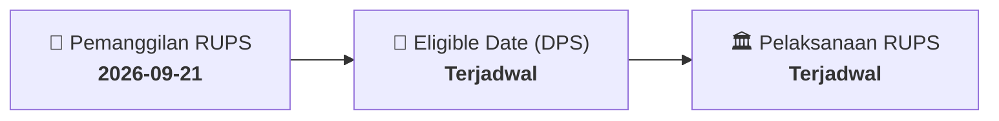

# ⚡ Laporan Intelijen Aksi Korporasi: [[BTPS]] - RUPS

⬅️ [[knowledge-base/daily-digests/Daily_Digest_20260921|Kembali ke Daily Digest]] | 📅 **2026-09-21** | 🎛️ [[Dashboard|Ke Dashboard Utama]]

> [!IMPORTANT]
> Laporan ini disusun secara otomatis oleh **Corporate Action Intelligence Agent** untuk memetakan implikasi strategis, rasio keuangan, alokasi dana, jadwal penting, dan panduan investor.

---

## 📌 1. Ringkasan Eksekutif & Katalis Strategis
- **Kode & Nama Emiten**: `[[BTPS]]`
- **Kategori Aksi Korporasi**: `RUPS`
- **Dokumen Resmi Bursa**: `Pemanggilan RUPS lamp4`
- **Ringkasan Inti Aksi**: Informasi dan fakta material BTPS: Page 1 of 7 Penjelasan Agenda dan Materi/Bahan Rapat Umum Pemegang Saham Luar Biasa (“Rapat) PT Bank BTPN Syariah Tbk (“Perseroan”) Selasa 13 Oktober 2026 Agenda Description and Materials of the Extraordinary General Meeting of Shareholders (the “Meeting”) of PT Bank BTPN Syariah Tbk (“Company”) Tuesday, 13 October 2026 Sehubungan dengan penyelenggaraan Rapat Umum Pemegang Saham Luar Biasa (“RUPSLB”) PT Bank BTPN Syariah Tbk (“Perseroan“) pada hari Selasa, 13 Oktober 2026 (“Rapat”), Perseroan te

---

## 📊 2. Matriks Parameter Material & Angka Kunci
| Parameter Utama | Nilai / Keterangan Resmi |
| :--- | :--- |
| **Uraian Kejadian** | `Page 1 of 7 Penjelasan Agenda dan Materi/Bahan Rapat Umum Pemegang Saham Luar Biasa (“Rapat) PT Bank BTPN Syariah Tbk (“Perseroan”) Selasa 13 Oktober 2026 Agenda Description and Materials of the Extraordinary General Meeting of Shareholders (the “Meeting”) of PT Bank BTPN Syariah Tbk (“Company”) Tuesday, 13 October 2026 Sehubungan dengan penyelenggaraan Rapat Umum Pemegang Saham Luar Biasa (“RUPSLB”) PT Bank BTPN Syariah Tbk (“Perseroan“) pada hari Selasa, 13 Oktober 2026 (“Rapat”), Perseroan te` |

---

## 📌 3. Detail Pelaksanaan RUPS / RUPSLB
- **Hari, Tanggal Pelaksanaan**: `Terjadwal`
- **Waktu Pelaksanaan**: `09.00 WIB s.d. selesai`
- **Lokasi / Tempat Pelaksanaan**: `Aplikasi eASY.KSEI / Kantor Perseroan`
- **Batas Hak Suara (Eligible Date / Recording Date)**: `Terjadwal`

## 📝 4. Matriks Agenda & Mata Acara Rapat
| No | Agenda / Mata Acara | Penjelasan & Sub-Acara |
| :-: | :--- | :--- |
| 1 | **Agenda Utama RUPS** | Informasi dan fakta material BTPS: Page 1 of 7 Penjelasan Agenda dan Materi/Bahan Rapat Umum Pemegang Saham Luar Biasa (“Rapat) PT Bank BTPN Syariah Tbk (“Perseroan”) Selasa 13 Oktober 2026 Agenda Description and Materials of the Extraordinary General Meeting of Shareholders (the “Meeting”) of PT Bank BTPN Syariah Tbk (“Company”) Tuesday, 13 October 2026 Sehubungan dengan penyelenggaraan Rapat Umum Pemegang Saham Luar Biasa (“RUPSLB”) PT Bank BTPN Syariah Tbk (“Perseroan“) pada hari Selasa, 13 Oktober 2026 (“Rapat”), Perseroan te |

## 🗓️ 5. Timeline Investor & Ketentuan Kehadiran

## 💡 6. Panduan Investor & E-Voting
- 👥 **Hak Suara**: Pemegang saham yang berhak hadir/memberikan suara adalah yang terdaftar dalam DPS pada **Eligible Date (Terjadwal)**.
- 🗳️ **E-Voting eASY.KSEI**: Pemegang saham dapat memberikan kuasa/suara secara elektronik melalui sistem eASY.KSEI.

---

## 🔗 Hubungan Note Terkait (Knowledge Graph)
- [[knowledge-base/daily-digests/Daily_Digest_20260921|📄 Daily Digest 2026-09-21]]
- [[knowledge-base/trading-signals/Trading_Signals_20260921|🎯 Sinyal Cuan 2026-09-21]]
- [[Dashboard|🎛️ Kembali ke Dashboard]]