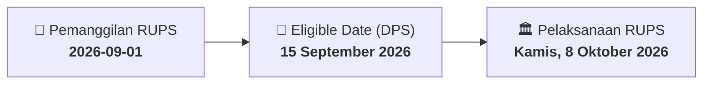

# ⚡ Laporan Intelijen Aksi Korporasi: [[CASH]] - RUPS

⬅️ [[knowledge-base/daily-digests/Daily_Digest_20260901|Kembali ke Daily Digest]] | 📅 **2026-09-01** | 🎛️ [[Dashboard|Ke Dashboard Utama]]

> [!IMPORTANT]
> Laporan ini disusun secara otomatis oleh **Corporate Action Intelligence Agent** untuk memetakan implikasi strategis, rasio keuangan, alokasi dana, jadwal penting, dan panduan investor.

---

## 📌 1. Ringkasan Eksekutif & Katalis Strategis
- **Kode & Nama Emiten**: `[[CASH]]`
- **Kategori Aksi Korporasi**: `RUPS`
- **Dokumen Resmi Bursa**: `Pengumuman RUPS lamp1`
- **Ringkasan Inti Aksi**: PT Cashlez Worldwide Indonesia Tbk mengumumkan penyelenggaraan Rapat Umum Pemegang Saham Luar Biasa (RUPSLB) yang akan diadakan pada Kamis, 8 Oktober 2026, pukul 10.00 WIB di Ruang Brass Ballroom, Thamrin Nine Complex, Jakarta. Pemegang saham yang berhak hadir adalah yang tercatat pada tanggal 15 September 2026. Rapat dapat dihadiri secara fisik atau elektronik melalui fasilitas e-Proxy.

---

## 📊 2. Matriks Parameter Material & Angka Kunci
| Parameter Utama | Nilai / Keterangan Resmi |
| :--- | :--- |
| **Jenis Rapat** | `Rapat Umum Pemegang Saham Luar Biasa (RUPSLB)` |
| **Hari/Tanggal Rapat** | `Kamis, 8 Oktober 2026` |
| **Waktu Rapat** | `10.00 WIB - selesai` |
| **Lokasi Rapat** | `Ruang Brass Ballroom, Thamrin Nine Complex, Lt. GF, Jl. M.H. Thamrin, No.10, Jakarta Pusat 10230` |
| **Tanggal Daftar Pemegang Saham (DPS)** | `15 September 2026` |
| **Batas Waktu Penerimaan Usulan Pemegang Saham** | `7 hari sebelum Pemanggilan Rapat` |
| **Batas Akhir Penggunaan e-Proxy** | `7 Oktober 2026` |
| **Dasar Hukum** | `Pasal 21 Ayat (5) Anggaran Dasar Perseroan, POJK 15/2020, POJK 16/2020` |

---

## 📌 3. Detail Pelaksanaan RUPS / RUPSLB
- **Hari, Tanggal Pelaksanaan**: `Kamis, 8 Oktober 2026`
- **Waktu Pelaksanaan**: `7 hari sebelum Pemanggilan Rapat`
- **Lokasi / Tempat Pelaksanaan**: `Ruang Brass Ballroom, Thamrin Nine Complex, Lt. GF, Jl. M.H. Thamrin, No.10, Jakarta Pusat 10230`
- **Batas Hak Suara (Eligible Date / Recording Date)**: `15 September 2026`

## 📝 4. Matriks Agenda & Mata Acara Rapat
| No | Agenda / Mata Acara | Penjelasan & Sub-Acara |
| :-: | :--- | :--- |
| 1 | **Agenda Utama RUPS** | PT Cashlez Worldwide Indonesia Tbk mengumumkan penyelenggaraan Rapat Umum Pemegang Saham Luar Biasa (RUPSLB) yang akan diadakan pada Kamis, 8 Oktober 2026, pukul 10.00 WIB di Ruang Brass Ballroom, Thamrin Nine Complex, Jakarta. Pemegang saham yang berhak hadir adalah yang tercatat pada tanggal 15 September 2026. Rapat dapat dihadiri secara fisik atau elektronik melalui fasilitas e-Proxy. |

## 🗓️ 5. Timeline Investor & Ketentuan Kehadiran

## 💡 6. Panduan Investor & E-Voting
- 👥 **Hak Suara**: Pemegang saham yang berhak hadir/memberikan suara adalah yang terdaftar dalam DPS pada **Eligible Date (15 September 2026)**.
- 🗳️ **E-Voting eASY.KSEI**: Pemegang saham dapat memberikan kuasa/suara secara elektronik melalui sistem eASY.KSEI.

---

## 🔗 Hubungan Note Terkait (Knowledge Graph)
- [[knowledge-base/daily-digests/Daily_Digest_20260901|📄 Daily Digest 2026-09-01]]
- [[knowledge-base/trading-signals/Trading_Signals_20260901|🎯 Sinyal Cuan 2026-09-01]]
- [[Dashboard|🎛️ Kembali ke Dashboard]]