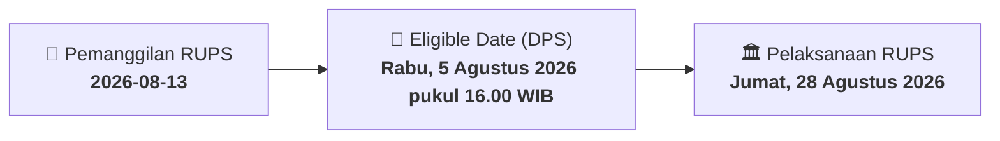

# ⚡ Laporan Intelijen Aksi Korporasi: [[CITA]] - RUPS

⬅️ [[knowledge-base/daily-digests/Daily_Digest_20260813|Kembali ke Daily Digest]] | 📅 **2026-08-13** | 🎛️ [[Dashboard|Ke Dashboard Utama]]

> [!IMPORTANT]
> Laporan ini disusun secara otomatis oleh **Corporate Action Intelligence Agent** untuk memetakan implikasi strategis, rasio keuangan, alokasi dana, jadwal penting, dan panduan investor.

---

## 📌 1. Ringkasan Eksekutif & Katalis Strategis
- **Kode & Nama Emiten**: `[[CITA]]`
- **Kategori Aksi Korporasi**: `RUPS`
- **Dokumen Resmi Bursa**: `Pemanggilan RUPS lamp1`
- **Ringkasan Inti Aksi**: PT Cita Mineral Investindo Tbk (CITA) memanggil pemegang saham untuk menghadiri Rapat Umum Pemegang Saham Luar Biasa (RUPSLB) Tahun 2026 yang akan diselenggarakan secara elektronik pada Jumat, 28 Agustus 2026. Agenda utama rapat adalah persetujuan penyesuaian Pasal 3 Anggaran Dasar Perseroan tentang Maksud dan Tujuan serta Kegiatan Usaha sesuai dengan KBLI 2025, yang bersifat administratif dan bukan merupakan perubahan kegiatan usaha.

---

## 📊 2. Matriks Parameter Material & Angka Kunci
| Parameter Utama | Nilai / Keterangan Resmi |
| :--- | :--- |
| **Jenis Rapat** | `Rapat Umum Pemegang Saham Luar Biasa (RUPSLB)` |
| **Hari/Tanggal Rapat** | `Jumat, 28 Agustus 2026` |
| **Waktu Rapat** | `14.00 - 15.00 WIB` |
| **Tempat Rapat** | `Ruang Meeting Puri Asri 2, Le Meridien Hotel Jakarta` |
| **Mekanisme Rapat** | `Secara elektronik (online) melalui platform e-RUPS sesuai POJK No. 14 Tahun 2025` |
| **Dasar Pemanggilan** | `POJK No. 15/POJK.04/2020 dan Anggaran Dasar Perseroan` |
| **Mata Acara Rapat** | `Persetujuan penyesuaian Pasal 3 Anggaran Dasar tentang Maksud dan Tujuan serta Kegiatan Usaha sesuai KBLI 2025` |
| **Sifat Penyesuaian** | `Administratif, bukan perubahan kegiatan usaha (sesuai POJK No. 17/POJK.04/2020)` |
| **Tanggal Daftar Pemegang Saham (DPS)** | `Rabu, 5 Agustus 2026 pukul 16.00 WIB` |

---

## 📌 3. Detail Pelaksanaan RUPS / RUPSLB
- **Hari, Tanggal Pelaksanaan**: `Jumat, 28 Agustus 2026`
- **Waktu Pelaksanaan**: `14.00 - 15.00 WIB`
- **Lokasi / Tempat Pelaksanaan**: `Ruang Meeting Puri Asri 2, Le Meridien Hotel Jakarta`
- **Batas Hak Suara (Eligible Date / Recording Date)**: `Rabu, 5 Agustus 2026 pukul 16.00 WIB`

## 📝 4. Matriks Agenda & Mata Acara Rapat
| No | Agenda / Mata Acara | Penjelasan & Sub-Acara |
| :-: | :--- | :--- |
| 1 | **Mata Acara Rapat** | Persetujuan penyesuaian Pasal 3 Anggaran Dasar tentang Maksud dan Tujuan serta Kegiatan Usaha sesuai KBLI 2025 |

## 🗓️ 5. Timeline Investor & Ketentuan Kehadiran

## 💡 6. Panduan Investor & E-Voting
- 👥 **Hak Suara**: Pemegang saham yang berhak hadir/memberikan suara adalah yang terdaftar dalam DPS pada **Eligible Date (Rabu, 5 Agustus 2026 pukul 16.00 WIB)**.
- 🗳️ **E-Voting eASY.KSEI**: Pemegang saham dapat memberikan kuasa/suara secara elektronik melalui sistem eASY.KSEI.

---

## 🔗 Hubungan Note Terkait (Knowledge Graph)
- [[knowledge-base/daily-digests/Daily_Digest_20260813|📄 Daily Digest 2026-08-13]]
- [[knowledge-base/trading-signals/Trading_Signals_20260813|🎯 Sinyal Cuan 2026-08-13]]
- [[Dashboard|🎛️ Kembali ke Dashboard]]