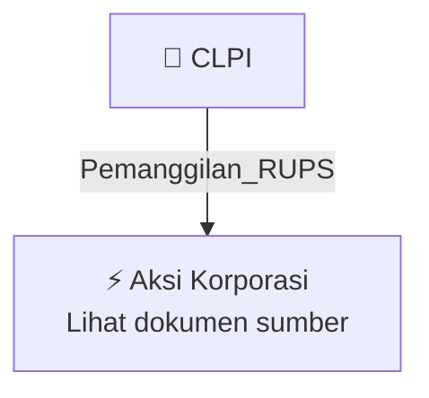

# 📢 Pemanggilan RUPS / RUPSLB — [[CLPI]]

⬅️ [[knowledge-base/daily-digests/Daily_Digest_20260924|Kembali ke Daily Digest]] | 📅 **2026-09-24** | 🎛️ [[Dashboard|Ke Dashboard Utama]]

> [!IMPORTANT]
> Laporan ini disusun secara otomatis oleh **Corporate Action Intelligence Agent** pada **2026-09-24**.
> Sumber dokumen: `20260923_CLPI_20260923_CLPI_Pemanggilan RUPS_32150518_lamp1.pdf`

---

## 📌 1. Ringkasan Eksekutif & Tujuan Strategis

- **Kode & Nama Emiten**: `[[CLPI]]`
- **Kategori Aksi Korporasi**: `Pemanggilan_RUPS`
- **Dokumen Sumber**: `20260923_CLPI_20260923_CLPI_Pemanggilan RUPS_32150518_lamp1.pdf`
- **Tanggal Laporan**: `2026-09-24`

[Analisis LLM tidak tersedia — isi manual]

---

## 📊 2. Fakta Material & Parameter Keuangan

| Parameter Utama | Nilai / Keterangan |
| :--- | :--- |
| **Hari/Tanggal RUPSLB** | `Kamis, 15 Oktober 2026` |
| **Waktu RUPSLB** | `10.00 WIB – Selesai` |
| **Tempat RUPSLB** | `Kantor PT Colorpak Indonesia Tbk` |
| **Mata Acara Rapat** | `Persetujuan penyesuaian Pasal 3 anggaran dasar tentang maksud dan tujuan serta kegiatan usaha dengan KBLI 2025` |
| **Sifat Penyesuaian** | `Administratif, bukan perubahan kegiatan usaha (sesuai POJK 17/POJK.04/2020)` |
| **Tanggal Daftar Pemegang Saham (Recording Date)** | `22 September 2026` |
| **Mekanisme Kehadiran** | `Fisik dan elektronik (e-RUPS)` |

---

## 👥 3. Struktur Kepemilikan, Pengendali & Pembeli Siaga

- **Emiten**: `CLPI` | Informasi kepemilikan mengacu pada dokumen resmi sumber.

---

## 🎯 4. Alokasi & Rencana Penggunaan Dana

- Informasi alokasi dana belum tersedia — lihat prospektus / dokumen resmi.

---

## 📅 5. Timeline & Jadwal Pelaksanaan

| Tahapan / Event | Tanggal |
| :--- | :---: |
| **Jadwal** | Lihat dokumen sumber. |

---

## 📈 6. Diagram Visual Flowchart (Mermaid)

---

## 💡 7. Rekomendasi Investor & Strategi Trading

[Analisis LLM tidak tersedia — isi manual]

---

## 🔗 8. Hubungan Note Terkait (Knowledge Graph)

- [[knowledge-base/daily-digests/Daily_Digest_20260924|📄 Daily Digest 2026-09-24]]
- [[knowledge-base/trading-signals/Trading_Signals_20260924|🎯 Sinyal Cuan 2026-09-24]]
- [[CLPI|🏬 Halaman Emiten CLPI]]
- [[Dashboard|🎛️ Kembali ke Dashboard Utama]]

---

*Laporan dibuat otomatis oleh Corporate Action Intelligence Agent · 2026-09-24*