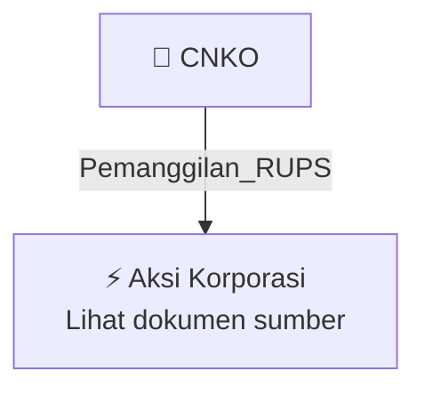

# 📢 Pemanggilan RUPS / RUPSLB — [[CNKO]]

⬅️ [[knowledge-base/daily-digests/Daily_Digest_20261007|Kembali ke Daily Digest]] | 📅 **2026-10-07** | 🎛️ [[Dashboard|Ke Dashboard Utama]]

> [!IMPORTANT]
> Laporan ini disusun secara otomatis oleh **Corporate Action Intelligence Agent** pada **2026-10-07**.
> Sumber dokumen: `20261007_CNKO_20261007_CNKO_Pemanggilan RUPS_32163976.pdf`

---

## 📌 1. Ringkasan Eksekutif & Tujuan Strategis

- **Kode & Nama Emiten**: `[[CNKO]]`
- **Kategori Aksi Korporasi**: `Pemanggilan_RUPS`
- **Dokumen Sumber**: `20261007_CNKO_20261007_CNKO_Pemanggilan RUPS_32163976.pdf`
- **Tanggal Laporan**: `2026-10-07`

[Analisis LLM tidak tersedia — isi manual]

---

## 📊 2. Fakta Material & Parameter Keuangan

| Parameter Utama | Nilai / Keterangan |
| :--- | :--- |
| **Nomor Surat** | `01.07/IDX-Net/CS/EEI/X/2026` |
| **Perihal** | `Pemanggilan Rapat Umum Pemegang Saham Luar Biasa` |
| **Jenis RUPS** | `RUPS Luar Biasa` |
| **Tanggal RUPS** | `15 Oktober 2026` |
| **Waktu RUPS** | `10:00` |
| **Lokasi RUPS** | `Financial Hall, Graha CIMB Niaga, Jl. Jenderal Sudirman Kav.58, Jakarta Selatan` |
| **Recording Date** | `06 Oktober 2026` |
| **Agenda RUPS** | `Persetujuan Perubahan Anggaran Dasar` |
| **RUPS Sebelumnya** | `20 Juli 2026` |
| **Status RUPS Sebelumnya** | `Tidak kuorum` |
| **Surat Sebelumnya** | `01.19/IDX-Net/CS/EEI/VIII/2026 tanggal 19 Agustus 2026` |
| **Pengirim** | `Wim Andrian` |
| **Alamat Perusahaan** | `Sinarmas MSIG Tower, Lantai 9, Jl. Jendral Sudirman Kav.21, Setiabudi, Karet` |
| **Telepon** | `021-80511130` |
| **Tanggal dan Waktu Pelaporan** | `07-10-2026 09:16` |

---

## 👥 3. Struktur Kepemilikan, Pengendali & Pembeli Siaga

- **Emiten**: `CNKO` | Informasi kepemilikan mengacu pada dokumen resmi sumber.

---

## 🎯 4. Alokasi & Rencana Penggunaan Dana

- Informasi alokasi dana belum tersedia — lihat prospektus / dokumen resmi.

---

## 📅 5. Timeline & Jadwal Pelaksanaan

| Tahapan / Event | Tanggal |
| :--- | :---: |
| **Jadwal** | Lihat dokumen sumber. |

---

## 📈 6. Diagram Visual Flowchart (Mermaid)

---

## 💡 7. Rekomendasi Investor & Strategi Trading

[Analisis LLM tidak tersedia — isi manual]

---

## 🔗 8. Hubungan Note Terkait (Knowledge Graph)

- [[knowledge-base/daily-digests/Daily_Digest_20261007|📄 Daily Digest 2026-10-07]]
- [[knowledge-base/trading-signals/Trading_Signals_20261007|🎯 Sinyal Cuan 2026-10-07]]
- [[CNKO|🏬 Halaman Emiten CNKO]]
- [[Dashboard|🎛️ Kembali ke Dashboard Utama]]

---

*Laporan dibuat otomatis oleh Corporate Action Intelligence Agent · 2026-10-07*