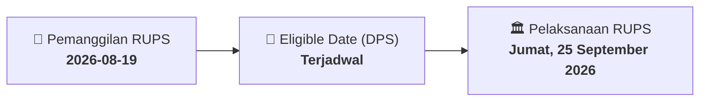

# ⚡ Laporan Intelijen Aksi Korporasi: [[CRAB]] - RUPS

⬅️ [[knowledge-base/daily-digests/Daily_Digest_20260819|Kembali ke Daily Digest]] | 📅 **2026-08-19** | 🎛️ [[Dashboard|Ke Dashboard Utama]]

> [!IMPORTANT]
> Laporan ini disusun secara otomatis oleh **Corporate Action Intelligence Agent** untuk memetakan implikasi strategis, rasio keuangan, alokasi dana, jadwal penting, dan panduan investor.

---

## 📌 1. Ringkasan Eksekutif & Katalis Strategis
- **Kode & Nama Emiten**: `[[CRAB]]`
- **Kategori Aksi Korporasi**: `RUPS`
- **Dokumen Resmi Bursa**: `Pengumuman RUPS`
- **Ringkasan Inti Aksi**: PT Toba Surimi Industries Tbk menyampaikan pemberitahuan rencana penyelenggaraan Rapat Umum Pemegang Saham Tahunan dan Luar Biasa untuk tahun buku yang berakhir 31 Desember 2025. RUPS direncanakan pada Jumat, 25 September 2026 pukul 14:00 di Grand City Hall Medan, dengan recording date 2 September 2026.

---

## 📊 2. Matriks Parameter Material & Angka Kunci
| Parameter Utama | Nilai / Keterangan Resmi |
| :--- | :--- |
| **Nomor Surat Pemberitahuan** | `020/TSI/CORSEC/VIII/2026` |
| **Nomor Surat Rujukan** | `019/TSI/CORSEC/VIII/2026` |
| **Tahun Buku** | `31 Desember 2025` |
| **Tanggal Daftar Pemegang Saham yang Berhak Hadir** | `02 September 2026` |
| **Hari/Tanggal RUPS** | `Jumat, 25 September 2026` |
| **Waktu RUPS** | `14:00` |
| **Lokasi RUPS** | `Grand City Hall Medan, Lt.2, Ruang Rosewood, Jl. Balai Kota No.1, Medan` |
| **Nama Pengirim** | `Gindra Tardy` |
| **Jabatan Pengirim** | `Direktur Utama` |
| **Tanggal Penyampaian Pemberitahuan** | `19-08-2026` |

---

## 📌 3. Detail Pelaksanaan RUPS / RUPSLB
- **Hari, Tanggal Pelaksanaan**: `Jumat, 25 September 2026`
- **Waktu Pelaksanaan**: `14:00`
- **Lokasi / Tempat Pelaksanaan**: `Grand City Hall Medan, Lt.2, Ruang Rosewood, Jl. Balai Kota No.1, Medan`
- **Batas Hak Suara (Eligible Date / Recording Date)**: `Terjadwal`

## 📝 4. Matriks Agenda & Mata Acara Rapat
| No | Agenda / Mata Acara | Penjelasan & Sub-Acara |
| :-: | :--- | :--- |
| 1 | **Agenda Utama RUPS** | PT Toba Surimi Industries Tbk menyampaikan pemberitahuan rencana penyelenggaraan Rapat Umum Pemegang Saham Tahunan dan Luar Biasa untuk tahun buku yang berakhir 31 Desember 2025. RUPS direncanakan pada Jumat, 25 September 2026 pukul 14:00 di Grand City Hall Medan, dengan recording date 2 September 2026. |

## 🗓️ 5. Timeline Investor & Ketentuan Kehadiran

## 💡 6. Panduan Investor & E-Voting
- 👥 **Hak Suara**: Pemegang saham yang berhak hadir/memberikan suara adalah yang terdaftar dalam DPS pada **Eligible Date (Terjadwal)**.
- 🗳️ **E-Voting eASY.KSEI**: Pemegang saham dapat memberikan kuasa/suara secara elektronik melalui sistem eASY.KSEI.

---

## 🔗 Hubungan Note Terkait (Knowledge Graph)
- [[knowledge-base/daily-digests/Daily_Digest_20260819|📄 Daily Digest 2026-08-19]]
- [[knowledge-base/trading-signals/Trading_Signals_20260819|🎯 Sinyal Cuan 2026-08-19]]
- [[Dashboard|🎛️ Kembali ke Dashboard]]