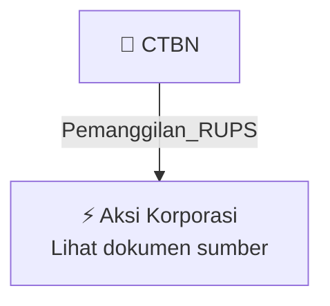

# 📢 Pemanggilan RUPS / RUPSLB — [[CTBN]]

⬅️ [[knowledge-base/daily-digests/Daily_Digest_20260924|Kembali ke Daily Digest]] | 📅 **2026-09-24** | 🎛️ [[Dashboard|Ke Dashboard Utama]]

> [!IMPORTANT]
> Laporan ini disusun secara otomatis oleh **Corporate Action Intelligence Agent** pada **2026-09-24**.
> Sumber dokumen: `20260923_CTBN_20260923_CTBN_Pemanggilan RUPS_32150592_lamp1.pdf`

---

## 📌 1. Ringkasan Eksekutif & Tujuan Strategis

- **Kode & Nama Emiten**: `[[CTBN]]`
- **Kategori Aksi Korporasi**: `Pemanggilan_RUPS`
- **Dokumen Sumber**: `20260923_CTBN_20260923_CTBN_Pemanggilan RUPS_32150592_lamp1.pdf`
- **Tanggal Laporan**: `2026-09-24`

[Analisis LLM tidak tersedia — isi manual]

---

## 📊 2. Fakta Material & Parameter Keuangan

| Parameter Utama | Nilai / Keterangan |
| :--- | :--- |
| **Uraian Kejadian** | `PT Citra Tubindo Tbk – Batam: Jl. Hang Kesturi I No. 2, Kawasan Industri Terpadu Kabil, Nongsa, 29467 Batam - Indonesia, Phone +62 778 711121-23 – Jakarta: World Trade Center 5, 16th Floor, Jl. Jenderal Sudirman Kav. 29-31, 12920 Jakarta Selatan – Indonesia, PT CITRA TUBINDO, TBK. (“Perseroan”) PANGGILAN RAPAT UMUM PEMEGANG SAHAM LUAR BIASA Direksi Perseroan dengan ini mengundang para pemegang saham Perseroan untuk menghadiri Rapat Umum Pemegang Saham Luar Biasa Perseroan (“Rapat”) yang akan dis` |

---

## 👥 3. Struktur Kepemilikan, Pengendali & Pembeli Siaga

- **Emiten**: `CTBN` | Informasi kepemilikan mengacu pada dokumen resmi sumber.

---

## 🎯 4. Alokasi & Rencana Penggunaan Dana

- Informasi alokasi dana belum tersedia — lihat prospektus / dokumen resmi.

---

## 📅 5. Timeline & Jadwal Pelaksanaan

| Tahapan / Event | Tanggal |
| :--- | :---: |
| **Jadwal** | Lihat dokumen sumber. |

---

## 📈 6. Diagram Visual Flowchart (Mermaid)

---

## 💡 7. Rekomendasi Investor & Strategi Trading

[Analisis LLM tidak tersedia — isi manual]

---

## 🔗 8. Hubungan Note Terkait (Knowledge Graph)

- [[knowledge-base/daily-digests/Daily_Digest_20260924|📄 Daily Digest 2026-09-24]]
- [[knowledge-base/trading-signals/Trading_Signals_20260924|🎯 Sinyal Cuan 2026-09-24]]
- [[CTBN|🏬 Halaman Emiten CTBN]]
- [[Dashboard|🎛️ Kembali ke Dashboard Utama]]

---

*Laporan dibuat otomatis oleh Corporate Action Intelligence Agent · 2026-09-24*