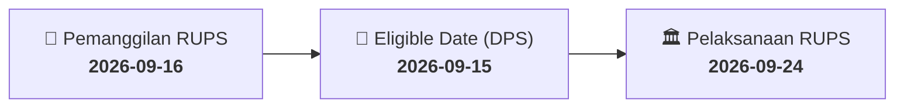

# ⚡ Laporan Intelijen Aksi Korporasi: [[DADA]] - RUPS

⬅️ [[knowledge-base/daily-digests/Daily_Digest_20260916|Kembali ke Daily Digest]] | 📅 **2026-09-16** | 🎛️ [[Dashboard|Ke Dashboard Utama]]

> [!IMPORTANT]
> Laporan ini disusun secara otomatis oleh **Corporate Action Intelligence Agent** untuk memetakan implikasi strategis, rasio keuangan, alokasi dana, jadwal penting, dan panduan investor.

---

## 📌 1. Ringkasan Eksekutif & Katalis Strategis
- **Kode & Nama Emiten**: `[[DADA]]`
- **Kategori Aksi Korporasi**: `RUPS`
- **Dokumen Resmi Bursa**: `Pemanggilan RUPS`
- **Ringkasan Inti Aksi**: PT Diamond Citra Propertindo Tbk. (DADA) mengumumkan pemanggilan Rapat Umum Pemegang Saham Tahunan (RUPST) ketiga yang akan diselenggarakan pada 24 September 2026 pukul 10:00 WIB di DAVE APARTMENT, JL. PALAKALI, KUKUSAN, KECAMATAN BEJI, KOTA DEPOK, JAWA BARAT 16425, INDONESIA. RUPS sebelumnya pada 16 Juli 2026 tidak mencapai kuorum. Tanggal pencatatan (recording date) untuk hak hadir adalah 15 September 2026. Agenda meliputi persetujuan laporan tahunan dan keuangan, penggunaan laba bersih, serta penunjukan akuntan publik.

---

## 📊 2. Matriks Parameter Material & Angka Kunci
| Parameter Utama | Nilai / Keterangan Resmi |
| :--- | :--- |
| **Nomor Surat Pemanggilan** | `282/S.KEL/ADM-FATA/DLD/IX/2026` |
| **Tanggal Surat Pemanggilan** | `2026-09-16` |
| **Tanggal RUPS** | `2026-09-24` |
| **Waktu RUPS** | `10:00 WIB` |
| **Lokasi RUPS** | `DAVE APARTMENT, JL. PALAKALI, KUKUSAN, KECAMATAN BEJI, KOTA DEPOK, JAWA BARAT 16425, INDONESIA` |
| **Tanggal Daftar Pemegang Saham (Recording Date)** | `2026-09-15` |
| **Hasil RUPS Sebelumnya (16 Juli 2026)** | `Tidak Kuorum` |
| **Agenda 1** | `Persetujuan Laporan Tahunan dan Laporan Keuangan Tahunan` |
| **Agenda 2** | `Persetujuan Penggunaan Laba Bersih` |
| **Agenda 3** | `Persetujuan Penunjukkan Akuntan Publik dan/atau Kantor Akuntan Publik` |

---

## 📌 3. Detail Pelaksanaan RUPS / RUPSLB
- **Hari, Tanggal Pelaksanaan**: `2026-09-24`
- **Waktu Pelaksanaan**: `10:00 WIB`
- **Lokasi / Tempat Pelaksanaan**: `DAVE APARTMENT, JL. PALAKALI, KUKUSAN, KECAMATAN BEJI, KOTA DEPOK, JAWA BARAT 16425, INDONESIA`
- **Batas Hak Suara (Eligible Date / Recording Date)**: `2026-09-15`

## 📝 4. Matriks Agenda & Mata Acara Rapat
| No | Agenda / Mata Acara | Penjelasan & Sub-Acara |
| :-: | :--- | :--- |
| 1 | **Agenda 1** | Persetujuan Laporan Tahunan dan Laporan Keuangan Tahunan |
| 2 | **Agenda 2** | Persetujuan Penggunaan Laba Bersih |
| 3 | **Agenda 3** | Persetujuan Penunjukkan Akuntan Publik dan/atau Kantor Akuntan Publik |

## 🗓️ 5. Timeline Investor & Ketentuan Kehadiran

## 💡 6. Panduan Investor & E-Voting
- 👥 **Hak Suara**: Pemegang saham yang berhak hadir/memberikan suara adalah yang terdaftar dalam DPS pada **Eligible Date (2026-09-15)**.
- 🗳️ **E-Voting eASY.KSEI**: Pemegang saham dapat memberikan kuasa/suara secara elektronik melalui sistem eASY.KSEI.

---

## 🔗 Hubungan Note Terkait (Knowledge Graph)
- [[knowledge-base/daily-digests/Daily_Digest_20260916|📄 Daily Digest 2026-09-16]]
- [[knowledge-base/trading-signals/Trading_Signals_20260916|🎯 Sinyal Cuan 2026-09-16]]
- [[Dashboard|🎛️ Kembali ke Dashboard]]