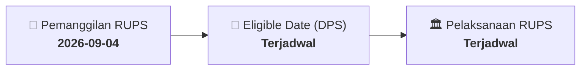

# ⚡ Laporan Intelijen Aksi Korporasi: [[DGWG]] - RUPS

⬅️ [[knowledge-base/daily-digests/Daily_Digest_20260904|Kembali ke Daily Digest]] | 📅 **2026-09-04** | 🎛️ [[Dashboard|Ke Dashboard Utama]]

> [!IMPORTANT]
> Laporan ini disusun secara otomatis oleh **Corporate Action Intelligence Agent** untuk memetakan implikasi strategis, rasio keuangan, alokasi dana, jadwal penting, dan panduan investor.

---

## 📌 1. Ringkasan Eksekutif & Katalis Strategis
- **Kode & Nama Emiten**: `[[DGWG]]`
- **Kategori Aksi Korporasi**: `RUPS`
- **Dokumen Resmi Bursa**: `Pemanggilan RUPS lamp2`
- **Ringkasan Inti Aksi**: Informasi dan fakta material DGWG: PT Delta Giri Wacana Tbk Head Office: Telp. +62 21 6520 222 Fax. +62 21 6520 111 PT DELTA GIRI WACANA TBK Berkedudukan di Jakarta Utara (“Perseroan”) PEMANGGILAN RAPAT UMUM PEMEGANG SAHAM Direksi Perseroan dengan ini mengundang para Pemegang Saham Perseroan untuk menghadiri Rapat Umum Pemegang Saham Luar Biasa (“RUPSLB”), untuk selanjutnya RUPSLB disebut “Rapat”, yang akan diselenggarakan pada: Hari/Tanggal : Senin, 28 September 2026 Pukul : 09:30 WIB - Selesai Tempat : Meeting Room Crystal 1-3,

---

## 📊 2. Matriks Parameter Material & Angka Kunci
| Parameter Utama | Nilai / Keterangan Resmi |
| :--- | :--- |
| **Uraian Kejadian** | `PT Delta Giri Wacana Tbk Head Office: Telp. +62 21 6520 222 Fax. +62 21 6520 111 PT DELTA GIRI WACANA TBK Berkedudukan di Jakarta Utara (“Perseroan”) PEMANGGILAN RAPAT UMUM PEMEGANG SAHAM Direksi Perseroan dengan ini mengundang para Pemegang Saham Perseroan untuk menghadiri Rapat Umum Pemegang Saham Luar Biasa (“RUPSLB”), untuk selanjutnya RUPSLB disebut “Rapat”, yang akan diselenggarakan pada: Hari/Tanggal : Senin, 28 September 2026 Pukul : 09:30 WIB - Selesai Tempat : Meeting Room Crystal 1-3,` |

---

## 📌 3. Detail Pelaksanaan RUPS / RUPSLB
- **Hari, Tanggal Pelaksanaan**: `Terjadwal`
- **Waktu Pelaksanaan**: `09.00 WIB s.d. selesai`
- **Lokasi / Tempat Pelaksanaan**: `Aplikasi eASY.KSEI / Kantor Perseroan`
- **Batas Hak Suara (Eligible Date / Recording Date)**: `Terjadwal`

## 📝 4. Matriks Agenda & Mata Acara Rapat
| No | Agenda / Mata Acara | Penjelasan & Sub-Acara |
| :-: | :--- | :--- |
| 1 | **Agenda Utama RUPS** | Informasi dan fakta material DGWG: PT Delta Giri Wacana Tbk Head Office: Telp. +62 21 6520 222 Fax. +62 21 6520 111 PT DELTA GIRI WACANA TBK Berkedudukan di Jakarta Utara (“Perseroan”) PEMANGGILAN RAPAT UMUM PEMEGANG SAHAM Direksi Perseroan dengan ini mengundang para Pemegang Saham Perseroan untuk menghadiri Rapat Umum Pemegang Saham Luar Biasa (“RUPSLB”), untuk selanjutnya RUPSLB disebut “Rapat”, yang akan diselenggarakan pada: Hari/Tanggal : Senin, 28 September 2026 Pukul : 09:30 WIB - Selesai Tempat : Meeting Room Crystal 1-3, |

## 🗓️ 5. Timeline Investor & Ketentuan Kehadiran

## 💡 6. Panduan Investor & E-Voting
- 👥 **Hak Suara**: Pemegang saham yang berhak hadir/memberikan suara adalah yang terdaftar dalam DPS pada **Eligible Date (Terjadwal)**.
- 🗳️ **E-Voting eASY.KSEI**: Pemegang saham dapat memberikan kuasa/suara secara elektronik melalui sistem eASY.KSEI.

---

## 🔗 Hubungan Note Terkait (Knowledge Graph)
- [[knowledge-base/daily-digests/Daily_Digest_20260904|📄 Daily Digest 2026-09-04]]
- [[knowledge-base/trading-signals/Trading_Signals_20260904|🎯 Sinyal Cuan 2026-09-04]]
- [[Dashboard|🎛️ Kembali ke Dashboard]]