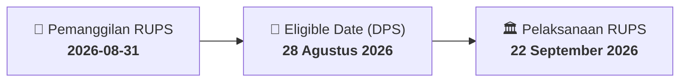

# ⚡ Laporan Intelijen Aksi Korporasi: [[DMAS]] - RUPS

⬅️ [[knowledge-base/daily-digests/Daily_Digest_20260831|Kembali ke Daily Digest]] | 📅 **2026-08-31** | 🎛️ [[Dashboard|Ke Dashboard Utama]]

> [!IMPORTANT]
> Laporan ini disusun secara otomatis oleh **Corporate Action Intelligence Agent** untuk memetakan implikasi strategis, rasio keuangan, alokasi dana, jadwal penting, dan panduan investor.

---

## 📌 1. Ringkasan Eksekutif & Katalis Strategis
- **Kode & Nama Emiten**: `[[DMAS]]`
- **Kategori Aksi Korporasi**: `RUPS`
- **Dokumen Resmi Bursa**: `Pemanggilan RUPS`
- **Ringkasan Inti Aksi**: PT Puradelta Lestari Tbk. menyampaikan pemanggilan Rapat Umum Pemegang Saham Luar Biasa (RUPSLB) yang akan diselenggarakan pada 22 September 2026 pukul 14:00 di Le Premier Hotel Kota Deltamas, Cikarang Pusat, Kabupaten Bekasi. Agenda tunggal RUPSLB adalah Perubahan Susunan Direksi Perseroan. Recording date ditetapkan pada 28 Agustus 2026.

---

## 📊 2. Matriks Parameter Material & Angka Kunci
| Parameter Utama | Nilai / Keterangan Resmi |
| :--- | :--- |
| **Jenis Rapat** | `Rapat Umum Pemegang Saham Luar Biasa (RUPSLB)` |
| **Tanggal RUPS** | `22 September 2026` |
| **Waktu RUPS** | `14:00` |
| **Lokasi RUPS** | `Le Premier Hotel Kota Deltamas Commercial Lot Sektor 1 no 6, Cikarang Pusat, Kabupaten Bekasi Jawa Barat 17815, Indonesia` |
| **Recording Date** | `28 Agustus 2026` |
| **Agenda RUPS** | `Perubahan Susunan Direksi Perseroan` |
| **Nomor Surat Pemanggilan** | `045/DMAS/IR-CS/VIII/2026` |
| **Tanggal Surat Pemanggilan** | `31 Agustus 2026` |
| **Surat Pemberitahuan Sebelumnya** | `041/DMAS/IR-CS/VIII/2026 tanggal 14 Agustus 2026` |
| **Nama Emiten** | `PT Puradelta Lestari Tbk.` |
| **Kode Emiten** | `DMAS` |

---

## 📌 3. Detail Pelaksanaan RUPS / RUPSLB
- **Hari, Tanggal Pelaksanaan**: `22 September 2026`
- **Waktu Pelaksanaan**: `14:00`
- **Lokasi / Tempat Pelaksanaan**: `Le Premier Hotel Kota Deltamas Commercial Lot Sektor 1 no 6, Cikarang Pusat, Kabupaten Bekasi Jawa Barat 17815, Indonesia`
- **Batas Hak Suara (Eligible Date / Recording Date)**: `28 Agustus 2026`

## 📝 4. Matriks Agenda & Mata Acara Rapat
| No | Agenda / Mata Acara | Penjelasan & Sub-Acara |
| :-: | :--- | :--- |
| 1 | **Agenda RUPS** | Perubahan Susunan Direksi Perseroan |

## 🗓️ 5. Timeline Investor & Ketentuan Kehadiran

## 💡 6. Panduan Investor & E-Voting
- 👥 **Hak Suara**: Pemegang saham yang berhak hadir/memberikan suara adalah yang terdaftar dalam DPS pada **Eligible Date (28 Agustus 2026)**.
- 🗳️ **E-Voting eASY.KSEI**: Pemegang saham dapat memberikan kuasa/suara secara elektronik melalui sistem eASY.KSEI.

---

## 🔗 Hubungan Note Terkait (Knowledge Graph)
- [[knowledge-base/daily-digests/Daily_Digest_20260831|📄 Daily Digest 2026-08-31]]
- [[knowledge-base/trading-signals/Trading_Signals_20260831|🎯 Sinyal Cuan 2026-08-31]]
- [[Dashboard|🎛️ Kembali ke Dashboard]]