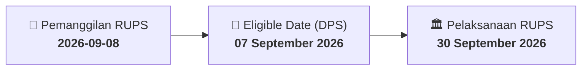

# ⚡ Laporan Intelijen Aksi Korporasi: [[DMND]] - RUPS

⬅️ [[knowledge-base/daily-digests/Daily_Digest_20260908|Kembali ke Daily Digest]] | 📅 **2026-09-08** | 🎛️ [[Dashboard|Ke Dashboard Utama]]

> [!IMPORTANT]
> Laporan ini disusun secara otomatis oleh **Corporate Action Intelligence Agent** untuk memetakan implikasi strategis, rasio keuangan, alokasi dana, jadwal penting, dan panduan investor.

---

## 📌 1. Ringkasan Eksekutif & Katalis Strategis
- **Kode & Nama Emiten**: `[[DMND]]`
- **Kategori Aksi Korporasi**: `RUPS`
- **Dokumen Resmi Bursa**: `Pemanggilan RUPS`
- **Ringkasan Inti Aksi**: PT Diamond Food Indonesia Tbk. mengundang pemegang saham untuk menghadiri Rapat Umum Pemegang Saham Luar Biasa (RUPSLB) yang akan diselenggarakan pada 30 September 2026 pukul 14:00 WIB di Ruang Cendana, DoubleTree by Hilton Jakarta Kemayoran. Rapat akan membahas persetujuan pengangkatan kembali/perubahan susunan Dewan Komisaris dan perubahan Pasal 3 Anggaran Dasar untuk penyesuaian dengan KBLI 2025. Pemegang saham yang berhak hadir adalah mereka yang tercatat pada tanggal 07 September 2026.

---

## 📊 2. Matriks Parameter Material & Angka Kunci
| Parameter Utama | Nilai / Keterangan Resmi |
| :--- | :--- |
| **Tanggal RUPS** | `30 September 2026` |
| **Waktu RUPS** | `14:00` |
| **Lokasi RUPS** | `Ruang Cendana, DoubleTree by Hilton Jakarta Kemayoran Lt. 2, Tanjung Priok, Jakarta, 14350` |
| **Tanggal Pencatatan Pemegang Saham (Recording Date)** | `07 September 2026` |
| **Agenda 1** | `Persetujuan Pengangkatan Kembali / Perubahan Susunan Dewan Komisaris` |
| **Agenda 2** | `Persetujuan atas perubahan ketentuan Pasal 3 Anggaran Dasar Perseroan melalui Maksud dan Tujuan serta Kegiatan Usaha Perseroan, dalam rangka penyesuaian dengan Klasifikasi Baku Lapangan Usaha Indonesia (KBLI) 2025` |
| **Tanggal Surat Pemberitahuan** | `24 Agustus 2026` |
| **Nomor Surat Pemberitahuan** | `DU/L-092/OJK/VIII/2026` |

---

## 📌 3. Detail Pelaksanaan RUPS / RUPSLB
- **Hari, Tanggal Pelaksanaan**: `30 September 2026`
- **Waktu Pelaksanaan**: `14:00`
- **Lokasi / Tempat Pelaksanaan**: `Ruang Cendana, DoubleTree by Hilton Jakarta Kemayoran Lt. 2, Tanjung Priok, Jakarta, 14350`
- **Batas Hak Suara (Eligible Date / Recording Date)**: `07 September 2026`

## 📝 4. Matriks Agenda & Mata Acara Rapat
| No | Agenda / Mata Acara | Penjelasan & Sub-Acara |
| :-: | :--- | :--- |
| 1 | **Agenda 1** | Persetujuan Pengangkatan Kembali / Perubahan Susunan Dewan Komisaris |
| 2 | **Agenda 2** | Persetujuan atas perubahan ketentuan Pasal 3 Anggaran Dasar Perseroan melalui Maksud dan Tujuan serta Kegiatan Usaha Perseroan, dalam rangka penyesuaian dengan Klasifikasi Baku Lapangan Usaha Indonesia (KBLI) 2025 |

## 🗓️ 5. Timeline Investor & Ketentuan Kehadiran

## 💡 6. Panduan Investor & E-Voting
- 👥 **Hak Suara**: Pemegang saham yang berhak hadir/memberikan suara adalah yang terdaftar dalam DPS pada **Eligible Date (07 September 2026)**.
- 🗳️ **E-Voting eASY.KSEI**: Pemegang saham dapat memberikan kuasa/suara secara elektronik melalui sistem eASY.KSEI.

---

## 🔗 Hubungan Note Terkait (Knowledge Graph)
- [[knowledge-base/daily-digests/Daily_Digest_20260908|📄 Daily Digest 2026-09-08]]
- [[knowledge-base/trading-signals/Trading_Signals_20260908|🎯 Sinyal Cuan 2026-09-08]]
- [[Dashboard|🎛️ Kembali ke Dashboard]]