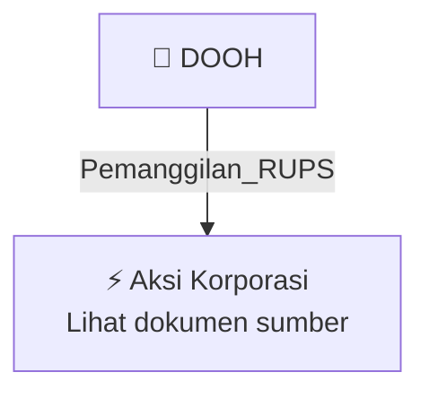

# 📢 Pemanggilan RUPS / RUPSLB — [[DOOH]]

⬅️ [[knowledge-base/daily-digests/Daily_Digest_20261002|Kembali ke Daily Digest]] | 📅 **2026-10-02** | 🎛️ [[Dashboard|Ke Dashboard Utama]]

> [!IMPORTANT]
> Laporan ini disusun secara otomatis oleh **Corporate Action Intelligence Agent** pada **2026-10-02**.
> Sumber dokumen: `20261001_DOOH_20261001_DOOH_Rencana Transaksi Material Dengan Persetujuan RUPS_32162590.pdf`

---

## 📌 1. Ringkasan Eksekutif & Tujuan Strategis

- **Kode & Nama Emiten**: `[[DOOH]]`
- **Kategori Aksi Korporasi**: `Pemanggilan_RUPS`
- **Dokumen Sumber**: `20261001_DOOH_20261001_DOOH_Rencana Transaksi Material Dengan Persetujuan RUPS_32162590.pdf`
- **Tanggal Laporan**: `2026-10-02`

[Analisis LLM tidak tersedia — isi manual]

---

## 📊 2. Fakta Material & Parameter Keuangan

| Parameter Utama | Nilai / Keterangan |
| :--- | :--- |
| **Nama Emiten** | `PT Era Media Sejahtera Tbk` |
| **Kode Emiten** | `DOOH` |
| **Jenis Transaksi** | `Rencana Transaksi Material dengan Persetujuan RUPS` |
| **Pihak Pembeli** | `PT Cakrawala Nexus Investama (CNI), anak usaha Perseroan` |
| **Pihak Penjual** | `PT Abadi Kreasi Unggul Nusantara (AKUN)` |
| **Tanggal RUPS/AGMS** | `2026-11-09` |
| **Tanggal Pengumuman RUPS/GMS Announcement Date** | `2026-10-01` |
| **Tanggal Penilaian** | `2026-09-29` |
| **Nama Penilai** | `Ir Okky Danuza, M.Sc., MAPPI` |
| **Nama KJPP** | `KJPP TOHA OKKY HERU & REKAN` |
| **Pendapat Kewajaran** | `Reasonable` |
| **Tanggal dan Waktu Publikasi** | `2026-10-01 19:50` |
| **Nama Pengirim** | `Vicktor Aritonang` |
| **Jabatan Pengirim** | `Direktur Utama` |
| **Alamat Pengirim** | `Ruko Fatmawati Mas Blok B5 Kav 205 Jl. RS Fatmawati No 20, Cilandak Barat` |
| **Lampiran** | `01.09.2026_DOOH_KI TM CNI x AKUN.pdf; 01.09.26_DOOH_CNI Akuisisi INET.pdf` |

---

## 👥 3. Struktur Kepemilikan, Pengendali & Pembeli Siaga

- **Emiten**: `DOOH` | Informasi kepemilikan mengacu pada dokumen resmi sumber.

---

## 🎯 4. Alokasi & Rencana Penggunaan Dana

- Informasi alokasi dana belum tersedia — lihat prospektus / dokumen resmi.

---

## 📅 5. Timeline & Jadwal Pelaksanaan

| Tahapan / Event | Tanggal |
| :--- | :---: |
| **Jadwal** | Lihat dokumen sumber. |

---

## 📈 6. Diagram Visual Flowchart (Mermaid)

---

## 💡 7. Rekomendasi Investor & Strategi Trading

[Analisis LLM tidak tersedia — isi manual]

---

## 🔗 8. Hubungan Note Terkait (Knowledge Graph)

- [[knowledge-base/daily-digests/Daily_Digest_20261002|📄 Daily Digest 2026-10-02]]
- [[knowledge-base/trading-signals/Trading_Signals_20261002|🎯 Sinyal Cuan 2026-10-02]]
- [[DOOH|🏬 Halaman Emiten DOOH]]
- [[Dashboard|🎛️ Kembali ke Dashboard Utama]]

---

*Laporan dibuat otomatis oleh Corporate Action Intelligence Agent · 2026-10-02*