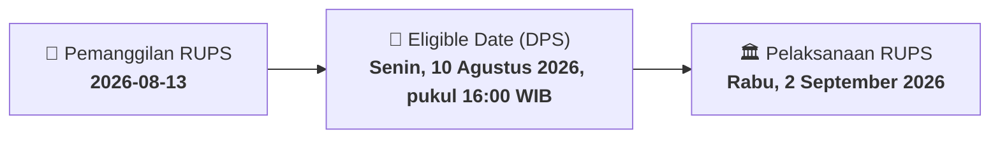

# ⚡ Laporan Intelijen Aksi Korporasi: [[ENAK]] - RUPS

⬅️ [[knowledge-base/daily-digests/Daily_Digest_20260813|Kembali ke Daily Digest]] | 📅 **2026-08-13** | 🎛️ [[Dashboard|Ke Dashboard Utama]]

> [!IMPORTANT]
> Laporan ini disusun secara otomatis oleh **Corporate Action Intelligence Agent** untuk memetakan implikasi strategis, rasio keuangan, alokasi dana, jadwal penting, dan panduan investor.

---

## 📌 1. Ringkasan Eksekutif & Katalis Strategis
- **Kode & Nama Emiten**: `[[ENAK]]`
- **Kategori Aksi Korporasi**: `RUPS`
- **Dokumen Resmi Bursa**: `Pemanggilan RUPS lamp2`
- **Ringkasan Inti Aksi**: PT Champ Resto Indonesia Tbk (ENAK) mengundang pemegang saham untuk menghadiri Rapat Umum Pemegang Saham Luar Biasa (RUPSLB) yang akan diselenggarakan secara fisik dan elektronik pada Rabu, 2 September 2026, pukul 14:00 WIB di Ruang Anggrek, North Tower, Sampoerna Strategic Square, Karet Semanggi, Setia Budi, Jakarta Selatan. Pemegang saham yang berhak hadir adalah yang tercatat dalam Daftar Pemegang Saham (DPS) Perseroan pada Senin, 10 Agustus 2026, pukul 16:00 WIB. Agenda utama RUPSLB adalah persetujuan atas perubahan susunan Dewan Komisaris dan Direksi Perseroan.

---

## 📊 2. Matriks Parameter Material & Angka Kunci
| Parameter Utama | Nilai / Keterangan Resmi |
| :--- | :--- |
| **Jenis Rapat** | `Rapat Umum Pemegang Saham Luar Biasa (RUPSLB)` |
| **Hari dan Tanggal Rapat** | `Rabu, 2 September 2026` |
| **Waktu Rapat** | `14:00 WIB sampai selesai` |
| **Tempat Rapat** | `Ruang Anggrek, North Tower, Sampoerna Strategic Square, Karet Semanggi, Setia Budi, Jakarta Selatan` |
| **Tanggal Pemanggilan** | `11 Agustus 2026` |
| **Tanggal Pengumuman Rapat** | `27 Juli 2026` |
| **Tanggal Daftar Pemegang Saham (DPS)** | `Senin, 10 Agustus 2026, pukul 16:00 WIB` |
| **Mata Acara Rapat** | `Persetujuan atas perubahan susunan Dewan Komisaris dan Direksi Perseroan` |
| **Dasar Hukum** | `POJK No. 15/2020, POJK No. 16/2020, dan POJK No. 33/2014` |

---

## 📌 3. Detail Pelaksanaan RUPS / RUPSLB
- **Hari, Tanggal Pelaksanaan**: `Rabu, 2 September 2026`
- **Waktu Pelaksanaan**: `14:00 WIB sampai selesai`
- **Lokasi / Tempat Pelaksanaan**: `Ruang Anggrek, North Tower, Sampoerna Strategic Square, Karet Semanggi, Setia Budi, Jakarta Selatan`
- **Batas Hak Suara (Eligible Date / Recording Date)**: `Senin, 10 Agustus 2026, pukul 16:00 WIB`

## 📝 4. Matriks Agenda & Mata Acara Rapat
| No | Agenda / Mata Acara | Penjelasan & Sub-Acara |
| :-: | :--- | :--- |
| 1 | **Mata Acara Rapat** | Persetujuan atas perubahan susunan Dewan Komisaris dan Direksi Perseroan |

## 🗓️ 5. Timeline Investor & Ketentuan Kehadiran

## 💡 6. Panduan Investor & E-Voting
- 👥 **Hak Suara**: Pemegang saham yang berhak hadir/memberikan suara adalah yang terdaftar dalam DPS pada **Eligible Date (Senin, 10 Agustus 2026, pukul 16:00 WIB)**.
- 🗳️ **E-Voting eASY.KSEI**: Pemegang saham dapat memberikan kuasa/suara secara elektronik melalui sistem eASY.KSEI.

---

## 🔗 Hubungan Note Terkait (Knowledge Graph)
- [[knowledge-base/daily-digests/Daily_Digest_20260813|📄 Daily Digest 2026-08-13]]
- [[knowledge-base/trading-signals/Trading_Signals_20260813|🎯 Sinyal Cuan 2026-08-13]]
- [[Dashboard|🎛️ Kembali ke Dashboard]]