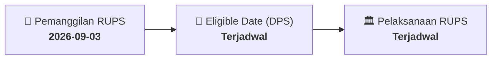

# ⚡ Laporan Intelijen Aksi Korporasi: [[EXCL]] - RUPS

⬅️ [[knowledge-base/daily-digests/Daily_Digest_20260903|Kembali ke Daily Digest]] | 📅 **2026-09-03** | 🎛️ [[Dashboard|Ke Dashboard Utama]]

> [!IMPORTANT]
> Laporan ini disusun secara otomatis oleh **Corporate Action Intelligence Agent** untuk memetakan implikasi strategis, rasio keuangan, alokasi dana, jadwal penting, dan panduan investor.

---

## 📌 1. Ringkasan Eksekutif & Katalis Strategis
- **Kode & Nama Emiten**: `[[EXCL]]`
- **Kategori Aksi Korporasi**: `RUPS`
- **Dokumen Resmi Bursa**: `Pengumuman RUPS lamp1`
- **Ringkasan Inti Aksi**: Informasi dan fakta material EXCL: PENGUMUMAN RAPAT UMUM PEMEGANG SAHAM LUAR BIASA PT XLSMART Telecom Sejahtera Tbk Dengan ini Direksi PT XLSMART Telecom Sejahtera Tbk (“ Perseroan ”), memberitahukan kepada pemegang saham bahwa Perseroan akan menyelenggarakan Rapat Umum Pemegang Saham Luar Biasa (“Rapat ”) di Jakarta pada hari Senin , 12 Oktober 2026 . Sesuai dengan ketentuan (i) Anggaran Dasar Perseroan, (ii) Pasal 17 ayat (1) dan Pasal 52 ayat (1) Peraturan Otoritas Jasa Keuangan No. 15/POJK.04/2020 tentang Rencana dan Penyelen

---

## 📊 2. Matriks Parameter Material & Angka Kunci
| Parameter Utama | Nilai / Keterangan Resmi |
| :--- | :--- |
| **Uraian Kejadian** | `PENGUMUMAN RAPAT UMUM PEMEGANG SAHAM LUAR BIASA PT XLSMART Telecom Sejahtera Tbk Dengan ini Direksi PT XLSMART Telecom Sejahtera Tbk (“ Perseroan ”), memberitahukan kepada pemegang saham bahwa Perseroan akan menyelenggarakan Rapat Umum Pemegang Saham Luar Biasa (“Rapat ”) di Jakarta pada hari Senin , 12 Oktober 2026 . Sesuai dengan ketentuan (i) Anggaran Dasar Perseroan, (ii) Pasal 17 ayat (1) dan Pasal 52 ayat (1) Peraturan Otoritas Jasa Keuangan No. 15/POJK.04/2020 tentang Rencana dan Penyelen` |

---

## 📌 3. Detail Pelaksanaan RUPS / RUPSLB
- **Hari, Tanggal Pelaksanaan**: `Terjadwal`
- **Waktu Pelaksanaan**: `09.00 WIB s.d. selesai`
- **Lokasi / Tempat Pelaksanaan**: `Aplikasi eASY.KSEI / Kantor Perseroan`
- **Batas Hak Suara (Eligible Date / Recording Date)**: `Terjadwal`

## 📝 4. Matriks Agenda & Mata Acara Rapat
| No | Agenda / Mata Acara | Penjelasan & Sub-Acara |
| :-: | :--- | :--- |
| 1 | **Agenda Utama RUPS** | Informasi dan fakta material EXCL: PENGUMUMAN RAPAT UMUM PEMEGANG SAHAM LUAR BIASA PT XLSMART Telecom Sejahtera Tbk Dengan ini Direksi PT XLSMART Telecom Sejahtera Tbk (“ Perseroan ”), memberitahukan kepada pemegang saham bahwa Perseroan akan menyelenggarakan Rapat Umum Pemegang Saham Luar Biasa (“Rapat ”) di Jakarta pada hari Senin , 12 Oktober 2026 . Sesuai dengan ketentuan (i) Anggaran Dasar Perseroan, (ii) Pasal 17 ayat (1) dan Pasal 52 ayat (1) Peraturan Otoritas Jasa Keuangan No. 15/POJK.04/2020 tentang Rencana dan Penyelen |

## 🗓️ 5. Timeline Investor & Ketentuan Kehadiran

## 💡 6. Panduan Investor & E-Voting
- 👥 **Hak Suara**: Pemegang saham yang berhak hadir/memberikan suara adalah yang terdaftar dalam DPS pada **Eligible Date (Terjadwal)**.
- 🗳️ **E-Voting eASY.KSEI**: Pemegang saham dapat memberikan kuasa/suara secara elektronik melalui sistem eASY.KSEI.

---

## 🔗 Hubungan Note Terkait (Knowledge Graph)
- [[knowledge-base/daily-digests/Daily_Digest_20260903|📄 Daily Digest 2026-09-03]]
- [[knowledge-base/trading-signals/Trading_Signals_20260903|🎯 Sinyal Cuan 2026-09-03]]
- [[Dashboard|🎛️ Kembali ke Dashboard]]