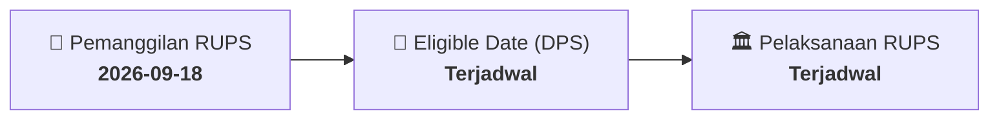

# ⚡ Laporan Intelijen Aksi Korporasi: [[EXCL]] - RUPS

⬅️ [[knowledge-base/daily-digests/Daily_Digest_20260918|Kembali ke Daily Digest]] | 📅 **2026-09-18** | 🎛️ [[Dashboard|Ke Dashboard Utama]]

> [!IMPORTANT]
> Laporan ini disusun secara otomatis oleh **Corporate Action Intelligence Agent** untuk memetakan implikasi strategis, rasio keuangan, alokasi dana, jadwal penting, dan panduan investor.

---

## 📌 1. Ringkasan Eksekutif & Katalis Strategis
- **Kode & Nama Emiten**: `[[EXCL]]`
- **Kategori Aksi Korporasi**: `RUPS`
- **Dokumen Resmi Bursa**: `Pemanggilan RUPS lamp1`
- **Ringkasan Inti Aksi**: Informasi dan fakta material EXCL: PEMANGGILAN RAPAT UMUM PEMEGANG SAHAM LUAR BIASA PT XL SMART Telecom Sejahtera Tbk (yang dilakukan secara hybrid ) Direksi PT XL SMART Telecom Sejahtera Tbk (“ Perseroan ”) dengan ini mengundang para Pemegang Saham Perseroan ("Pemegang Saham ”) untuk menghadiri Rapat Umum Pemegang Saham Luar Biasa Perseroan (“ Rapat ”) yang akan dilaksanakan pada waktu dan tanggal sebagai berikut : Hari/Tanggal : Senin, 12 Oktober 2026 Waktu Tempat : : Pukul 09 .0 0 – 10.30 WIB XLSMART Tower, Jl. H. R. Rasuna Sa

---

## 📊 2. Matriks Parameter Material & Angka Kunci
| Parameter Utama | Nilai / Keterangan Resmi |
| :--- | :--- |
| **Uraian Kejadian** | `PEMANGGILAN RAPAT UMUM PEMEGANG SAHAM LUAR BIASA PT XL SMART Telecom Sejahtera Tbk (yang dilakukan secara hybrid ) Direksi PT XL SMART Telecom Sejahtera Tbk (“ Perseroan ”) dengan ini mengundang para Pemegang Saham Perseroan ("Pemegang Saham ”) untuk menghadiri Rapat Umum Pemegang Saham Luar Biasa Perseroan (“ Rapat ”) yang akan dilaksanakan pada waktu dan tanggal sebagai berikut : Hari/Tanggal : Senin, 12 Oktober 2026 Waktu Tempat : : Pukul 09 .0 0 – 10.30 WIB XLSMART Tower, Jl. H. R. Rasuna Sa` |

---

## 📌 3. Detail Pelaksanaan RUPS / RUPSLB
- **Hari, Tanggal Pelaksanaan**: `Terjadwal`
- **Waktu Pelaksanaan**: `09.00 WIB s.d. selesai`
- **Lokasi / Tempat Pelaksanaan**: `Aplikasi eASY.KSEI / Kantor Perseroan`
- **Batas Hak Suara (Eligible Date / Recording Date)**: `Terjadwal`

## 📝 4. Matriks Agenda & Mata Acara Rapat
| No | Agenda / Mata Acara | Penjelasan & Sub-Acara |
| :-: | :--- | :--- |
| 1 | **Agenda Utama RUPS** | Informasi dan fakta material EXCL: PEMANGGILAN RAPAT UMUM PEMEGANG SAHAM LUAR BIASA PT XL SMART Telecom Sejahtera Tbk (yang dilakukan secara hybrid ) Direksi PT XL SMART Telecom Sejahtera Tbk (“ Perseroan ”) dengan ini mengundang para Pemegang Saham Perseroan ("Pemegang Saham ”) untuk menghadiri Rapat Umum Pemegang Saham Luar Biasa Perseroan (“ Rapat ”) yang akan dilaksanakan pada waktu dan tanggal sebagai berikut : Hari/Tanggal : Senin, 12 Oktober 2026 Waktu Tempat : : Pukul 09 .0 0 – 10.30 WIB XLSMART Tower, Jl. H. R. Rasuna Sa |

## 🗓️ 5. Timeline Investor & Ketentuan Kehadiran

## 💡 6. Panduan Investor & E-Voting
- 👥 **Hak Suara**: Pemegang saham yang berhak hadir/memberikan suara adalah yang terdaftar dalam DPS pada **Eligible Date (Terjadwal)**.
- 🗳️ **E-Voting eASY.KSEI**: Pemegang saham dapat memberikan kuasa/suara secara elektronik melalui sistem eASY.KSEI.

---

## 🔗 Hubungan Note Terkait (Knowledge Graph)
- [[knowledge-base/daily-digests/Daily_Digest_20260918|📄 Daily Digest 2026-09-18]]
- [[knowledge-base/trading-signals/Trading_Signals_20260918|🎯 Sinyal Cuan 2026-09-18]]
- [[Dashboard|🎛️ Kembali ke Dashboard]]