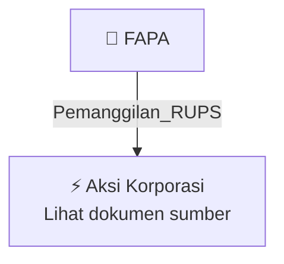

# 📢 Pemanggilan RUPS / RUPSLB — [[FAPA]]

⬅️ [[knowledge-base/daily-digests/Daily_Digest_20261009|Kembali ke Daily Digest]] | 📅 **2026-10-09** | 🎛️ [[Dashboard|Ke Dashboard Utama]]

> [!IMPORTANT]
> Laporan ini disusun secara otomatis oleh **Corporate Action Intelligence Agent** pada **2026-10-09**.
> Sumber dokumen: `20261008_FAPA_20261008_FAPA_Pengumuman RUPS_32164472_lamp2.pdf`

---

## 📌 1. Ringkasan Eksekutif & Tujuan Strategis

- **Kode & Nama Emiten**: `[[FAPA]]`
- **Kategori Aksi Korporasi**: `Pemanggilan_RUPS`
- **Dokumen Sumber**: `20261008_FAPA_20261008_FAPA_Pengumuman RUPS_32164472_lamp2.pdf`
- **Tanggal Laporan**: `2026-10-09`

[Analisis LLM tidak tersedia — isi manual]

---

## 📊 2. Fakta Material & Parameter Keuangan

| Parameter Utama | Nilai / Keterangan |
| :--- | :--- |
| **Jenis RUPS** | `Rapat Umum Pemegang Saham Luar Biasa (RUPSLB)` |
| **Tanggal Pengumuman** | `2026-10-08` |
| **Hari/Tanggal RUPS** | `2026-11-16` |
| **Waktu RUPS** | `09.30 WIB` |
| **Tempat RUPS** | `Gedung Gold Coast, Tower Liberty Lt. 16 A-aH, Jl. Pantai Indah Kapuk, Kelurahan Kamal Muara, Kecamatan Penjaringan, Jakarta Utara` |
| **Tanggal Pencatatan Pemegang Saham yang Berhak Hadir** | `2026-10-22 pukul 16.00 WIB` |
| **Batas Pengajuan Usulan Agenda Tambahan** | `2026-11-09` |
| **Dasar Hukum** | `Anggaran Dasar Perseroan Pasal 10 ayat 5 dan 8, POJK No. 15/POJK.04/2020 tanggal 21 April 2020, Article 16 dan 17 POJK 15/2020` |
| **Hak Pemegang Saham** | `Pemegang saham secara individu atau kolektif mewakili 1/20 atau lebih dari total saham Perseroan berhak mengusulkan agenda RUPS` |
| **Penyelenggara** | `Direksi PT FAP AGRI Tbk` |

---

## 👥 3. Struktur Kepemilikan, Pengendali & Pembeli Siaga

- **Emiten**: `FAPA` | Informasi kepemilikan mengacu pada dokumen resmi sumber.

---

## 🎯 4. Alokasi & Rencana Penggunaan Dana

- Informasi alokasi dana belum tersedia — lihat prospektus / dokumen resmi.

---

## 📅 5. Timeline & Jadwal Pelaksanaan

| Tahapan / Event | Tanggal |
| :--- | :---: |
| **Jadwal** | Lihat dokumen sumber. |

---

## 📈 6. Diagram Visual Flowchart (Mermaid)

---

## 💡 7. Rekomendasi Investor & Strategi Trading

[Analisis LLM tidak tersedia — isi manual]

---

## 🔗 8. Hubungan Note Terkait (Knowledge Graph)

- [[knowledge-base/daily-digests/Daily_Digest_20261009|📄 Daily Digest 2026-10-09]]
- [[knowledge-base/trading-signals/Trading_Signals_20261009|🎯 Sinyal Cuan 2026-10-09]]
- [[FAPA|🏬 Halaman Emiten FAPA]]
- [[Dashboard|🎛️ Kembali ke Dashboard Utama]]

---

*Laporan dibuat otomatis oleh Corporate Action Intelligence Agent · 2026-10-09*