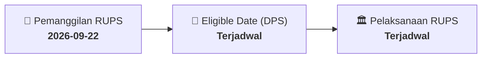

# ⚡ Laporan Intelijen Aksi Korporasi: [[FAST]] - RUPS

⬅️ [[knowledge-base/daily-digests/Daily_Digest_20260922|Kembali ke Daily Digest]] | 📅 **2026-09-22** | 🎛️ [[Dashboard|Ke Dashboard Utama]]

> [!IMPORTANT]
> Laporan ini disusun secara otomatis oleh **Corporate Action Intelligence Agent** untuk memetakan implikasi strategis, rasio keuangan, alokasi dana, jadwal penting, dan panduan investor.

---

## 📌 1. Ringkasan Eksekutif & Katalis Strategis
- **Kode & Nama Emiten**: `[[FAST]]`
- **Kategori Aksi Korporasi**: `RUPS`
- **Dokumen Resmi Bursa**: `Pemanggilan RUPS lamp1`
- **Ringkasan Inti Aksi**: Informasi dan fakta material FAST: INVITATION OF EXTRAORDINARY MEETING OF SHAREHOLDERS The Directors of the Company hereby invites the shareholders of the Company to attend the Extraordinary Meeting of Shareholders, hereinafter referred to as the “EGMS”, which will be held on: Day/date : Wednesday, 14 October 2026 Time : 10.00 WIB – finish Venue : Floor 5, Jl. MT Haryono Kav 7, Tebet, South Jakarta. Agenda of EGMS: 1. Approval of Change in the Composition of the Board of Directors Explanation: The Company seeks approval from the

---

## 📊 2. Matriks Parameter Material & Angka Kunci
| Parameter Utama | Nilai / Keterangan Resmi |
| :--- | :--- |
| **Uraian Kejadian** | `INVITATION OF EXTRAORDINARY MEETING OF SHAREHOLDERS The Directors of the Company hereby invites the shareholders of the Company to attend the Extraordinary Meeting of Shareholders, hereinafter referred to as the “EGMS”, which will be held on: Day/date : Wednesday, 14 October 2026 Time : 10.00 WIB – finish Venue : Floor 5, Jl. MT Haryono Kav 7, Tebet, South Jakarta. Agenda of EGMS: 1. Approval of Change in the Composition of the Board of Directors Explanation: The Company seeks approval from the` |

---

## 📌 3. Detail Pelaksanaan RUPS / RUPSLB
- **Hari, Tanggal Pelaksanaan**: `Terjadwal`
- **Waktu Pelaksanaan**: `09.00 WIB s.d. selesai`
- **Lokasi / Tempat Pelaksanaan**: `Aplikasi eASY.KSEI / Kantor Perseroan`
- **Batas Hak Suara (Eligible Date / Recording Date)**: `Terjadwal`

## 📝 4. Matriks Agenda & Mata Acara Rapat
| No | Agenda / Mata Acara | Penjelasan & Sub-Acara |
| :-: | :--- | :--- |
| 1 | **Agenda Utama RUPS** | Informasi dan fakta material FAST: INVITATION OF EXTRAORDINARY MEETING OF SHAREHOLDERS The Directors of the Company hereby invites the shareholders of the Company to attend the Extraordinary Meeting of Shareholders, hereinafter referred to as the “EGMS”, which will be held on: Day/date : Wednesday, 14 October 2026 Time : 10.00 WIB – finish Venue : Floor 5, Jl. MT Haryono Kav 7, Tebet, South Jakarta. Agenda of EGMS: 1. Approval of Change in the Composition of the Board of Directors Explanation: The Company seeks approval from the |

## 🗓️ 5. Timeline Investor & Ketentuan Kehadiran

## 💡 6. Panduan Investor & E-Voting
- 👥 **Hak Suara**: Pemegang saham yang berhak hadir/memberikan suara adalah yang terdaftar dalam DPS pada **Eligible Date (Terjadwal)**.
- 🗳️ **E-Voting eASY.KSEI**: Pemegang saham dapat memberikan kuasa/suara secara elektronik melalui sistem eASY.KSEI.

---

## 🔗 Hubungan Note Terkait (Knowledge Graph)
- [[knowledge-base/daily-digests/Daily_Digest_20260922|📄 Daily Digest 2026-09-22]]
- [[knowledge-base/trading-signals/Trading_Signals_20260922|🎯 Sinyal Cuan 2026-09-22]]
- [[Dashboard|🎛️ Kembali ke Dashboard]]