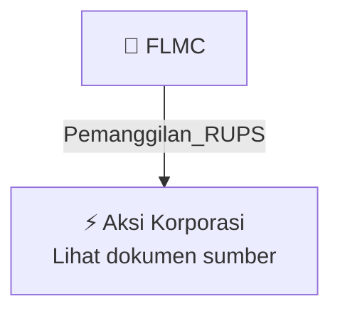

# 📢 Pemanggilan RUPS / RUPSLB — [[FLMC]]

⬅️ [[knowledge-base/daily-digests/Daily_Digest_20261012|Kembali ke Daily Digest]] | 📅 **2026-10-12** | 🎛️ [[Dashboard|Ke Dashboard Utama]]

> [!IMPORTANT]
> Laporan ini disusun secara otomatis oleh **Corporate Action Intelligence Agent** pada **2026-10-12**.
> Sumber dokumen: `20261012_FLMC_20261012_FLMC_Pengumuman RUPS_32165466_lamp2.pdf`

---

## 📌 1. Ringkasan Eksekutif & Tujuan Strategis

- **Kode & Nama Emiten**: `[[FLMC]]`
- **Kategori Aksi Korporasi**: `Pemanggilan_RUPS`
- **Dokumen Sumber**: `20261012_FLMC_20261012_FLMC_Pengumuman RUPS_32165466_lamp2.pdf`
- **Tanggal Laporan**: `2026-10-12`

[Analisis LLM tidak tersedia — isi manual]

---

## 📊 2. Fakta Material & Parameter Keuangan

| Parameter Utama | Nilai / Keterangan |
| :--- | :--- |
| **Nama Perusahaan** | `PT Falmaco Nonwoven Industri Tbk` |
| **Jenis Rapat** | `Extraordinary General Meeting of Shareholders (EGMS) / RUPS Luar Biasa` |
| **Hari dan Tanggal Rapat** | `Rabu, 18 November 2026` |
| **Waktu Rapat** | `10.00 WIB sampai selesai` |
| **Tempat Rapat** | `Artotel Suites Aquila Bandung, Jl. Dr Djunjunan No 116, Bandung` |
| **Tanggal Pemanggilan Rapat** | `Selasa, 27 Oktober 2026` |
| **Tanggal Pencatatan Pemegang Saham yang Berhak Hadir** | `Senin, 26 Oktober 2026` |
| **Batas Pengajuan Usulan Agenda oleh Pemegang Saham** | `Selasa, 20 Oktober 2026, paling lambat 7 hari sebelum pemanggilan RUPS` |
| **Syarat Pemegang Saham yang Dapat Mengusulkan Agenda** | `1 (satu) atau lebih pemegang saham yang mewakili 1/20 (satu per dua puluh) atau lebih dari total saham dengan hak suara` |
| **Tanggal Pengumuman** | `12 Oktober 2026` |
| **Kota Pengumuman** | `Bandung` |

---

## 👥 3. Struktur Kepemilikan, Pengendali & Pembeli Siaga

- **Emiten**: `FLMC` | Informasi kepemilikan mengacu pada dokumen resmi sumber.

---

## 🎯 4. Alokasi & Rencana Penggunaan Dana

- Informasi alokasi dana belum tersedia — lihat prospektus / dokumen resmi.

---

## 📅 5. Timeline & Jadwal Pelaksanaan

| Tahapan / Event | Tanggal |
| :--- | :---: |
| **Jadwal** | Lihat dokumen sumber. |

---

## 📈 6. Diagram Visual Flowchart (Mermaid)

---

## 💡 7. Rekomendasi Investor & Strategi Trading

[Analisis LLM tidak tersedia — isi manual]

---

## 🔗 8. Hubungan Note Terkait (Knowledge Graph)

- [[knowledge-base/daily-digests/Daily_Digest_20261012|📄 Daily Digest 2026-10-12]]
- [[knowledge-base/trading-signals/Trading_Signals_20261012|🎯 Sinyal Cuan 2026-10-12]]
- [[FLMC|🏬 Halaman Emiten FLMC]]
- [[Dashboard|🎛️ Kembali ke Dashboard Utama]]

---

*Laporan dibuat otomatis oleh Corporate Action Intelligence Agent · 2026-10-12*