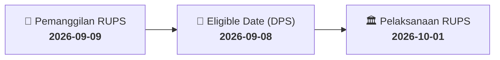

# ⚡ Laporan Intelijen Aksi Korporasi: [[FWCT]] - RUPS

⬅️ [[knowledge-base/daily-digests/Daily_Digest_20260909|Kembali ke Daily Digest]] | 📅 **2026-09-09** | 🎛️ [[Dashboard|Ke Dashboard Utama]]

> [!IMPORTANT]
> Laporan ini disusun secara otomatis oleh **Corporate Action Intelligence Agent** untuk memetakan implikasi strategis, rasio keuangan, alokasi dana, jadwal penting, dan panduan investor.

---

## 📌 1. Ringkasan Eksekutif & Katalis Strategis
- **Kode & Nama Emiten**: `[[FWCT]]`
- **Kategori Aksi Korporasi**: `RUPS`
- **Dokumen Resmi Bursa**: `Pemanggilan RUPS`
- **Ringkasan Inti Aksi**: PT Wijaya Cahaya Timber Tbk (FWCT) menyelenggarakan Rapat Umum Pemegang Saham Luar Biasa (RUPSLB) pada 1 Oktober 2026 pukul 14:00 WIB di Puri Indah Financial Tower, Jakarta Barat. RUPSLB ini memiliki agenda tunggal yaitu perubahan Anggaran Dasar Perseroan untuk penyesuaian Klasifikasi Baku Lapangan Usaha Indonesia (KBLI) sesuai Peraturan Pemerintah Nomor 28 Tahun 2025. Pemegang saham yang berhak hadir adalah mereka yang tercatat pada Recording Date 8 September 2026.

---

## 📊 2. Matriks Parameter Material & Angka Kunci
| Parameter Utama | Nilai / Keterangan Resmi |
| :--- | :--- |
| **Jenis Rapat** | `Rapat Umum Pemegang Saham Luar Biasa (RUPSLB)` |
| **Tanggal Pelaksanaan RUPS** | `2026-10-01` |
| **Waktu Pelaksanaan** | `14:00 WIB` |
| **Lokasi Pelaksanaan** | `Puri Indah Financial Tower, Jl. Puri Lingkar Dalam Blok T8, RT.001/RW.002, Kelurahan Kembangan Selatan, Kecamatan Kembangan, Jakarta Barat - 11610` |
| **Recording Date (DPS)** | `2026-09-08` |
| **Agenda RUPS** | `Perubahan Anggaran Dasar Perseroan dalam rangka Penyesuaian Klasifikasi Baku Lapangan Usaha Indonesia (KBLI) untuk memenuhi ketentuan Peraturan Pemerintah Republik Indonesia Nomor 28 Tahun 2025 tentang Penyelenggaraan Perizinan Berusaha Berbasis Risiko` |
| **Pengirim / Penanggung Jawab** | `Budi Tjahjadi (Direktur)` |
| **Tanggal Surat Pemberitahuan** | `2026-08-24` |
| **Nomor Surat Pemberitahuan** | `DIR/WCT/JKT/0826/083` |

---

## 📌 3. Detail Pelaksanaan RUPS / RUPSLB
- **Hari, Tanggal Pelaksanaan**: `2026-10-01`
- **Waktu Pelaksanaan**: `14:00 WIB`
- **Lokasi / Tempat Pelaksanaan**: `Puri Indah Financial Tower, Jl. Puri Lingkar Dalam Blok T8, RT.001/RW.002, Kelurahan Kembangan Selatan, Kecamatan Kembangan, Jakarta Barat - 11610`
- **Batas Hak Suara (Eligible Date / Recording Date)**: `2026-09-08`

## 📝 4. Matriks Agenda & Mata Acara Rapat
| No | Agenda / Mata Acara | Penjelasan & Sub-Acara |
| :-: | :--- | :--- |
| 1 | **Agenda RUPS** | Perubahan Anggaran Dasar Perseroan dalam rangka Penyesuaian Klasifikasi Baku Lapangan Usaha Indonesia (KBLI) untuk memenuhi ketentuan Peraturan Pemerintah Republik Indonesia Nomor 28 Tahun 2025 tentang Penyelenggaraan Perizinan Berusaha Berbasis Risiko |

## 🗓️ 5. Timeline Investor & Ketentuan Kehadiran

## 💡 6. Panduan Investor & E-Voting
- 👥 **Hak Suara**: Pemegang saham yang berhak hadir/memberikan suara adalah yang terdaftar dalam DPS pada **Eligible Date (2026-09-08)**.
- 🗳️ **E-Voting eASY.KSEI**: Pemegang saham dapat memberikan kuasa/suara secara elektronik melalui sistem eASY.KSEI.

---

## 🔗 Hubungan Note Terkait (Knowledge Graph)
- [[knowledge-base/daily-digests/Daily_Digest_20260909|📄 Daily Digest 2026-09-09]]
- [[knowledge-base/trading-signals/Trading_Signals_20260909|🎯 Sinyal Cuan 2026-09-09]]
- [[Dashboard|🎛️ Kembali ke Dashboard]]