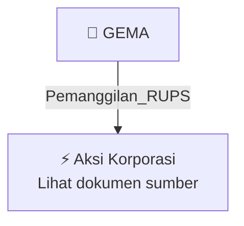

# 📢 Pemanggilan RUPS / RUPSLB — [[GEMA]]

⬅️ [[knowledge-base/daily-digests/Daily_Digest_20261009|Kembali ke Daily Digest]] | 📅 **2026-10-09** | 🎛️ [[Dashboard|Ke Dashboard Utama]]

> [!IMPORTANT]
> Laporan ini disusun secara otomatis oleh **Corporate Action Intelligence Agent** pada **2026-10-09**.
> Sumber dokumen: `20261009_GEMA_20261009_GEMA_Pengumuman RUPS_32164972_lamp1.pdf`

---

## 📌 1. Ringkasan Eksekutif & Tujuan Strategis

- **Kode & Nama Emiten**: `[[GEMA]]`
- **Kategori Aksi Korporasi**: `Pemanggilan_RUPS`
- **Dokumen Sumber**: `20261009_GEMA_20261009_GEMA_Pengumuman RUPS_32164972_lamp1.pdf`
- **Tanggal Laporan**: `2026-10-09`

[Analisis LLM tidak tersedia — isi manual]

---

## 📊 2. Fakta Material & Parameter Keuangan

| Parameter Utama | Nilai / Keterangan |
| :--- | :--- |
| **Jenis rapat** | `Rapat Umum Pemegang Saham Luar Biasa (RUPSLB)` |
| **Penyelenggara** | `PT GEMA GRAHASARANA Tbk` |
| **Hari/tanggal rapat** | `Selasa, 17 November 2026` |
| **Tanggal pengumuman** | `09 Oktober 2026` |
| **Kota pengumuman** | `Tangerang` |
| **Tanggal pemanggilan rapat** | `26 Oktober 2026` |
| **Tanggal daftar pemegang saham yang berhak hadir** | `Jumat, 23 Oktober 2026 sampai dengan pukul 16.00 WIB` |
| **Batas pengajuan usul pemegang saham** | `Paling lambat 7 (tujuh) hari kalender sebelum tanggal pemanggilan rapat` |
| **Metode penyelenggaraan rapat** | `Secara elektronik` |
| **Waktu partisipasi/voting elektronik** | `Sejak tanggal pemanggilan rapat sampai dengan 1 (satu) hari kerja sebelum tanggal rapat pukul 12.00 WIB` |
| **Dasar hukum** | `Pasal 21 ayat 11 Anggaran Dasar Perseroan; POJK No. 15/POJK.04/2020; Pasal 21 ayat 8 Anggaran Dasar Perseroan; Pasal 16 POJK No. 15/POJK.04/2020; Pasal 5 POJK No. 14 Tahun 2025` |
| **Pihak yang berhak hadir atau diwakili** | `Pemegang saham yang namanya tercatat dalam Daftar Pemegang Saham Perseroan pada 23 Oktober 2026 sampai pukul 16.00 WIB dan pemilik saham pada sub rekening efek PT Kustodian Sentral Efek di PT Bursa Efek Indonesia pada 23 Oktober 2026` |

---

## 👥 3. Struktur Kepemilikan, Pengendali & Pembeli Siaga

- **Emiten**: `GEMA` | Informasi kepemilikan mengacu pada dokumen resmi sumber.

---

## 🎯 4. Alokasi & Rencana Penggunaan Dana

- Informasi alokasi dana belum tersedia — lihat prospektus / dokumen resmi.

---

## 📅 5. Timeline & Jadwal Pelaksanaan

| Tahapan / Event | Tanggal |
| :--- | :---: |
| **Jadwal** | Lihat dokumen sumber. |

---

## 📈 6. Diagram Visual Flowchart (Mermaid)

---

## 💡 7. Rekomendasi Investor & Strategi Trading

[Analisis LLM tidak tersedia — isi manual]

---

## 🔗 8. Hubungan Note Terkait (Knowledge Graph)

- [[knowledge-base/daily-digests/Daily_Digest_20261009|📄 Daily Digest 2026-10-09]]
- [[knowledge-base/trading-signals/Trading_Signals_20261009|🎯 Sinyal Cuan 2026-10-09]]
- [[GEMA|🏬 Halaman Emiten GEMA]]
- [[Dashboard|🎛️ Kembali ke Dashboard Utama]]

---

*Laporan dibuat otomatis oleh Corporate Action Intelligence Agent · 2026-10-09*