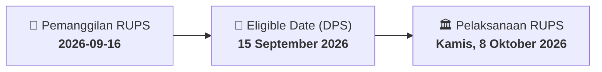

# ⚡ Laporan Intelijen Aksi Korporasi: [[GIAA]] - RUPS

⬅️ [[knowledge-base/daily-digests/Daily_Digest_20260916|Kembali ke Daily Digest]] | 📅 **2026-09-16** | 🎛️ [[Dashboard|Ke Dashboard Utama]]

> [!IMPORTANT]
> Laporan ini disusun secara otomatis oleh **Corporate Action Intelligence Agent** untuk memetakan implikasi strategis, rasio keuangan, alokasi dana, jadwal penting, dan panduan investor.

---

## 📌 1. Ringkasan Eksekutif & Katalis Strategis
- **Kode & Nama Emiten**: `[[GIAA]]`
- **Kategori Aksi Korporasi**: `RUPS`
- **Dokumen Resmi Bursa**: `Pemanggilan RUPS lamp1`
- **Ringkasan Inti Aksi**: PT Garuda Indonesia (Persero) Tbk mengundang pemegang saham untuk menghadiri Rapat Umum Pemegang Saham Luar Biasa (RUPS) yang akan diselenggarakan secara elektronik pada Kamis, 8 Oktober 2026, pukul 14.00 WIB. Agenda utama RUPS adalah perubahan pengurus Perseroan. Pemegang saham yang berhak hadir adalah yang tercatat dalam Daftar Pemegang Saham pada 15 September 2026.

---

## 📊 2. Matriks Parameter Material & Angka Kunci
| Parameter Utama | Nilai / Keterangan Resmi |
| :--- | :--- |
| **Hari/Tanggal RUPS** | `Kamis, 8 Oktober 2026` |
| **Waktu RUPS** | `14.00 WIB sampai selesai` |
| **Tempat RUPS** | `Secara elektronik melalui sistem` |
| **Mata Acara** | `Perubahan Pengurus Perseroan` |
| **Tanggal Daftar Pemegang Saham (DPS)** | `15 September 2026` |
| **Batas Waktu Deklarasi Kehadiran Elektronik** | `1 hari kerja sebelum tanggal RUPS, pukul 12.00 WIB` |

---

## 📌 3. Detail Pelaksanaan RUPS / RUPSLB
- **Hari, Tanggal Pelaksanaan**: `Kamis, 8 Oktober 2026`
- **Waktu Pelaksanaan**: `1 hari kerja sebelum tanggal RUPS, pukul 12.00 WIB`
- **Lokasi / Tempat Pelaksanaan**: `Secara elektronik melalui sistem`
- **Batas Hak Suara (Eligible Date / Recording Date)**: `15 September 2026`

## 📝 4. Matriks Agenda & Mata Acara Rapat
| No | Agenda / Mata Acara | Penjelasan & Sub-Acara |
| :-: | :--- | :--- |
| 1 | **Mata Acara** | Perubahan Pengurus Perseroan |

## 🗓️ 5. Timeline Investor & Ketentuan Kehadiran

## 💡 6. Panduan Investor & E-Voting
- 👥 **Hak Suara**: Pemegang saham yang berhak hadir/memberikan suara adalah yang terdaftar dalam DPS pada **Eligible Date (15 September 2026)**.
- 🗳️ **E-Voting eASY.KSEI**: Pemegang saham dapat memberikan kuasa/suara secara elektronik melalui sistem eASY.KSEI.

---

## 🔗 Hubungan Note Terkait (Knowledge Graph)
- [[knowledge-base/daily-digests/Daily_Digest_20260916|📄 Daily Digest 2026-09-16]]
- [[knowledge-base/trading-signals/Trading_Signals_20260916|🎯 Sinyal Cuan 2026-09-16]]
- [[Dashboard|🎛️ Kembali ke Dashboard]]