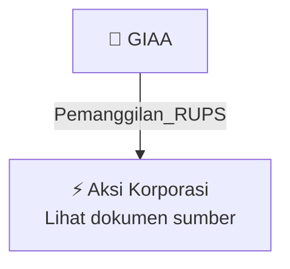

# 📢 Pemanggilan RUPS / RUPSLB — [[GIAA]]

⬅️ [[knowledge-base/daily-digests/Daily_Digest_20261002|Kembali ke Daily Digest]] | 📅 **2026-10-02** | 🎛️ [[Dashboard|Ke Dashboard Utama]]

> [!IMPORTANT]
> Laporan ini disusun secara otomatis oleh **Corporate Action Intelligence Agent** pada **2026-10-02**.
> Sumber dokumen: `20260930_GIAA_20260930_GIAA_Pengumuman RUPS_32162112_lamp1.pdf`

---

## 📌 1. Ringkasan Eksekutif & Tujuan Strategis

- **Kode & Nama Emiten**: `[[GIAA]]`
- **Kategori Aksi Korporasi**: `Pemanggilan_RUPS`
- **Dokumen Sumber**: `20260930_GIAA_20260930_GIAA_Pengumuman RUPS_32162112_lamp1.pdf`
- **Tanggal Laporan**: `2026-10-02`

[Analisis LLM tidak tersedia — isi manual]

---

## 📊 2. Fakta Material & Parameter Keuangan

| Parameter Utama | Nilai / Keterangan |
| :--- | :--- |
| **Jenis Rapat** | `Rapat Umum Pemegang Saham Luar Biasa (RUPSLB)` |
| **Tanggal Penyelenggaraan RUPSLB** | `6 November 2026` |
| **Metode Penyelenggaraan** | `Secara elektronik` |
| **Tanggal Pengumuman** | `30 September 2026` |
| **Tanggal Panggilan Rapat** | `15 Oktober 2026` |
| **Tanggal Daftar Pemegang Saham yang Berhak Hadir** | `14 Oktober 2026 sampai dengan pukul 16.00 WIB` |
| **Batas Akhir Usulan Mata Acara Rapat** | `8 Oktober 2026` |
| **Pihak yang Dapat Mengusulkan Mata Acara** | `Pemegang Saham Seri A Dwiwarna dan/atau satu pemegang saham atau lebih yang mewakili 1/20 atau lebih dari jumlah seluruh saham dengan hak suara yang sah` |
| **Dasar Regulasi** | `POJK No. 15/POJK.04/2020 dan Anggaran Dasar Perseroan` |

---

## 👥 3. Struktur Kepemilikan, Pengendali & Pembeli Siaga

- **Emiten**: `GIAA` | Informasi kepemilikan mengacu pada dokumen resmi sumber.

---

## 🎯 4. Alokasi & Rencana Penggunaan Dana

- Informasi alokasi dana belum tersedia — lihat prospektus / dokumen resmi.

---

## 📅 5. Timeline & Jadwal Pelaksanaan

| Tahapan / Event | Tanggal |
| :--- | :---: |
| **Jadwal** | Lihat dokumen sumber. |

---

## 📈 6. Diagram Visual Flowchart (Mermaid)

---

## 💡 7. Rekomendasi Investor & Strategi Trading

[Analisis LLM tidak tersedia — isi manual]

---

## 🔗 8. Hubungan Note Terkait (Knowledge Graph)

- [[knowledge-base/daily-digests/Daily_Digest_20261002|📄 Daily Digest 2026-10-02]]
- [[knowledge-base/trading-signals/Trading_Signals_20261002|🎯 Sinyal Cuan 2026-10-02]]
- [[GIAA|🏬 Halaman Emiten GIAA]]
- [[Dashboard|🎛️ Kembali ke Dashboard Utama]]

---

*Laporan dibuat otomatis oleh Corporate Action Intelligence Agent · 2026-10-02*