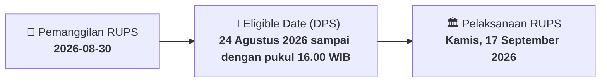

# ⚡ Laporan Intelijen Aksi Korporasi: [[HEXA]] - RUPS

⬅️ [[knowledge-base/daily-digests/Daily_Digest_20260830|Kembali ke Daily Digest]] | 📅 **2026-08-30** | 🎛️ [[Dashboard|Ke Dashboard Utama]]

> [!IMPORTANT]
> Laporan ini disusun secara otomatis oleh **Corporate Action Intelligence Agent** untuk memetakan implikasi strategis, rasio keuangan, alokasi dana, jadwal penting, dan panduan investor.

---

## 📌 1. Ringkasan Eksekutif & Katalis Strategis
- **Kode & Nama Emiten**: `[[HEXA]]`
- **Kategori Aksi Korporasi**: `RUPS`
- **Dokumen Resmi Bursa**: `Pemanggilan RUPS lamp2`
- **Ringkasan Inti Aksi**: PT Hexindo Adiperkasa Tbk mengundang pemegang saham untuk menghadiri RUPST dan RUPSLB yang akan diselenggarakan pada Kamis, 17 September 2026 pukul 10.00 WIB di Kantor Pusat Perseroan, Kawasan Industri Pulo Gadung. RUPST memiliki 5 mata acara rutin dan RUPSLB memiliki 1 mata acara terkait penyesuaian Pasal 3 Anggaran Dasar terhadap KBLI 2025.

---

## 📊 2. Matriks Parameter Material & Angka Kunci
| Parameter Utama | Nilai / Keterangan Resmi |
| :--- | :--- |
| **Jenis Rapat** | `RUPST dan RUPSLB` |
| **Hari dan Tanggal Rapat** | `Kamis, 17 September 2026` |
| **Waktu Rapat** | `10.00 WIB - selesai` |
| **Tempat Rapat** | `Kantor Pusat Perseroan, Kawasan Industri Pulo Gadung` |
| **Recording Date** | `24 Agustus 2026 sampai dengan pukul 16.00 WIB` |
| **Tahun Buku yang Berakhir** | `31 Maret 2026` |
| **Mata Acara RUPST** | `1. Persetujuan dan pengesahan Laporan Tahunan untuk tahun buku yang berakhir 31 Maret 2026 serta acquit et de charge; 2. Penetapan penggunaan laba; 3. Penunjukan Akuntan Publik dan/atau KAP untuk periode 1 April 2026 sampai dengan 31 Maret 2027; 4. Penetapan gaji dan tunjangan Dewan Komisaris dan Direksi; 5. Perubahan dan/atau pengangkatan kembali Direksi dan/atau Dewan Komisaris` |
| **Mata Acara RUPSLB** | `Persetujuan atas perubahan Pasal 3 Anggaran Dasar Perseroan tentang Maksud dan Tujuan serta Kegiatan Usaha Perseroan dalam rangka penyesuaian dengan Klasifikasi Baku Lapangan Usaha Indonesia Tahun 2025 (KBLI 2025)` |
| **Sifat Perubahan Anggaran Dasar** | `Administratif, tidak mengubah kegiatan usaha maupun arah bisnis Perseroan, serta tidak termasuk perubahan kegiatan usaha sebagaimana dimaksud dalam POJK No. 17/POJK.04/2020` |
| **Dasar Hukum Mata Acara 5 RUPST** | `Anggaran Dasar Perseroan dan POJK Nomor 33/POJK.04/2014 tentang Direksi dan Dewan Komisaris Emiten atau Perusahaan Publik` |

---

## 📌 3. Detail Pelaksanaan RUPS / RUPSLB
- **Hari, Tanggal Pelaksanaan**: `Kamis, 17 September 2026`
- **Waktu Pelaksanaan**: `10.00 WIB - selesai`
- **Lokasi / Tempat Pelaksanaan**: `Kantor Pusat Perseroan, Kawasan Industri Pulo Gadung`
- **Batas Hak Suara (Eligible Date / Recording Date)**: `24 Agustus 2026 sampai dengan pukul 16.00 WIB`

## 📝 4. Matriks Agenda & Mata Acara Rapat
| No | Agenda / Mata Acara | Penjelasan & Sub-Acara |
| :-: | :--- | :--- |
| 1 | **Mata Acara RUPST** | 1. Persetujuan dan pengesahan Laporan Tahunan untuk tahun buku yang berakhir 31 Maret 2026 serta acquit et de charge; 2. Penetapan penggunaan laba; 3. Penunjukan Akuntan Publik dan/atau KAP untuk periode 1 April 2026 sampai dengan 31 Maret 2027; 4. Penetapan gaji dan tunjangan Dewan Komisaris dan Direksi; 5. Perubahan dan/atau pengangkatan kembali Direksi dan/atau Dewan Komisaris |
| 2 | **Mata Acara RUPSLB** | Persetujuan atas perubahan Pasal 3 Anggaran Dasar Perseroan tentang Maksud dan Tujuan serta Kegiatan Usaha Perseroan dalam rangka penyesuaian dengan Klasifikasi Baku Lapangan Usaha Indonesia Tahun 2025 (KBLI 2025) |
| 3 | **Dasar Hukum Mata Acara 5 RUPST** | Anggaran Dasar Perseroan dan POJK Nomor 33/POJK.04/2014 tentang Direksi dan Dewan Komisaris Emiten atau Perusahaan Publik |

## 🗓️ 5. Timeline Investor & Ketentuan Kehadiran

## 💡 6. Panduan Investor & E-Voting
- 👥 **Hak Suara**: Pemegang saham yang berhak hadir/memberikan suara adalah yang terdaftar dalam DPS pada **Eligible Date (24 Agustus 2026 sampai dengan pukul 16.00 WIB)**.
- 🗳️ **E-Voting eASY.KSEI**: Pemegang saham dapat memberikan kuasa/suara secara elektronik melalui sistem eASY.KSEI.

---

## 🔗 Hubungan Note Terkait (Knowledge Graph)
- [[knowledge-base/daily-digests/Daily_Digest_20260830|📄 Daily Digest 2026-08-30]]
- [[knowledge-base/trading-signals/Trading_Signals_20260830|🎯 Sinyal Cuan 2026-08-30]]
- [[Dashboard|🎛️ Kembali ke Dashboard]]