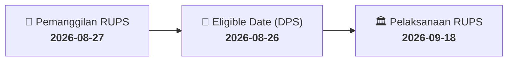

# ⚡ Laporan Intelijen Aksi Korporasi: [[HRUM]] - RUPS

⬅️ [[knowledge-base/daily-digests/Daily_Digest_20260827|Kembali ke Daily Digest]] | 📅 **2026-08-27** | 🎛️ [[Dashboard|Ke Dashboard Utama]]

> [!IMPORTANT]
> Laporan ini disusun secara otomatis oleh **Corporate Action Intelligence Agent** untuk memetakan implikasi strategis, rasio keuangan, alokasi dana, jadwal penting, dan panduan investor.

---

## 📌 1. Ringkasan Eksekutif & Katalis Strategis
- **Kode & Nama Emiten**: `[[HRUM]]`
- **Kategori Aksi Korporasi**: `RUPS`
- **Dokumen Resmi Bursa**: `Pemanggilan RUPS`
- **Ringkasan Inti Aksi**: Harum Energy Tbk menyampaikan pemanggilan Rapat Umum Pemegang Saham Luar Biasa yang akan diselenggarakan pada 18 September 2026 pukul 10:00 di Deutsche Bank Building, Lantai 1, Jln. Imam Bonjol No. 80 Jakarta Pusat. Agenda RUPSLB meliputi persetujuan pengangkatan kembali/perubahan susunan Direksi dan persetujuan perubahan Anggaran Dasar. Recording date ditetapkan 26 Agustus 2026.

---

## 📊 2. Matriks Parameter Material & Angka Kunci
| Parameter Utama | Nilai / Keterangan Resmi |
| :--- | :--- |
| **Nomor Surat Pemanggilan** | `055/HE/VIII/2026` |
| **Nomor Surat Pemberitahuan** | `053/HE/VIII/2026` |
| **Tanggal Pemberitahuan** | `2026-08-12` |
| **Jenis RUPS** | `Luar Biasa` |
| **Tanggal RUPS** | `2026-09-18` |
| **Waktu RUPS** | `10:00` |
| **Lokasi RUPS** | `Deutsche Bank Building, Lantai 1, Jln. Imam Bonjol No. 80 Jakarta Pusat` |
| **Recording Date** | `2026-08-26` |
| **Agenda 1** | `Persetujuan Pengangkatan Kembali / Perubahan Susunan Direksi` |
| **Agenda 2** | `Persetujuan Perubahan Anggaran Dasar` |
| **Nama Pengirim/Approver** | `Ray Gunara` |

---

## 📌 3. Detail Pelaksanaan RUPS / RUPSLB
- **Hari, Tanggal Pelaksanaan**: `2026-09-18`
- **Waktu Pelaksanaan**: `10:00`
- **Lokasi / Tempat Pelaksanaan**: `Deutsche Bank Building, Lantai 1, Jln. Imam Bonjol No. 80 Jakarta Pusat`
- **Batas Hak Suara (Eligible Date / Recording Date)**: `2026-08-26`

## 📝 4. Matriks Agenda & Mata Acara Rapat
| No | Agenda / Mata Acara | Penjelasan & Sub-Acara |
| :-: | :--- | :--- |
| 1 | **Agenda 1** | Persetujuan Pengangkatan Kembali / Perubahan Susunan Direksi |
| 2 | **Agenda 2** | Persetujuan Perubahan Anggaran Dasar |

## 🗓️ 5. Timeline Investor & Ketentuan Kehadiran

## 💡 6. Panduan Investor & E-Voting
- 👥 **Hak Suara**: Pemegang saham yang berhak hadir/memberikan suara adalah yang terdaftar dalam DPS pada **Eligible Date (2026-08-26)**.
- 🗳️ **E-Voting eASY.KSEI**: Pemegang saham dapat memberikan kuasa/suara secara elektronik melalui sistem eASY.KSEI.

---

## 🔗 Hubungan Note Terkait (Knowledge Graph)
- [[knowledge-base/daily-digests/Daily_Digest_20260827|📄 Daily Digest 2026-08-27]]
- [[knowledge-base/trading-signals/Trading_Signals_20260827|🎯 Sinyal Cuan 2026-08-27]]
- [[Dashboard|🎛️ Kembali ke Dashboard]]