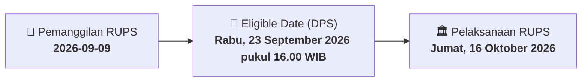

# ⚡ Laporan Intelijen Aksi Korporasi: [[IBOS]] - RUPS

⬅️ [[knowledge-base/daily-digests/Daily_Digest_20260909|Kembali ke Daily Digest]] | 📅 **2026-09-09** | 🎛️ [[Dashboard|Ke Dashboard Utama]]

> [!IMPORTANT]
> Laporan ini disusun secara otomatis oleh **Corporate Action Intelligence Agent** untuk memetakan implikasi strategis, rasio keuangan, alokasi dana, jadwal penting, dan panduan investor.

---

## 📌 1. Ringkasan Eksekutif & Katalis Strategis
- **Kode & Nama Emiten**: `[[IBOS]]`
- **Kategori Aksi Korporasi**: `RUPS`
- **Dokumen Resmi Bursa**: `Pengumuman RUPS lamp1`
- **Ringkasan Inti Aksi**: PT Indo Boga Sukses Tbk mengumumkan akan menyelenggarakan Rapat Umum Pemegang Saham Luar Biasa (RUPSLB) pada Jumat, 16 Oktober 2026, pukul 10.00 WIB di BAKI Restaurant, Sleman, DI Yogyakarta. Pemegang saham yang berhak hadir adalah yang tercatat dalam Daftar Pemegang Saham pada Rabu, 23 September 2026 pukul 16.00 WIB. Pemanggilan rapat akan diunggah di situs web Perseroan pada September 2026. Usulan pemegang saham harus diterima Direksi paling lambat 7 hari sebelum pemanggilan rapat.

---

## 📊 2. Matriks Parameter Material & Angka Kunci
| Parameter Utama | Nilai / Keterangan Resmi |
| :--- | :--- |
| **Jenis Rapat** | `RUPSLB (Rapat Umum Pemegang Saham Luar Biasa)` |
| **Hari/Tanggal Rapat** | `Jumat, 16 Oktober 2026` |
| **Waktu Rapat** | `10.00 WIB - Selesai` |
| **Tempat Rapat** | `BAKI Restaurant, Jl. Raya Randugowang, Jatirejo, Sendangadi, Mlati, Sleman, DI Yogyakarta 55285` |
| **Tanggal Pemanggilan Rapat** | `September 2026 (diunggah di situs web Perseroan)` |
| **Tanggal Daftar Pemegang Saham (Recording Date)** | `Rabu, 23 September 2026 pukul 16.00 WIB` |
| **Batas Akhir Penerimaan Usulan Pemegang Saham** | `7 hari sebelum tanggal pemanggilan rapat` |
| **Dasar Hukum** | `POJK No.15/POJK.04/2020 dan POJK No.16/POJK.04/2020` |
| **Tanggal Pengumuman** | `9 September 2026` |

---

## 📌 3. Detail Pelaksanaan RUPS / RUPSLB
- **Hari, Tanggal Pelaksanaan**: `Jumat, 16 Oktober 2026`
- **Waktu Pelaksanaan**: `10.00 WIB - Selesai`
- **Lokasi / Tempat Pelaksanaan**: `BAKI Restaurant, Jl. Raya Randugowang, Jatirejo, Sendangadi, Mlati, Sleman, DI Yogyakarta 55285`
- **Batas Hak Suara (Eligible Date / Recording Date)**: `Rabu, 23 September 2026 pukul 16.00 WIB`

## 📝 4. Matriks Agenda & Mata Acara Rapat
| No | Agenda / Mata Acara | Penjelasan & Sub-Acara |
| :-: | :--- | :--- |
| 1 | **Agenda Utama RUPS** | PT Indo Boga Sukses Tbk mengumumkan akan menyelenggarakan Rapat Umum Pemegang Saham Luar Biasa (RUPSLB) pada Jumat, 16 Oktober 2026, pukul 10.00 WIB di BAKI Restaurant, Sleman, DI Yogyakarta. Pemegang saham yang berhak hadir adalah yang tercatat dalam Daftar Pemegang Saham pada Rabu, 23 September 2026 pukul 16.00 WIB. Pemanggilan rapat akan diunggah di situs web Perseroan pada September 2026. Usulan pemegang saham harus diterima Direksi paling lambat 7 hari sebelum pemanggilan rapat. |

## 🗓️ 5. Timeline Investor & Ketentuan Kehadiran

## 💡 6. Panduan Investor & E-Voting
- 👥 **Hak Suara**: Pemegang saham yang berhak hadir/memberikan suara adalah yang terdaftar dalam DPS pada **Eligible Date (Rabu, 23 September 2026 pukul 16.00 WIB)**.
- 🗳️ **E-Voting eASY.KSEI**: Pemegang saham dapat memberikan kuasa/suara secara elektronik melalui sistem eASY.KSEI.

---

## 🔗 Hubungan Note Terkait (Knowledge Graph)
- [[knowledge-base/daily-digests/Daily_Digest_20260909|📄 Daily Digest 2026-09-09]]
- [[knowledge-base/trading-signals/Trading_Signals_20260909|🎯 Sinyal Cuan 2026-09-09]]
- [[Dashboard|🎛️ Kembali ke Dashboard]]