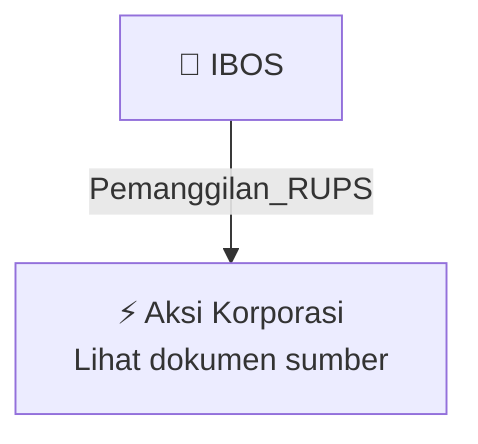

# 📢 Pemanggilan RUPS / RUPSLB — [[IBOS]]

⬅️ [[knowledge-base/daily-digests/Daily_Digest_20260925|Kembali ke Daily Digest]] | 📅 **2026-09-25** | 🎛️ [[Dashboard|Ke Dashboard Utama]]

> [!IMPORTANT]
> Laporan ini disusun secara otomatis oleh **Corporate Action Intelligence Agent** pada **2026-09-25**.
> Sumber dokumen: `20260924_IBOS_20260924_IBOS_Pemanggilan RUPS_32150901_lamp1.pdf`

---

## 📌 1. Ringkasan Eksekutif & Tujuan Strategis

- **Kode & Nama Emiten**: `[[IBOS]]`
- **Kategori Aksi Korporasi**: `Pemanggilan_RUPS`
- **Dokumen Sumber**: `20260924_IBOS_20260924_IBOS_Pemanggilan RUPS_32150901_lamp1.pdf`
- **Tanggal Laporan**: `2026-09-25`

[Analisis LLM tidak tersedia — isi manual]

---

## 📊 2. Fakta Material & Parameter Keuangan

| Parameter Utama | Nilai / Keterangan |
| :--- | :--- |
| **Uraian Kejadian** | `PT INDO BOGA SUKSES TBK BAKI Restaurant Phone: +62 274 2880 288 Mobile: +62 821 3531 0001 corsec@indobogasukses.com PEMANGGILAN RAPAT UMUM PEMEGANG SAHAM LUAR BIASA PT INDO BOGA SUKSES Tbk Direksi PT Indo Boga Sukses Tbk (“Perseroan”) dengan ini mengundang Pemegang Saham Perseroan untuk menghadiri Rapat Umum Pemegang Saham Luar Biasa Tahun Buku 2026 (“Rapat”) yang akan diselenggarakan pada: Hari dan Tanggal : Jumat, 16 Oktober 2026 Waktu : 10.00 WIB – Selesai Tempat : BAKI Restaurant – Jl. Randu` |

---

## 👥 3. Struktur Kepemilikan, Pengendali & Pembeli Siaga

- **Emiten**: `IBOS` | Informasi kepemilikan mengacu pada dokumen resmi sumber.

---

## 🎯 4. Alokasi & Rencana Penggunaan Dana

- Informasi alokasi dana belum tersedia — lihat prospektus / dokumen resmi.

---

## 📅 5. Timeline & Jadwal Pelaksanaan

| Tahapan / Event | Tanggal |
| :--- | :---: |
| **Jadwal** | Lihat dokumen sumber. |

---

## 📈 6. Diagram Visual Flowchart (Mermaid)

---

## 💡 7. Rekomendasi Investor & Strategi Trading

[Analisis LLM tidak tersedia — isi manual]

---

## 🔗 8. Hubungan Note Terkait (Knowledge Graph)

- [[knowledge-base/daily-digests/Daily_Digest_20260925|📄 Daily Digest 2026-09-25]]
- [[knowledge-base/trading-signals/Trading_Signals_20260925|🎯 Sinyal Cuan 2026-09-25]]
- [[IBOS|🏬 Halaman Emiten IBOS]]
- [[Dashboard|🎛️ Kembali ke Dashboard Utama]]

---

*Laporan dibuat otomatis oleh Corporate Action Intelligence Agent · 2026-09-25*