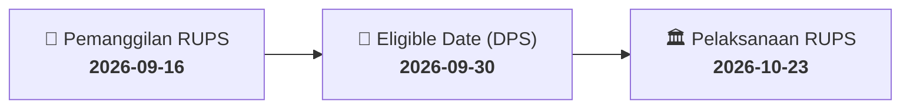

# ⚡ Laporan Intelijen Aksi Korporasi: [[IDEA]] - RUPS

⬅️ [[knowledge-base/daily-digests/Daily_Digest_20260916|Kembali ke Daily Digest]] | 📅 **2026-09-16** | 🎛️ [[Dashboard|Ke Dashboard Utama]]

> [!IMPORTANT]
> Laporan ini disusun secara otomatis oleh **Corporate Action Intelligence Agent** untuk memetakan implikasi strategis, rasio keuangan, alokasi dana, jadwal penting, dan panduan investor.

---

## 📌 1. Ringkasan Eksekutif & Katalis Strategis
- **Kode & Nama Emiten**: `[[IDEA]]`
- **Kategori Aksi Korporasi**: `RUPS`
- **Dokumen Resmi Bursa**: `Pengumuman RUPS`
- **Ringkasan Inti Aksi**: PT Idea Indonesia Akademi Tbk mengumumkan rencana penyelenggaraan Rapat Umum Pemegang Saham Luar Biasa (RUPSLB) yang akan diadakan pada Jumat, 23 Oktober 2026, pukul 13:30 WIB di Aleesha Venue, Jl. Warung Sila No. 1, Cipedak, Jagakarsa. Tanggal Daftar Pemegang Saham (DPS) yang berhak hadir ditetapkan pada 30 September 2026.

---

## 📊 2. Matriks Parameter Material & Angka Kunci
| Parameter Utama | Nilai / Keterangan Resmi |
| :--- | :--- |
| **Jenis Rapat** | `Rapat Umum Pemegang Saham Luar Biasa (RUPSLB)` |
| **Tanggal Pelaporan** | `2026-09-16` |
| **Tanggal Penyelenggaraan RUPS** | `2026-10-23` |
| **Waktu Penyelenggaraan** | `13:30 WIB` |
| **Lokasi Penyelenggaraan** | `Aleesha Venue, Jl. Warung Sila No. 1, RT.001/RW.005, Cipedak, Kec. Jagakarsa` |
| **Tanggal Daftar Pemegang Saham (DPS)** | `2026-09-30` |
| **Nomor Surat Pemberitahuan** | `01.204/AG/SPK/IIA/IX/2026` |
| **Nama Pengirim** | `Yusuf Nur Fauzan` |
| **Jabatan Pengirim** | `Corsec` |

---

## 📌 3. Detail Pelaksanaan RUPS / RUPSLB
- **Hari, Tanggal Pelaksanaan**: `2026-10-23`
- **Waktu Pelaksanaan**: `13:30 WIB`
- **Lokasi / Tempat Pelaksanaan**: `Aleesha Venue, Jl. Warung Sila No. 1, RT.001/RW.005, Cipedak, Kec. Jagakarsa`
- **Batas Hak Suara (Eligible Date / Recording Date)**: `2026-09-30`

## 📝 4. Matriks Agenda & Mata Acara Rapat
| No | Agenda / Mata Acara | Penjelasan & Sub-Acara |
| :-: | :--- | :--- |
| 1 | **Agenda Utama RUPS** | PT Idea Indonesia Akademi Tbk mengumumkan rencana penyelenggaraan Rapat Umum Pemegang Saham Luar Biasa (RUPSLB) yang akan diadakan pada Jumat, 23 Oktober 2026, pukul 13:30 WIB di Aleesha Venue, Jl. Warung Sila No. 1, Cipedak, Jagakarsa. Tanggal Daftar Pemegang Saham (DPS) yang berhak hadir ditetapkan pada 30 September 2026. |

## 🗓️ 5. Timeline Investor & Ketentuan Kehadiran

## 💡 6. Panduan Investor & E-Voting
- 👥 **Hak Suara**: Pemegang saham yang berhak hadir/memberikan suara adalah yang terdaftar dalam DPS pada **Eligible Date (2026-09-30)**.
- 🗳️ **E-Voting eASY.KSEI**: Pemegang saham dapat memberikan kuasa/suara secara elektronik melalui sistem eASY.KSEI.

---

## 🔗 Hubungan Note Terkait (Knowledge Graph)
- [[knowledge-base/daily-digests/Daily_Digest_20260916|📄 Daily Digest 2026-09-16]]
- [[knowledge-base/trading-signals/Trading_Signals_20260916|🎯 Sinyal Cuan 2026-09-16]]
- [[Dashboard|🎛️ Kembali ke Dashboard]]