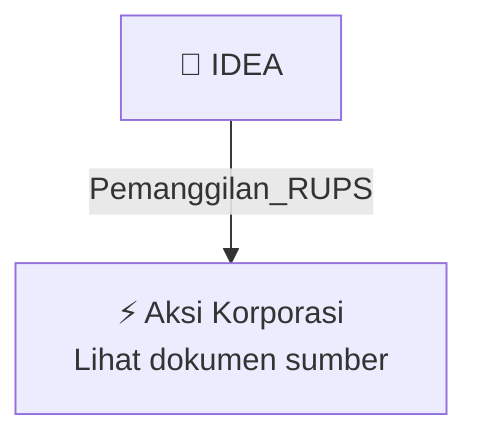

# 📢 Pemanggilan RUPS / RUPSLB — [[IDEA]]

⬅️ [[knowledge-base/daily-digests/Daily_Digest_20261002|Kembali ke Daily Digest]] | 📅 **2026-10-02** | 🎛️ [[Dashboard|Ke Dashboard Utama]]

> [!IMPORTANT]
> Laporan ini disusun secara otomatis oleh **Corporate Action Intelligence Agent** pada **2026-10-02**.
> Sumber dokumen: `20261001_IDEA_20261001_IDEA_Pemanggilan RUPS_32162510_lamp1.pdf`

---

## 📌 1. Ringkasan Eksekutif & Tujuan Strategis

- **Kode & Nama Emiten**: `[[IDEA]]`
- **Kategori Aksi Korporasi**: `Pemanggilan_RUPS`
- **Dokumen Sumber**: `20261001_IDEA_20261001_IDEA_Pemanggilan RUPS_32162510_lamp1.pdf`
- **Tanggal Laporan**: `2026-10-02`

[Analisis LLM tidak tersedia — isi manual]

---

## 📊 2. Fakta Material & Parameter Keuangan

| Parameter Utama | Nilai / Keterangan |
| :--- | :--- |
| **Jenis Rapat** | `Rapat Umum Pemegang Saham Luar Biasa (RUPSLB)` |
| **Hari, Tanggal Rapat** | `Jumat, 23 Oktober 2026` |
| **Waktu Rapat** | `14.00 WIB - selesai` |
| **Tempat Rapat** | `Aleesha Venue Cipedak, Jagakarsa, Jakarta Selatan - 12630` |
| **Agenda 1** | `Persetujuan atas perubahan Susunan Direksi dan Dewan Komisaris Perseroan` |
| **Agenda 2** | `Penegasan atas susunan pemegang saham Perseroan` |
| **Agenda 3** | `Persetujuan atas perubahan Pasal 3 Anggaran Dasar Perseroan tentang Maksud dan Tujuan serta Kegiatan Usaha dalam rangka penyesuaian dengan KBLI Tahun 2025` |
| **Dasar Hukum Agenda 1** | `POJK No. 33/POJK.04/2014 tentang Direksi dan Dewan Komisaris Emiten atau Perusahaan Publik dan anggaran dasar Perseroan` |
| **Dasar Hukum Agenda 3** | `Peraturan BPS No. 7/2025 yang diundangkan pada 18 Desember 2025` |
| **Tanggal Pemanggilan** | `01 Oktober 2026` |
| **Tanggal Pencatatan Pemegang Saham yang Berhak Hadir** | `30 September 2026 pada penutupan jam perdagangan Bursa Efek` |
| **Ketersediaan Bahan Mata Acara Rapat** | `Dapat diakses pemegang saham melalui situs Perseroan sejak tanggal Pemanggilan 01 Oktober 2026` |
| **Mekanisme Keikutsertaan Rapat** | `Hadir secara fisik atau hadir secara elektronik` |
| **Nama Perseroan dalam Dokumen** | `PT Idea Indonesia Tbk / PT IDEA INDONESIA AKADEMI, Tbk` |

---

## 👥 3. Struktur Kepemilikan, Pengendali & Pembeli Siaga

- **Emiten**: `IDEA` | Informasi kepemilikan mengacu pada dokumen resmi sumber.

---

## 🎯 4. Alokasi & Rencana Penggunaan Dana

- Informasi alokasi dana belum tersedia — lihat prospektus / dokumen resmi.

---

## 📅 5. Timeline & Jadwal Pelaksanaan

| Tahapan / Event | Tanggal |
| :--- | :---: |
| **Jadwal** | Lihat dokumen sumber. |

---

## 📈 6. Diagram Visual Flowchart (Mermaid)

---

## 💡 7. Rekomendasi Investor & Strategi Trading

[Analisis LLM tidak tersedia — isi manual]

---

## 🔗 8. Hubungan Note Terkait (Knowledge Graph)

- [[knowledge-base/daily-digests/Daily_Digest_20261002|📄 Daily Digest 2026-10-02]]
- [[knowledge-base/trading-signals/Trading_Signals_20261002|🎯 Sinyal Cuan 2026-10-02]]
- [[IDEA|🏬 Halaman Emiten IDEA]]
- [[Dashboard|🎛️ Kembali ke Dashboard Utama]]

---

*Laporan dibuat otomatis oleh Corporate Action Intelligence Agent · 2026-10-02*