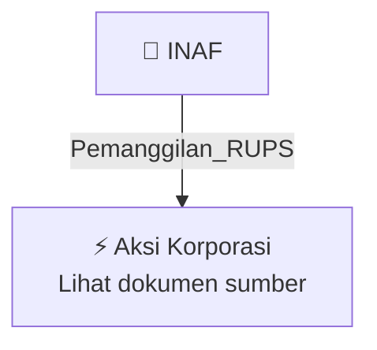

# 📢 Pemanggilan RUPS / RUPSLB — [[INAF]]

⬅️ [[knowledge-base/daily-digests/Daily_Digest_20261007|Kembali ke Daily Digest]] | 📅 **2026-10-07** | 🎛️ [[Dashboard|Ke Dashboard Utama]]

> [!IMPORTANT]
> Laporan ini disusun secara otomatis oleh **Corporate Action Intelligence Agent** pada **2026-10-07**.
> Sumber dokumen: `20261007_INAF_20261007_INAF_Pemanggilan RUPS_32164119_lamp2.pdf`

---

## 📌 1. Ringkasan Eksekutif & Tujuan Strategis

- **Kode & Nama Emiten**: `[[INAF]]`
- **Kategori Aksi Korporasi**: `Pemanggilan_RUPS`
- **Dokumen Sumber**: `20261007_INAF_20261007_INAF_Pemanggilan RUPS_32164119_lamp2.pdf`
- **Tanggal Laporan**: `2026-10-07`

[Analisis LLM tidak tersedia — isi manual]

---

## 📊 2. Fakta Material & Parameter Keuangan

| Parameter Utama | Nilai / Keterangan |
| :--- | :--- |
| **Nama Perusahaan/Emiten** | `PT Indofarma (Persero) Tbk` |
| **Kode Emiten** | `INAF` |
| **Jenis RUPS** | `RUPS Luar Biasa Tahun 2026` |
| **Hari, Tanggal RUPS** | `Kamis, 29 Oktober 2026` |
| **Waktu RUPS** | `14.00 WIB sampai selesai` |
| **Metode Penyelenggaraan** | `Elektronik melalui sistem e-GMS` |
| **Lokasi Koordinasi Elektronik** | `Indonesia Health Learning Institute, Jl. Cipinang Cimpedak I No. 36, Jakarta Timur` |
| **Agenda Tunggal** | `Perubahan Susunan Pengurus Perusahaan` |
| **Dasar Hukum Agenda** | `Pasal 11 ayat (6) dan Pasal 14 ayat (7) Anggaran Dasar Perusahaan` |
| **Ketentuan Seri A Dwiwarna** | `RUPS harus dihadiri dan disetujui oleh pemegang saham Seri A Dwiwarna; pengangkatan Direksi/Komisaris dari kandidat yang diusulkan Seri A Dwiwarna dan mengikat RUPS` |
| **Tanggal DPS/Pemegang Saham Berhak Hadir** | `Selasa, 6 Oktober 2026` |
| **Pemberitahuan** | `Surat pemberitahuan ini merupakan undangan resmi; tidak ada undangan terpisah` |
| **Ketersediaan Materi RUPS** | `Materi RUPS tersedia sejak tanggal pemberitahuan dan dapat diunduh dari situs Perusahaan` |
| **Referensi Regulasi** | `POJK No. 15/POJK.04/2020 dan POJK No. 14 Tahun 2025` |

---

## 👥 3. Struktur Kepemilikan, Pengendali & Pembeli Siaga

- **Emiten**: `INAF` | Informasi kepemilikan mengacu pada dokumen resmi sumber.

---

## 🎯 4. Alokasi & Rencana Penggunaan Dana

- Informasi alokasi dana belum tersedia — lihat prospektus / dokumen resmi.

---

## 📅 5. Timeline & Jadwal Pelaksanaan

| Tahapan / Event | Tanggal |
| :--- | :---: |
| **Jadwal** | Lihat dokumen sumber. |

---

## 📈 6. Diagram Visual Flowchart (Mermaid)

---

## 💡 7. Rekomendasi Investor & Strategi Trading

[Analisis LLM tidak tersedia — isi manual]

---

## 🔗 8. Hubungan Note Terkait (Knowledge Graph)

- [[knowledge-base/daily-digests/Daily_Digest_20261007|📄 Daily Digest 2026-10-07]]
- [[knowledge-base/trading-signals/Trading_Signals_20261007|🎯 Sinyal Cuan 2026-10-07]]
- [[INAF|🏬 Halaman Emiten INAF]]
- [[Dashboard|🎛️ Kembali ke Dashboard Utama]]

---

*Laporan dibuat otomatis oleh Corporate Action Intelligence Agent · 2026-10-07*