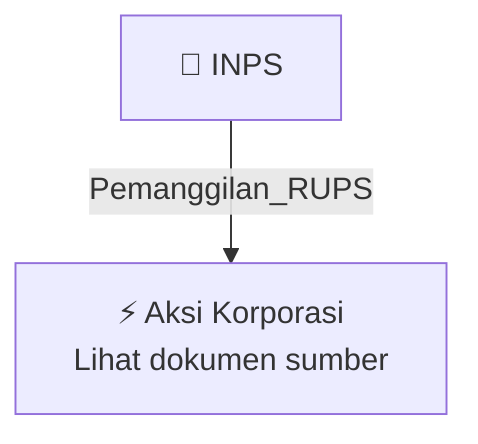

# 📢 Pemanggilan RUPS / RUPSLB — [[INPS]]

⬅️ [[knowledge-base/daily-digests/Daily_Digest_20260929|Kembali ke Daily Digest]] | 📅 **2026-09-29** | 🎛️ [[Dashboard|Ke Dashboard Utama]]

> [!IMPORTANT]
> Laporan ini disusun secara otomatis oleh **Corporate Action Intelligence Agent** pada **2026-09-29**.
> Sumber dokumen: `20260929_INPS_20260929_INPS_Pengumuman RUPS_32161596_lamp3.pdf`

---

## 📌 1. Ringkasan Eksekutif & Tujuan Strategis

- **Kode & Nama Emiten**: `[[INPS]]`
- **Kategori Aksi Korporasi**: `Pemanggilan_RUPS`
- **Dokumen Sumber**: `20260929_INPS_20260929_INPS_Pengumuman RUPS_32161596_lamp3.pdf`
- **Tanggal Laporan**: `2026-09-29`

[Analisis LLM tidak tersedia — isi manual]

---

## 📊 2. Fakta Material & Parameter Keuangan

| Parameter Utama | Nilai / Keterangan |
| :--- | :--- |
| **Uraian Kejadian** | `PT. INDAH PRAKASA SENTOSA, Tbk Menara Jakarta Tower Fortune, Lt. 23 Unit F Telp. : 02150976933 Ref. No.: 018/INPS-BEI/IX/2026 : 1 (satu) berkas Kepada Yth. Direksi PT Bursa Efek Indonesia u.p. Kepala Divisi Penilaian Perusahaan 1 (PP1) : Penyampaian Pengumuman Rapat Umum Pemegang Saham Luar Biasa PT Indah Prakasa Sentosa Tbk Dengan hormat, Menunjuk surat kami Ref. No. 014/INPS-OJK/IX/2026 tanggal 18 September 2026 Pemberitahuan Rencana Penyelenggaraan dan Mata Acara Rapat Umum Pemegang Saham Lua` |

---

## 👥 3. Struktur Kepemilikan, Pengendali & Pembeli Siaga

- **Emiten**: `INPS` | Informasi kepemilikan mengacu pada dokumen resmi sumber.

---

## 🎯 4. Alokasi & Rencana Penggunaan Dana

- Informasi alokasi dana belum tersedia — lihat prospektus / dokumen resmi.

---

## 📅 5. Timeline & Jadwal Pelaksanaan

| Tahapan / Event | Tanggal |
| :--- | :---: |
| **Jadwal** | Lihat dokumen sumber. |

---

## 📈 6. Diagram Visual Flowchart (Mermaid)

---

## 💡 7. Rekomendasi Investor & Strategi Trading

[Analisis LLM tidak tersedia — isi manual]

---

## 🔗 8. Hubungan Note Terkait (Knowledge Graph)

- [[knowledge-base/daily-digests/Daily_Digest_20260929|📄 Daily Digest 2026-09-29]]
- [[knowledge-base/trading-signals/Trading_Signals_20260929|🎯 Sinyal Cuan 2026-09-29]]
- [[INPS|🏬 Halaman Emiten INPS]]
- [[Dashboard|🎛️ Kembali ke Dashboard Utama]]

---

*Laporan dibuat otomatis oleh Corporate Action Intelligence Agent · 2026-09-29*