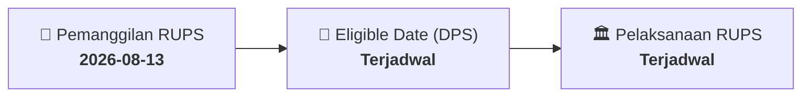

# ⚡ Laporan Intelijen Aksi Korporasi: [[IPCC]] - RUPS

⬅️ [[knowledge-base/daily-digests/Daily_Digest_20260813|Kembali ke Daily Digest]] | 📅 **2026-08-13** | 🎛️ [[Dashboard|Ke Dashboard Utama]]

> [!IMPORTANT]
> Laporan ini disusun secara otomatis oleh **Corporate Action Intelligence Agent** untuk memetakan implikasi strategis, rasio keuangan, alokasi dana, jadwal penting, dan panduan investor.

---

## 📌 1. Ringkasan Eksekutif & Katalis Strategis
- **Kode & Nama Emiten**: `[[IPCC]]`
- **Kategori Aksi Korporasi**: `RUPS`
- **Dokumen Resmi Bursa**: `Pemanggilan RUPS lamp1`
- **Ringkasan Inti Aksi**: PT Indonesia Kendaraan Terminal Tbk (IPCC) melalui Direksi menerbitkan surat pemanggilan Rapat Umum Pemegang Saham Luar Biasa (RUPSLB) tertanggal 12 Agustus 2026. RUPSLB direncanakan diselenggarakan secara offline/fisik dan online/virtual. Pemanggilan ini merupakan tindak lanjut atas pengunduran diri Anggota Direksi, pengajuan rencana RUPSLB kepada Otoritas Jasa Keuangan, dan pengumuman rencana RUPSLB.

---

## 📊 2. Matriks Parameter Material & Angka Kunci
| Parameter Utama | Nilai / Keterangan Resmi |
| :--- | :--- |
| **Nomor Surat** | `HK.03/12/8/1/HUKM/SKPR/IKT-26` |
| **Tanggal Surat** | `12 Agustus 2026` |
| **Perihal** | `Pemanggilan Penyelenggaraan Rapat Umum Pemegang Saham Luar Biasa (RUPSLB) PT Indonesia Kendaraan Terminal Tbk` |
| **Dasar Hukum** | `Undang-Undang Nomor 40 Tahun 2007; Peraturan Otoritas Jasa Keuangan Nomor 15/POJK.04/2020; Peraturan Otoritas Jasa Keuangan Nomor 14 Tahun 2025; Peraturan Otoritas Jasa Keuangan Nomor 33/POJK.04/2014` |
| **Surat Pengunduran Diri Anggota Direksi** | `Surat Nomor HM.03.06/26/6/1/SKPR/SKPR/IKT-26 tanggal 26 Juni 2026 tentang Penyampaian Pengunduran Diri Anggota Direksi PT Indonesia Kendaraan Terminal Tbk kepada Otoritas Jasa Keuangan` |
| **Surat Pengajuan Rencana RUPSLB** | `Surat Nomor SK.03/21/7/1/SKPR/SKPR/IKT-26 tanggal 21 Juli 2026 tentang Pengajuan Rencana Penyelenggaraan Rapat Umum Pemegang Saham Luar Biasa (RUPSLB) Tahun 2026 PT Indonesia Kendaraan Terminal Tbk kepada Otoritas Jasa Keuangan` |
| **Surat Pengumuman Rencana RUPSLB** | `Surat Nomor HK.03/28/7/1/HUKM/SKPR/IKT-26 tanggal 28 Juli 2026 tentang Pengumuman Rencana Penyelenggaraan Rapat Umum Pemegang Saham Luar Biasa (RUPSLB) PT Indonesia Kendaraan Terminal Tbk` |
| **Mode Penyelenggaraan RUPSLB** | `Offline dan online dengan menggunakan sistem elektronik` |
| **Penandatangan Surat** | `Direksi PT Indonesia Kendaraan Terminal Tbk, Direktorat Utama RORO Endah Dwi Liesly Puspita Sari, NIP. 103415` |
| **Nomor Referensi** | `IND/SKTR/55/2026` |

---

## 📌 3. Detail Pelaksanaan RUPS / RUPSLB
- **Hari, Tanggal Pelaksanaan**: `Terjadwal`
- **Waktu Pelaksanaan**: `09.00 WIB s.d. selesai`
- **Lokasi / Tempat Pelaksanaan**: `Aplikasi eASY.KSEI / Kantor Perseroan`
- **Batas Hak Suara (Eligible Date / Recording Date)**: `Terjadwal`

## 📝 4. Matriks Agenda & Mata Acara Rapat
| No | Agenda / Mata Acara | Penjelasan & Sub-Acara |
| :-: | :--- | :--- |
| 1 | **Agenda Utama RUPS** | PT Indonesia Kendaraan Terminal Tbk (IPCC) melalui Direksi menerbitkan surat pemanggilan Rapat Umum Pemegang Saham Luar Biasa (RUPSLB) tertanggal 12 Agustus 2026. RUPSLB direncanakan diselenggarakan secara offline/fisik dan online/virtual. Pemanggilan ini merupakan tindak lanjut atas pengunduran diri Anggota Direksi, pengajuan rencana RUPSLB kepada Otoritas Jasa Keuangan, dan pengumuman rencana RUPSLB. |

## 🗓️ 5. Timeline Investor & Ketentuan Kehadiran

## 💡 6. Panduan Investor & E-Voting
- 👥 **Hak Suara**: Pemegang saham yang berhak hadir/memberikan suara adalah yang terdaftar dalam DPS pada **Eligible Date (Terjadwal)**.
- 🗳️ **E-Voting eASY.KSEI**: Pemegang saham dapat memberikan kuasa/suara secara elektronik melalui sistem eASY.KSEI.

---

## 🔗 Hubungan Note Terkait (Knowledge Graph)
- [[knowledge-base/daily-digests/Daily_Digest_20260813|📄 Daily Digest 2026-08-13]]
- [[knowledge-base/trading-signals/Trading_Signals_20260813|🎯 Sinyal Cuan 2026-08-13]]
- [[Dashboard|🎛️ Kembali ke Dashboard]]