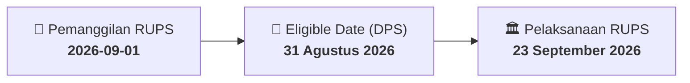

# ⚡ Laporan Intelijen Aksi Korporasi: [[IPCM]] - RUPS

⬅️ [[knowledge-base/daily-digests/Daily_Digest_20260901|Kembali ke Daily Digest]] | 📅 **2026-09-01** | 🎛️ [[Dashboard|Ke Dashboard Utama]]

> [!IMPORTANT]
> Laporan ini disusun secara otomatis oleh **Corporate Action Intelligence Agent** untuk memetakan implikasi strategis, rasio keuangan, alokasi dana, jadwal penting, dan panduan investor.

---

## 📌 1. Ringkasan Eksekutif & Katalis Strategis
- **Kode & Nama Emiten**: `[[IPCM]]`
- **Kategori Aksi Korporasi**: `RUPS`
- **Dokumen Resmi Bursa**: `Pemanggilan RUPS`
- **Ringkasan Inti Aksi**: PT Jasa Armada Indonesia Tbk. menyampaikan pemanggilan Rapat Umum Pemegang Saham Luar Biasa yang akan diselenggarakan pada 23 September 2026 pukul 16:00 di Museum Maritim Indonesia Lantai 2, Tanjung Priok, dengan recording date 31 Agustus 2026.

---

## 📊 2. Matriks Parameter Material & Angka Kunci
| Parameter Utama | Nilai / Keterangan Resmi |
| :--- | :--- |
| **Jenis RUPS** | `Rapat Umum Pemegang Saham Luar Biasa` |
| **Hari/Tanggal RUPS** | `23 September 2026` |
| **Waktu RUPS** | `16:00` |
| **Lokasi RUPS** | `Museum Maritim Indonesia Lantai 2, Jl. Raya Pelabuhan No. 9, Tanjung Priok` |
| **Recording Date** | `31 Agustus 2026` |
| **Agenda 1** | `Perubahan dan Pernyataan Kembali Anggaran Dasar Perseroan` |
| **Agenda 2** | `Penetapan Gaji/Honorarium/Tantiem berikut Fasilitas dan Tunjangan Tahun Buku 2026, serta Remunerasi atas Kinerja Tahun Buku 2025 bagi Pengurus Perseroan` |
| **Agenda 3** | `Perubahan Susunan Pengurus Perseroan` |
| **Nama Pengirim** | `Eddy Haristiani` |
| **Tanggal dan Waktu Pelaporan** | `01-09-2026 15:51` |

---

## 📌 3. Detail Pelaksanaan RUPS / RUPSLB
- **Hari, Tanggal Pelaksanaan**: `23 September 2026`
- **Waktu Pelaksanaan**: `01-09-2026 15:51`
- **Lokasi / Tempat Pelaksanaan**: `Museum Maritim Indonesia Lantai 2, Jl. Raya Pelabuhan No. 9, Tanjung Priok`
- **Batas Hak Suara (Eligible Date / Recording Date)**: `31 Agustus 2026`

## 📝 4. Matriks Agenda & Mata Acara Rapat
| No | Agenda / Mata Acara | Penjelasan & Sub-Acara |
| :-: | :--- | :--- |
| 1 | **Agenda 1** | Perubahan dan Pernyataan Kembali Anggaran Dasar Perseroan |
| 2 | **Agenda 2** | Penetapan Gaji/Honorarium/Tantiem berikut Fasilitas dan Tunjangan Tahun Buku 2026, serta Remunerasi atas Kinerja Tahun Buku 2025 bagi Pengurus Perseroan |
| 3 | **Agenda 3** | Perubahan Susunan Pengurus Perseroan |

## 🗓️ 5. Timeline Investor & Ketentuan Kehadiran

## 💡 6. Panduan Investor & E-Voting
- 👥 **Hak Suara**: Pemegang saham yang berhak hadir/memberikan suara adalah yang terdaftar dalam DPS pada **Eligible Date (31 Agustus 2026)**.
- 🗳️ **E-Voting eASY.KSEI**: Pemegang saham dapat memberikan kuasa/suara secara elektronik melalui sistem eASY.KSEI.

---

## 🔗 Hubungan Note Terkait (Knowledge Graph)
- [[knowledge-base/daily-digests/Daily_Digest_20260901|📄 Daily Digest 2026-09-01]]
- [[knowledge-base/trading-signals/Trading_Signals_20260901|🎯 Sinyal Cuan 2026-09-01]]
- [[Dashboard|🎛️ Kembali ke Dashboard]]