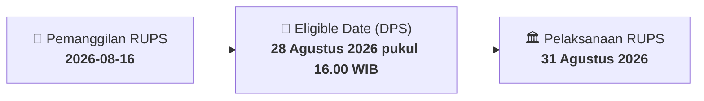

# ⚡ Laporan Intelijen Aksi Korporasi: [[ISAT]] - RUPS

⬅️ [[knowledge-base/daily-digests/Daily_Digest_20260816|Kembali ke Daily Digest]] | 📅 **2026-08-16** | 🎛️ [[Dashboard|Ke Dashboard Utama]]

> [!IMPORTANT]
> Laporan ini disusun secara otomatis oleh **Corporate Action Intelligence Agent** untuk memetakan implikasi strategis, rasio keuangan, alokasi dana, jadwal penting, dan panduan investor.

---

## 📌 1. Ringkasan Eksekutif & Katalis Strategis
- **Kode & Nama Emiten**: `[[ISAT]]`
- **Kategori Aksi Korporasi**: `RUPS`
- **Dokumen Resmi Bursa**: `Pengumuman RUPS lamp1`
- **Ringkasan Inti Aksi**: PT Indosat Tbk mengumumkan akan menyelenggarakan Rapat Umum Pemegang Saham Luar Biasa (RUPSLB) pada tanggal 29 September 2026 secara elektronik. Pemegang saham yang berhak hadir adalah yang tercatat dalam Daftar Pemegang Saham pada tanggal 28 Agustus 2026 pukul 16.00 WIB. Pemanggilan RUPSLB akan diumumkan pada tanggal 31 Agustus 2026, dan usulan mata acara dapat diajukan paling lambat 24 Agustus 2026.

---

## 📊 2. Matriks Parameter Material & Angka Kunci
| Parameter Utama | Nilai / Keterangan Resmi |
| :--- | :--- |
| **Jenis Rapat** | `Rapat Umum Pemegang Saham Luar Biasa (RUPSLB)` |
| **Tanggal Penyelenggaraan RUPSLB** | `29 September 2026` |
| **Hari Penyelenggaraan RUPSLB** | `Selasa` |
| **Tanggal Daftar Pemegang Saham (Recording Date)** | `28 Agustus 2026 pukul 16.00 WIB` |
| **Tanggal Pemanggilan RUPSLB** | `31 Agustus 2026` |
| **Batas Akhir Pengajuan Usulan Mata Acara** | `24 Agustus 2026` |
| **Batas Akhir Penggunaan e-Proxy** | `28 September 2026` |
| **Syarat Pengajuan Usulan Mata Acara** | `Satu atau lebih pemegang saham yang mewakili 1/20 atau lebih dari seluruh saham dengan hak suara yang sah` |
| **Tanggal Pengumuman** | `16 Agustus 2026` |

---

## 📌 3. Detail Pelaksanaan RUPS / RUPSLB
- **Hari, Tanggal Pelaksanaan**: `31 Agustus 2026`
- **Waktu Pelaksanaan**: `09.00 WIB s.d. selesai`
- **Lokasi / Tempat Pelaksanaan**: `Aplikasi eASY.KSEI / Kantor Perseroan`
- **Batas Hak Suara (Eligible Date / Recording Date)**: `28 Agustus 2026 pukul 16.00 WIB`

## 📝 4. Matriks Agenda & Mata Acara Rapat
| No | Agenda / Mata Acara | Penjelasan & Sub-Acara |
| :-: | :--- | :--- |
| 1 | **Batas Akhir Pengajuan Usulan Mata Acara** | 24 Agustus 2026 |
| 2 | **Syarat Pengajuan Usulan Mata Acara** | Satu atau lebih pemegang saham yang mewakili 1/20 atau lebih dari seluruh saham dengan hak suara yang sah |

## 🗓️ 5. Timeline Investor & Ketentuan Kehadiran

## 💡 6. Panduan Investor & E-Voting
- 👥 **Hak Suara**: Pemegang saham yang berhak hadir/memberikan suara adalah yang terdaftar dalam DPS pada **Eligible Date (28 Agustus 2026 pukul 16.00 WIB)**.
- 🗳️ **E-Voting eASY.KSEI**: Pemegang saham dapat memberikan kuasa/suara secara elektronik melalui sistem eASY.KSEI.

---

## 🔗 Hubungan Note Terkait (Knowledge Graph)
- [[knowledge-base/daily-digests/Daily_Digest_20260816|📄 Daily Digest 2026-08-16]]
- [[knowledge-base/trading-signals/Trading_Signals_20260816|🎯 Sinyal Cuan 2026-08-16]]
- [[Dashboard|🎛️ Kembali ke Dashboard]]