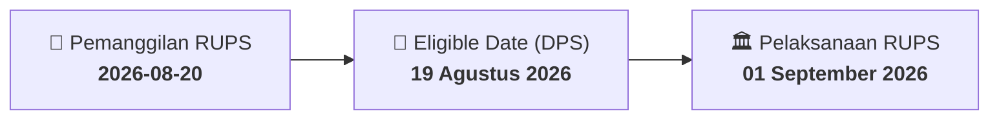

# ⚡ Laporan Intelijen Aksi Korporasi: [[JGLE]] - RUPS

⬅️ [[knowledge-base/daily-digests/Daily_Digest_20260820|Kembali ke Daily Digest]] | 📅 **2026-08-20** | 🎛️ [[Dashboard|Ke Dashboard Utama]]

> [!IMPORTANT]
> Laporan ini disusun secara otomatis oleh **Corporate Action Intelligence Agent** untuk memetakan implikasi strategis, rasio keuangan, alokasi dana, jadwal penting, dan panduan investor.

---

## 📌 1. Ringkasan Eksekutif & Katalis Strategis
- **Kode & Nama Emiten**: `[[JGLE]]`
- **Kategori Aksi Korporasi**: `RUPS`
- **Dokumen Resmi Bursa**: `Pemanggilan RUPS`
- **Ringkasan Inti Aksi**: PT Graha Andrasentra Propertindo Tbk. menyampaikan pemanggilan ketiga Rapat Umum Pemegang Saham Luar Biasa yang akan diselenggarakan pada 1 September 2026 pukul 09:30 di Aston Bogor Hotel & Resort, Bogor. RUPSLB ini diadakan karena RUPS sebelumnya pada 23 Juni 2026 tidak mencapai kuorum.

---

## 📊 2. Matriks Parameter Material & Angka Kunci
| Parameter Utama | Nilai / Keterangan Resmi |
| :--- | :--- |
| **Nomor Surat** | `107/L/GAP-CORSEC/SB/VIII/2026` |
| **Jenis Rapat** | `Rapat Umum Pemegang Saham Luar Biasa` |
| **Tanggal RUPS Sebelumnya** | `23 Juni 2026` |
| **Status RUPS Sebelumnya** | `Tidak kuorum` |
| **Surat Rujukan Sebelumnya** | `090/L/GAP-CORSEC/SB/VI/2026 tanggal 24 Juni 2026` |
| **Tanggal Pelaksanaan RUPSLB** | `01 September 2026` |
| **Waktu Pelaksanaan RUPSLB** | `09:30` |
| **Lokasi RUPSLB** | `Aston Bogor Hotel & Resort, Perumahan Bogor Nirwana Residence, Bogor Selatan` |
| **Recording Date** | `19 Agustus 2026` |
| **Agenda RUPSLB** | `Persetujuan Penyesuaian Kegiatan Usaha Perseroan dengan Peraturan Badan Pusat Statistik Nomor 7 Tahun 2025 tentang Klasifikasi Baku Lapangan Usaha Indonesia 2025 (KBLI 2025)` |
| **Nama Pengirim** | `Santoso Budi` |
| **Jabatan Pengirim** | `PT Graha Andrasentra Propertindo Tbk.` |
| **Tanggal dan Waktu Pelaporan** | `20-08-2026 11:57` |

---

## 📌 3. Detail Pelaksanaan RUPS / RUPSLB
- **Hari, Tanggal Pelaksanaan**: `01 September 2026`
- **Waktu Pelaksanaan**: `20-08-2026 11:57`
- **Lokasi / Tempat Pelaksanaan**: `Aston Bogor Hotel & Resort, Perumahan Bogor Nirwana Residence, Bogor Selatan`
- **Batas Hak Suara (Eligible Date / Recording Date)**: `19 Agustus 2026`

## 📝 4. Matriks Agenda & Mata Acara Rapat
| No | Agenda / Mata Acara | Penjelasan & Sub-Acara |
| :-: | :--- | :--- |
| 1 | **Agenda RUPSLB** | Persetujuan Penyesuaian Kegiatan Usaha Perseroan dengan Peraturan Badan Pusat Statistik Nomor 7 Tahun 2025 tentang Klasifikasi Baku Lapangan Usaha Indonesia 2025 (KBLI 2025) |

## 🗓️ 5. Timeline Investor & Ketentuan Kehadiran

## 💡 6. Panduan Investor & E-Voting
- 👥 **Hak Suara**: Pemegang saham yang berhak hadir/memberikan suara adalah yang terdaftar dalam DPS pada **Eligible Date (19 Agustus 2026)**.
- 🗳️ **E-Voting eASY.KSEI**: Pemegang saham dapat memberikan kuasa/suara secara elektronik melalui sistem eASY.KSEI.

---

## 🔗 Hubungan Note Terkait (Knowledge Graph)
- [[knowledge-base/daily-digests/Daily_Digest_20260820|📄 Daily Digest 2026-08-20]]
- [[knowledge-base/trading-signals/Trading_Signals_20260820|🎯 Sinyal Cuan 2026-08-20]]
- [[Dashboard|🎛️ Kembali ke Dashboard]]