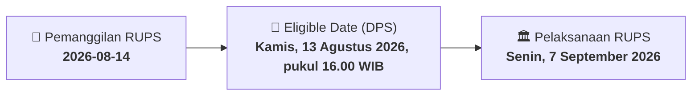

# ⚡ Laporan Intelijen Aksi Korporasi: [[KBLM]] - RUPS

⬅️ [[knowledge-base/daily-digests/Daily_Digest_20260814|Kembali ke Daily Digest]] | 📅 **2026-08-14** | 🎛️ [[Dashboard|Ke Dashboard Utama]]

> [!IMPORTANT]
> Laporan ini disusun secara otomatis oleh **Corporate Action Intelligence Agent** untuk memetakan implikasi strategis, rasio keuangan, alokasi dana, jadwal penting, dan panduan investor.

---

## 📌 1. Ringkasan Eksekutif & Katalis Strategis
- **Kode & Nama Emiten**: `[[KBLM]]`
- **Kategori Aksi Korporasi**: `RUPS`
- **Dokumen Resmi Bursa**: `Pemanggilan RUPS lamp2`
- **Ringkasan Inti Aksi**: Pemanggilan Rapat Umum Pemegang Saham Luar Biasa (RUPSLB) PT Kabelindo Murni Tbk yang akan diselenggarakan pada Senin, 7 September 2026. Agenda tunggal RUPSLB adalah perubahan Pasal 3 Anggaran Dasar Perseroan untuk menyesuaikan dengan Klasifikasi Baku Lapangan Usaha Indonesia (KBLI) 2025. Pemegang saham yang berhak hadir adalah yang terdaftar dalam Daftar Pemegang Saham Perseroan pada Kamis, 13 Agustus 2026, pukul 16.00 WIB.

---

## 📊 2. Matriks Parameter Material & Angka Kunci
| Parameter Utama | Nilai / Keterangan Resmi |
| :--- | :--- |
| **Jenis Rapat** | `Rapat Umum Pemegang Saham Luar Biasa (RUPSLB)` |
| **Hari, Tanggal Rapat** | `Senin, 7 September 2026` |
| **Waktu Rapat** | `10.00 WIB sampai selesai` |
| **Tempat Rapat** | `PT Kabelindo Murni Tbk` |
| **Agenda Rapat** | `Perubahan Pasal 3 Anggaran Dasar Perseroan untuk menyesuaikan dengan Klasifikasi Baku Lapangan Usaha Indonesia (KBLI) 2025` |
| **Tanggal Daftar Pemegang Saham (Recording Date)** | `Kamis, 13 Agustus 2026, pukul 16.00 WIB` |
| **Biro Administrasi Efek** | `PT Sinartama Gunita` |
| **Batas Akhir Penerimaan Kuasa Konvensional** | `Rabu, 2 September 2026` |
| **Alamat Kantor Perseroan** | `Jl. Rawagirang No. 2, Kawasan Industri Pulogadung` |
| **Sifat Perubahan Anggaran Dasar** | `Penyesuaian administratif dan tidak merupakan perubahan kegiatan usaha sebagaimana dimaksud dalam POJK No. 17/POJK.04/2020` |

---

## 📌 3. Detail Pelaksanaan RUPS / RUPSLB
- **Hari, Tanggal Pelaksanaan**: `Senin, 7 September 2026`
- **Waktu Pelaksanaan**: `10.00 WIB sampai selesai`
- **Lokasi / Tempat Pelaksanaan**: `PT Kabelindo Murni Tbk`
- **Batas Hak Suara (Eligible Date / Recording Date)**: `Kamis, 13 Agustus 2026, pukul 16.00 WIB`

## 📝 4. Matriks Agenda & Mata Acara Rapat
| No | Agenda / Mata Acara | Penjelasan & Sub-Acara |
| :-: | :--- | :--- |
| 1 | **Agenda Rapat** | Perubahan Pasal 3 Anggaran Dasar Perseroan untuk menyesuaikan dengan Klasifikasi Baku Lapangan Usaha Indonesia (KBLI) 2025 |

## 🗓️ 5. Timeline Investor & Ketentuan Kehadiran

## 💡 6. Panduan Investor & E-Voting
- 👥 **Hak Suara**: Pemegang saham yang berhak hadir/memberikan suara adalah yang terdaftar dalam DPS pada **Eligible Date (Kamis, 13 Agustus 2026, pukul 16.00 WIB)**.
- 🗳️ **E-Voting eASY.KSEI**: Pemegang saham dapat memberikan kuasa/suara secara elektronik melalui sistem eASY.KSEI.

---

## 🔗 Hubungan Note Terkait (Knowledge Graph)
- [[knowledge-base/daily-digests/Daily_Digest_20260814|📄 Daily Digest 2026-08-14]]
- [[knowledge-base/trading-signals/Trading_Signals_20260814|🎯 Sinyal Cuan 2026-08-14]]
- [[Dashboard|🎛️ Kembali ke Dashboard]]