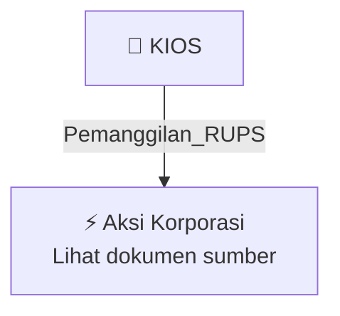

# 📢 Pemanggilan RUPS / RUPSLB — [[KIOS]]

⬅️ [[knowledge-base/daily-digests/Daily_Digest_20261006|Kembali ke Daily Digest]] | 📅 **2026-10-06** | 🎛️ [[Dashboard|Ke Dashboard Utama]]

> [!IMPORTANT]
> Laporan ini disusun secara otomatis oleh **Corporate Action Intelligence Agent** pada **2026-10-06**.
> Sumber dokumen: `20261005_KIOS_20261005_KIOS_Pemanggilan RUPS_32163284_lamp2.pdf`

---

## 📌 1. Ringkasan Eksekutif & Tujuan Strategis

- **Kode & Nama Emiten**: `[[KIOS]]`
- **Kategori Aksi Korporasi**: `Pemanggilan_RUPS`
- **Dokumen Sumber**: `20261005_KIOS_20261005_KIOS_Pemanggilan RUPS_32163284_lamp2.pdf`
- **Tanggal Laporan**: `2026-10-06`

[Analisis LLM tidak tersedia — isi manual]

---

## 📊 2. Fakta Material & Parameter Keuangan

| Parameter Utama | Nilai / Keterangan |
| :--- | :--- |
| **Nama Perseroan** | `PT Kioson Komersial Indonesia Tbk` |
| **Jenis Rapat** | `Rapat Umum Pemegang Saham Luar Biasa (RUPSLB)` |
| **Hari/Tanggal Rapat** | `Selasa, 27 Oktober 2026` |
| **Waktu Rapat** | `14.00 WIB s/d selesai` |
| **Tempat Rapat** | `Axa Tower Lantai 42, Jl. Prof. DR. Satrio, Kuningan, Karet Kuningan` |
| **Mata Acara 1** | `Persetujuan Perubahan Susunan Direksi dan/atau Dewan Komisaris` |
| **Mata Acara 2** | `Persetujuan Perubahan Pasal 3 Anggaran Dasar Perseroan sehubungan dengan Penyesuaian Peraturan Badan Pusat Statistik (BPS) Nomor 7 Tahun 2025 tentang Klasifikasi Baku Lapangan Usaha Indonesia (KBLI)` |
| **Tanggal Pencatatan Pemegang Saham yang Berhak Hadir (Record Date)** | `Jumat, 02 Oktober 2026` |
| **Mekanisme Keikutsertaan** | `Hadir secara fisik atau secara elektronik sesuai ketentuan Perseroan` |
| **Undangan Khusus** | `Perseroan tidak mengirimkan undangan khusus; pemanggilan ini berlaku sebagai undangan resmi` |
| **Akses Dokumen** | `Laman situs Perseroan https://kioson.co.id/, situs Bursa Efek Indonesia, dan aplikasi` |
| **Materi Rapat** | `Tidak disediakan dalam bentuk hardcopy pada saat Rapat` |

---

## 👥 3. Struktur Kepemilikan, Pengendali & Pembeli Siaga

- **Emiten**: `KIOS` | Informasi kepemilikan mengacu pada dokumen resmi sumber.

---

## 🎯 4. Alokasi & Rencana Penggunaan Dana

- Informasi alokasi dana belum tersedia — lihat prospektus / dokumen resmi.

---

## 📅 5. Timeline & Jadwal Pelaksanaan

| Tahapan / Event | Tanggal |
| :--- | :---: |
| **Jadwal** | Lihat dokumen sumber. |

---

## 📈 6. Diagram Visual Flowchart (Mermaid)

---

## 💡 7. Rekomendasi Investor & Strategi Trading

[Analisis LLM tidak tersedia — isi manual]

---

## 🔗 8. Hubungan Note Terkait (Knowledge Graph)

- [[knowledge-base/daily-digests/Daily_Digest_20261006|📄 Daily Digest 2026-10-06]]
- [[knowledge-base/trading-signals/Trading_Signals_20261006|🎯 Sinyal Cuan 2026-10-06]]
- [[KIOS|🏬 Halaman Emiten KIOS]]
- [[Dashboard|🎛️ Kembali ke Dashboard Utama]]

---

*Laporan dibuat otomatis oleh Corporate Action Intelligence Agent · 2026-10-06*