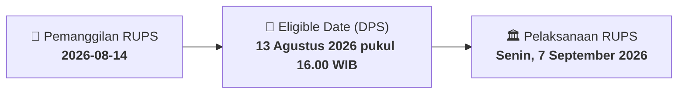

# ⚡ Laporan Intelijen Aksi Korporasi: [[KONI]] - RUPS

⬅️ [[knowledge-base/daily-digests/Daily_Digest_20260814|Kembali ke Daily Digest]] | 📅 **2026-08-14** | 🎛️ [[Dashboard|Ke Dashboard Utama]]

> [!IMPORTANT]
> Laporan ini disusun secara otomatis oleh **Corporate Action Intelligence Agent** untuk memetakan implikasi strategis, rasio keuangan, alokasi dana, jadwal penting, dan panduan investor.

---

## 📌 1. Ringkasan Eksekutif & Katalis Strategis
- **Kode & Nama Emiten**: `[[KONI]]`
- **Kategori Aksi Korporasi**: `RUPS`
- **Dokumen Resmi Bursa**: `Pemanggilan RUPS lamp1`
- **Ringkasan Inti Aksi**: PT Perdana Bangun Pusaka Tbk (KONI) memanggil pemegang saham untuk menghadiri Rapat Umum Pemegang Saham Luar Biasa (RUPSLB) yang akan diselenggarakan pada 7 September 2026. Agenda rapat meliputi persetujuan perubahan Anggaran Dasar untuk penyesuaian KBLI 2025 dan persetujuan perubahan susunan Direksi. Pemegang saham yang berhak hadir adalah yang tercatat dalam Daftar Pemegang Saham pada 13 Agustus 2026.

---

## 📊 2. Matriks Parameter Material & Angka Kunci
| Parameter Utama | Nilai / Keterangan Resmi |
| :--- | :--- |
| **Jenis Rapat** | `Rapat Umum Pemegang Saham Luar Biasa (RUPSLB)` |
| **Hari/Tanggal Rapat** | `Senin, 7 September 2026` |
| **Waktu Rapat** | `10:30 WIB - selesai` |
| **Tempat Rapat** | `Gedung Konica Lt. 7, Jl Gunung Sahari Raya No. 78` |
| **Tanggal Daftar Pemegang Saham (Recording Date)** | `13 Agustus 2026 pukul 16.00 WIB` |
| **Agenda 1** | `Persetujuan Perubahan Anggaran Dasar Perseroan (penyesuaian KBLI 2025)` |
| **Agenda 2** | `Persetujuan Perubahan Susunan Direksi` |
| **Tanggal Pemanggilan** | `14 Agustus 2026` |
| **Biro Administrasi Efek (BAE)** | `PT Sinartama Gunita` |

---

## 📌 3. Detail Pelaksanaan RUPS / RUPSLB
- **Hari, Tanggal Pelaksanaan**: `Senin, 7 September 2026`
- **Waktu Pelaksanaan**: `10:30 WIB - selesai`
- **Lokasi / Tempat Pelaksanaan**: `Gedung Konica Lt. 7, Jl Gunung Sahari Raya No. 78`
- **Batas Hak Suara (Eligible Date / Recording Date)**: `13 Agustus 2026 pukul 16.00 WIB`

## 📝 4. Matriks Agenda & Mata Acara Rapat
| No | Agenda / Mata Acara | Penjelasan & Sub-Acara |
| :-: | :--- | :--- |
| 1 | **Agenda 1** | Persetujuan Perubahan Anggaran Dasar Perseroan (penyesuaian KBLI 2025) |
| 2 | **Agenda 2** | Persetujuan Perubahan Susunan Direksi |

## 🗓️ 5. Timeline Investor & Ketentuan Kehadiran

## 💡 6. Panduan Investor & E-Voting
- 👥 **Hak Suara**: Pemegang saham yang berhak hadir/memberikan suara adalah yang terdaftar dalam DPS pada **Eligible Date (13 Agustus 2026 pukul 16.00 WIB)**.
- 🗳️ **E-Voting eASY.KSEI**: Pemegang saham dapat memberikan kuasa/suara secara elektronik melalui sistem eASY.KSEI.

---

## 🔗 Hubungan Note Terkait (Knowledge Graph)
- [[knowledge-base/daily-digests/Daily_Digest_20260814|📄 Daily Digest 2026-08-14]]
- [[knowledge-base/trading-signals/Trading_Signals_20260814|🎯 Sinyal Cuan 2026-08-14]]
- [[Dashboard|🎛️ Kembali ke Dashboard]]