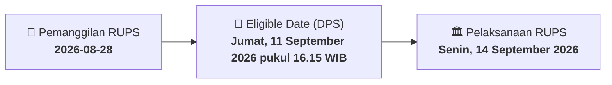

# ⚡ Laporan Intelijen Aksi Korporasi: [[KOTA]] - RUPS

⬅️ [[knowledge-base/daily-digests/Daily_Digest_20260828|Kembali ke Daily Digest]] | 📅 **2026-08-28** | 🎛️ [[Dashboard|Ke Dashboard Utama]]

> [!IMPORTANT]
> Laporan ini disusun secara otomatis oleh **Corporate Action Intelligence Agent** untuk memetakan implikasi strategis, rasio keuangan, alokasi dana, jadwal penting, dan panduan investor.

---

## 📌 1. Ringkasan Eksekutif & Katalis Strategis
- **Kode & Nama Emiten**: `[[KOTA]]`
- **Kategori Aksi Korporasi**: `RUPS`
- **Dokumen Resmi Bursa**: `Pengumuman RUPS lamp1`
- **Ringkasan Inti Aksi**: PT DMS Propertindo Tbk mengumumkan rencana penyelenggaraan Rapat Umum Pemegang Saham Luar Biasa (RUPSLB) yang akan diselenggarakan pada Selasa, 6 Oktober 2026 pukul 10.00 WIB di Azana Suite Hotel Antasari. Pemanggilan RUPSLB akan diumumkan pada 14 September 2026, dengan recording date pada 11 September 2026 pukul 16.15 WIB.

---

## 📊 2. Matriks Parameter Material & Angka Kunci
| Parameter Utama | Nilai / Keterangan Resmi |
| :--- | :--- |
| **Tanggal RUPSLB** | `Selasa, 6 Oktober 2026` |
| **Waktu RUPSLB** | `10.00 - Selesai` |
| **Tempat RUPSLB** | `Azana Suite Hotel Antasari` |
| **Tanggal Pemanggilan RUPSLB** | `Senin, 14 September 2026` |
| **Recording Date** | `Jumat, 11 September 2026 pukul 16.15 WIB` |
| **Syarat Pengusulan Mata Acara oleh Pemegang Saham** | `1/20 atau lebih dari jumlah seluruh saham dengan hak suara yang sah` |

---

## 📌 3. Detail Pelaksanaan RUPS / RUPSLB
- **Hari, Tanggal Pelaksanaan**: `Senin, 14 September 2026`
- **Waktu Pelaksanaan**: `10.00 - Selesai`
- **Lokasi / Tempat Pelaksanaan**: `Azana Suite Hotel Antasari`
- **Batas Hak Suara (Eligible Date / Recording Date)**: `Jumat, 11 September 2026 pukul 16.15 WIB`

## 📝 4. Matriks Agenda & Mata Acara Rapat
| No | Agenda / Mata Acara | Penjelasan & Sub-Acara |
| :-: | :--- | :--- |
| 1 | **Syarat Pengusulan Mata Acara oleh Pemegang Saham** | 1/20 atau lebih dari jumlah seluruh saham dengan hak suara yang sah |

## 🗓️ 5. Timeline Investor & Ketentuan Kehadiran

## 💡 6. Panduan Investor & E-Voting
- 👥 **Hak Suara**: Pemegang saham yang berhak hadir/memberikan suara adalah yang terdaftar dalam DPS pada **Eligible Date (Jumat, 11 September 2026 pukul 16.15 WIB)**.
- 🗳️ **E-Voting eASY.KSEI**: Pemegang saham dapat memberikan kuasa/suara secara elektronik melalui sistem eASY.KSEI.

---

## 🔗 Hubungan Note Terkait (Knowledge Graph)
- [[knowledge-base/daily-digests/Daily_Digest_20260828|📄 Daily Digest 2026-08-28]]
- [[knowledge-base/trading-signals/Trading_Signals_20260828|🎯 Sinyal Cuan 2026-08-28]]
- [[Dashboard|🎛️ Kembali ke Dashboard]]