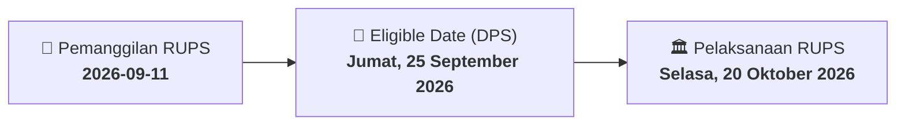

# ⚡ Laporan Intelijen Aksi Korporasi: [[LAPD]] - RUPS

⬅️ [[knowledge-base/daily-digests/Daily_Digest_20260911|Kembali ke Daily Digest]] | 📅 **2026-09-11** | 🎛️ [[Dashboard|Ke Dashboard Utama]]

> [!IMPORTANT]
> Laporan ini disusun secara otomatis oleh **Corporate Action Intelligence Agent** untuk memetakan implikasi strategis, rasio keuangan, alokasi dana, jadwal penting, dan panduan investor.

---

## 📌 1. Ringkasan Eksekutif & Katalis Strategis
- **Kode & Nama Emiten**: `[[LAPD]]`
- **Kategori Aksi Korporasi**: `RUPS`
- **Dokumen Resmi Bursa**: `Pengumuman RUPS lamp1`
- **Ringkasan Inti Aksi**: PT Leyand International Tbk mengumumkan penyelenggaraan Rapat Umum Pemegang Saham Luar Biasa (RUPSLB) yang akan diadakan pada Selasa, 20 Oktober 2026, pukul 10.00 WIB di Meeting Room Maia Hotel, Jakarta Pusat. Rapat akan diselenggarakan secara elektronik melalui fasilitas Electronic General Meeting. Pemegang saham yang berhak hadir adalah yang tercatat dalam Daftar Pemegang Saham pada 25 September 2026. Pemanggilan Rapat akan dilakukan pada 28 September 2026. Usulan mata acara tambahan dapat diajukan paling lambat 21 September 2026.

---

## 📊 2. Matriks Parameter Material & Angka Kunci
| Parameter Utama | Nilai / Keterangan Resmi |
| :--- | :--- |
| **Hari/Tanggal Rapat** | `Selasa, 20 Oktober 2026` |
| **Waktu Rapat** | `Pukul 10.00 WIB – selesai` |
| **Tempat Rapat** | `Meeting Room Maia Hotel, Jakarta Pusat, DKI Jakarta 10240` |
| **Tanggal Pemanggilan Rapat** | `Senin, 28 September 2026` |
| **Tanggal Daftar Pemegang Saham (DPS)** | `Jumat, 25 September 2026` |
| **Batas Akhir Usulan Mata Acara** | `Senin, 21 September 2026` |
| **Batas Akhir Pendaftaran Partisipasi Elektronik** | `Senin, 19 Oktober 2026` |
| **Metode Rapat** | `Elektronik melalui fasilitas Electronic General Meeting` |

---

## 📌 3. Detail Pelaksanaan RUPS / RUPSLB
- **Hari, Tanggal Pelaksanaan**: `Selasa, 20 Oktober 2026`
- **Waktu Pelaksanaan**: `Pukul 10.00 WIB – selesai`
- **Lokasi / Tempat Pelaksanaan**: `Meeting Room Maia Hotel, Jakarta Pusat, DKI Jakarta 10240`
- **Batas Hak Suara (Eligible Date / Recording Date)**: `Jumat, 25 September 2026`

## 📝 4. Matriks Agenda & Mata Acara Rapat
| No | Agenda / Mata Acara | Penjelasan & Sub-Acara |
| :-: | :--- | :--- |
| 1 | **Batas Akhir Usulan Mata Acara** | Senin, 21 September 2026 |

## 🗓️ 5. Timeline Investor & Ketentuan Kehadiran

## 💡 6. Panduan Investor & E-Voting
- 👥 **Hak Suara**: Pemegang saham yang berhak hadir/memberikan suara adalah yang terdaftar dalam DPS pada **Eligible Date (Jumat, 25 September 2026)**.
- 🗳️ **E-Voting eASY.KSEI**: Pemegang saham dapat memberikan kuasa/suara secara elektronik melalui sistem eASY.KSEI.

---

## 🔗 Hubungan Note Terkait (Knowledge Graph)
- [[knowledge-base/daily-digests/Daily_Digest_20260911|📄 Daily Digest 2026-09-11]]
- [[knowledge-base/trading-signals/Trading_Signals_20260911|🎯 Sinyal Cuan 2026-09-11]]
- [[Dashboard|🎛️ Kembali ke Dashboard]]