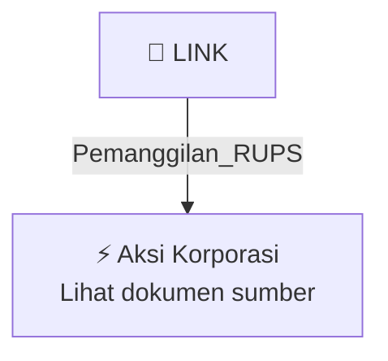

# 📢 Pemanggilan RUPS / RUPSLB — [[LINK]]

⬅️ [[knowledge-base/daily-digests/Daily_Digest_20261005|Kembali ke Daily Digest]] | 📅 **2026-10-05** | 🎛️ [[Dashboard|Ke Dashboard Utama]]

> [!IMPORTANT]
> Laporan ini disusun secara otomatis oleh **Corporate Action Intelligence Agent** pada **2026-10-05**.
> Sumber dokumen: `20261002_LINK_20261002_LINK_Pemanggilan RUPS_32162715_lamp1.pdf`

---

## 📌 1. Ringkasan Eksekutif & Tujuan Strategis

- **Kode & Nama Emiten**: `[[LINK]]`
- **Kategori Aksi Korporasi**: `Pemanggilan_RUPS`
- **Dokumen Sumber**: `20261002_LINK_20261002_LINK_Pemanggilan RUPS_32162715_lamp1.pdf`
- **Tanggal Laporan**: `2026-10-05`

[Analisis LLM tidak tersedia — isi manual]

---

## 📊 2. Fakta Material & Parameter Keuangan

| Parameter Utama | Nilai / Keterangan |
| :--- | :--- |
| **Jenis Rapat** | `Rapat Umum Pemegang Saham Luar Biasa (RUPSLB) / Extraordinary General Meeting of Shareholders` |
| **Hari, Tanggal RUPS** | `Senin, 26 Oktober 2026` |
| **Waktu RUPS** | `10.00 - 11.00 WIB` |
| **Tempat RUPS** | `The Westin Jakarta, Jakarta 12910` |
| **Mata Acara Rapat** | `Perubahan Susunan Anggota Dewan Komisaris dan/atau Direksi Perseroan` |
| **Penjelasan Mata Acara** | `Perseroan akan meminta persetujuan para Pemegang Saham sehubungan dengan perubahan susunan anggota Dewan Komisaris dan/atau Direksi Perseroan` |
| **Tanggal Daftar Pemegang Saham yang Berhak Hadir** | `Kamis, 1 Oktober 2026 pukul 16.00 WIB` |
| **Mekanisme Keikutsertaan** | `Hadir secara fisik, diwakili pihak lain dengan kuasa elektronik, atau hadir secara elektronik melalui e-RUPS` |
| **Batas Waktu Deklarasi Kehadiran Elektronik** | `Paling lambat pukul 12.00 WIB pada 1 (satu) hari kerja sebelum penyelenggaraan Rapat` |
| **Penyelenggaraan Elektronik** | `Melalui fasilitas Electronic General Meeting System (e-RUPS)` |

---

## 👥 3. Struktur Kepemilikan, Pengendali & Pembeli Siaga

- **Emiten**: `LINK` | Informasi kepemilikan mengacu pada dokumen resmi sumber.

---

## 🎯 4. Alokasi & Rencana Penggunaan Dana

- Informasi alokasi dana belum tersedia — lihat prospektus / dokumen resmi.

---

## 📅 5. Timeline & Jadwal Pelaksanaan

| Tahapan / Event | Tanggal |
| :--- | :---: |
| **Jadwal** | Lihat dokumen sumber. |

---

## 📈 6. Diagram Visual Flowchart (Mermaid)

---

## 💡 7. Rekomendasi Investor & Strategi Trading

[Analisis LLM tidak tersedia — isi manual]

---

## 🔗 8. Hubungan Note Terkait (Knowledge Graph)

- [[knowledge-base/daily-digests/Daily_Digest_20261005|📄 Daily Digest 2026-10-05]]
- [[knowledge-base/trading-signals/Trading_Signals_20261005|🎯 Sinyal Cuan 2026-10-05]]
- [[LINK|🏬 Halaman Emiten LINK]]
- [[Dashboard|🎛️ Kembali ke Dashboard Utama]]

---

*Laporan dibuat otomatis oleh Corporate Action Intelligence Agent · 2026-10-05*