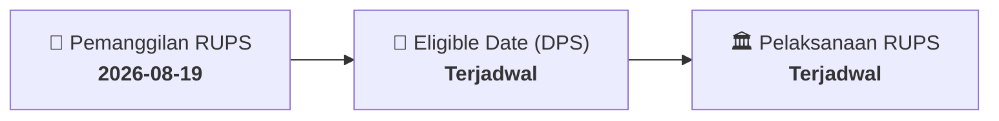

# ⚡ Laporan Intelijen Aksi Korporasi: [[LMPI]] - RUPS

⬅️ [[knowledge-base/daily-digests/Daily_Digest_20260819|Kembali ke Daily Digest]] | 📅 **2026-08-19** | 🎛️ [[Dashboard|Ke Dashboard Utama]]

> [!IMPORTANT]
> Laporan ini disusun secara otomatis oleh **Corporate Action Intelligence Agent** untuk memetakan implikasi strategis, rasio keuangan, alokasi dana, jadwal penting, dan panduan investor.

---

## 📌 1. Ringkasan Eksekutif & Katalis Strategis
- **Kode & Nama Emiten**: `[[LMPI]]`
- **Kategori Aksi Korporasi**: `RUPS`
- **Dokumen Resmi Bursa**: `Pengumuman RUPS lamp1`
- **Ringkasan Inti Aksi**: PT Langgeng Makmur Industri Tbk. mengumumkan akan menyelenggarakan Rapat Umum Pemegang Saham Luar Biasa di Sidoarjo pada 25 September 2026. Panggilan Rapat akan dilakukan pada 3 September 2026 melalui situs web KSEI, BEI, dan Perseroan. Pemegang saham yang berhak hadir adalah yang tercatat dalam Daftar Pemegang Saham per 2 September 2026 pukul 16.00 WIB.

---

## 📊 2. Matriks Parameter Material & Angka Kunci
| Parameter Utama | Nilai / Keterangan Resmi |
| :--- | :--- |
| **Jenis Rapat** | `Rapat Umum Pemegang Saham Luar Biasa` |
| **Tanggal Rapat** | `2026-09-25` |
| **Lokasi Rapat** | `Sidoarjo` |
| **Tanggal Panggilan Rapat** | `2026-09-03` |
| **Media Panggilan Rapat** | `Situs web PT Kustodian Sentral Efek Indonesia, PT Bursa Efek Indonesia, dan situs web Perseroan` |
| **Tanggal Pencatatan Daftar Pemegang Saham** | `2026-09-02` |
| **Batas Waktu Pencatatan DPS** | `16.00 WIB` |
| **Syarat Usul Pemegang Saham** | `Pasal 12 ayat 12 Anggaran Dasar Perseroan dan Pasal 16 Peraturan OJK No. 15/POJK.04/2020` |
| **Tanggal Pengumuman** | `2026-08-19` |

---

## 📌 3. Detail Pelaksanaan RUPS / RUPSLB
- **Hari, Tanggal Pelaksanaan**: `Terjadwal`
- **Waktu Pelaksanaan**: `16.00 WIB`
- **Lokasi / Tempat Pelaksanaan**: `Sidoarjo`
- **Batas Hak Suara (Eligible Date / Recording Date)**: `Terjadwal`

## 📝 4. Matriks Agenda & Mata Acara Rapat
| No | Agenda / Mata Acara | Penjelasan & Sub-Acara |
| :-: | :--- | :--- |
| 1 | **Agenda Utama RUPS** | PT Langgeng Makmur Industri Tbk. mengumumkan akan menyelenggarakan Rapat Umum Pemegang Saham Luar Biasa di Sidoarjo pada 25 September 2026. Panggilan Rapat akan dilakukan pada 3 September 2026 melalui situs web KSEI, BEI, dan Perseroan. Pemegang saham yang berhak hadir adalah yang tercatat dalam Daftar Pemegang Saham per 2 September 2026 pukul 16.00 WIB. |

## 🗓️ 5. Timeline Investor & Ketentuan Kehadiran

## 💡 6. Panduan Investor & E-Voting
- 👥 **Hak Suara**: Pemegang saham yang berhak hadir/memberikan suara adalah yang terdaftar dalam DPS pada **Eligible Date (Terjadwal)**.
- 🗳️ **E-Voting eASY.KSEI**: Pemegang saham dapat memberikan kuasa/suara secara elektronik melalui sistem eASY.KSEI.

---

## 🔗 Hubungan Note Terkait (Knowledge Graph)
- [[knowledge-base/daily-digests/Daily_Digest_20260819|📄 Daily Digest 2026-08-19]]
- [[knowledge-base/trading-signals/Trading_Signals_20260819|🎯 Sinyal Cuan 2026-08-19]]
- [[Dashboard|🎛️ Kembali ke Dashboard]]