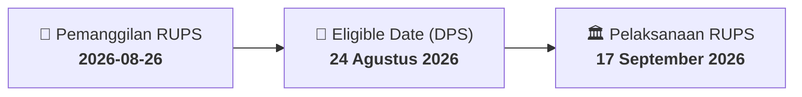

# ⚡ Laporan Intelijen Aksi Korporasi: [[MBSS]] - RUPS

⬅️ [[knowledge-base/daily-digests/Daily_Digest_20260826|Kembali ke Daily Digest]] | 📅 **2026-08-26** | 🎛️ [[Dashboard|Ke Dashboard Utama]]

> [!IMPORTANT]
> Laporan ini disusun secara otomatis oleh **Corporate Action Intelligence Agent** untuk memetakan implikasi strategis, rasio keuangan, alokasi dana, jadwal penting, dan panduan investor.

---

## 📌 1. Ringkasan Eksekutif & Katalis Strategis
- **Kode & Nama Emiten**: `[[MBSS]]`
- **Kategori Aksi Korporasi**: `RUPS`
- **Dokumen Resmi Bursa**: `Pemanggilan RUPS`
- **Ringkasan Inti Aksi**: MBSS menyampaikan pemanggilan RUPSLB yang akan diselenggarakan pada 17 September 2026 pukul 10:00 melalui fasilitas PT Kustodian Sentral Efek, dengan recording date 24 Agustus 2026. Agenda meliputi perubahan susunan Direksi dan Dewan Komisaris, penegasan susunan pemegang saham, serta perubahan tempat kedudukan dan alamat kantor pusat.

---

## 📊 2. Matriks Parameter Material & Angka Kunci
| Parameter Utama | Nilai / Keterangan Resmi |
| :--- | :--- |
| **Nomor Surat Pemanggilan** | `040/MBSS-Corsec/VIII/2026` |
| **Jenis Rapat** | `Rapat Umum Pemegang Saham Luar Biasa (RUPSLB)` |
| **Tanggal RUPS** | `17 September 2026` |
| **Waktu RUPS** | `10:00` |
| **Recording Date** | `24 Agustus 2026` |
| **Lokasi Penyelenggaraan RUPS** | `Disediakan oleh PT Kustodian Sentral Efek` |
| **Surat Pemberitahuan Sebelumnya** | `No. 035/MBSS-Corsec/VIII/2026 tanggal 11 Agustus 2026` |
| **Agenda 1** | `Perubahan susunan Direksi dan Dewan Komisaris Perseroan` |
| **Agenda 2** | `Penegasan susunan pemegang saham Perseroan` |
| **Agenda 3** | `Perubahan tempat kedudukan dan alamat kantor pusat Perseroan` |

---

## 📌 3. Detail Pelaksanaan RUPS / RUPSLB
- **Hari, Tanggal Pelaksanaan**: `17 September 2026`
- **Waktu Pelaksanaan**: `10:00`
- **Lokasi / Tempat Pelaksanaan**: `Disediakan oleh PT Kustodian Sentral Efek`
- **Batas Hak Suara (Eligible Date / Recording Date)**: `24 Agustus 2026`

## 📝 4. Matriks Agenda & Mata Acara Rapat
| No | Agenda / Mata Acara | Penjelasan & Sub-Acara |
| :-: | :--- | :--- |
| 1 | **Agenda 1** | Perubahan susunan Direksi dan Dewan Komisaris Perseroan |
| 2 | **Agenda 2** | Penegasan susunan pemegang saham Perseroan |
| 3 | **Agenda 3** | Perubahan tempat kedudukan dan alamat kantor pusat Perseroan |

## 🗓️ 5. Timeline Investor & Ketentuan Kehadiran

## 💡 6. Panduan Investor & E-Voting
- 👥 **Hak Suara**: Pemegang saham yang berhak hadir/memberikan suara adalah yang terdaftar dalam DPS pada **Eligible Date (24 Agustus 2026)**.
- 🗳️ **E-Voting eASY.KSEI**: Pemegang saham dapat memberikan kuasa/suara secara elektronik melalui sistem eASY.KSEI.

---

## 🔗 Hubungan Note Terkait (Knowledge Graph)
- [[knowledge-base/daily-digests/Daily_Digest_20260826|📄 Daily Digest 2026-08-26]]
- [[knowledge-base/trading-signals/Trading_Signals_20260826|🎯 Sinyal Cuan 2026-08-26]]
- [[Dashboard|🎛️ Kembali ke Dashboard]]