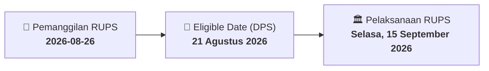

# ⚡ Laporan Intelijen Aksi Korporasi: [[MCOR]] - RUPS

⬅️ [[knowledge-base/daily-digests/Daily_Digest_20260826|Kembali ke Daily Digest]] | 📅 **2026-08-26** | 🎛️ [[Dashboard|Ke Dashboard Utama]]

> [!IMPORTANT]
> Laporan ini disusun secara otomatis oleh **Corporate Action Intelligence Agent** untuk memetakan implikasi strategis, rasio keuangan, alokasi dana, jadwal penting, dan panduan investor.

---

## 📌 1. Ringkasan Eksekutif & Katalis Strategis
- **Kode & Nama Emiten**: `[[MCOR]]`
- **Kategori Aksi Korporasi**: `RUPS`
- **Dokumen Resmi Bursa**: `Pemanggilan RUPS lamp1`
- **Ringkasan Inti Aksi**: Ralat pemanggilan RUPSLB PT Bank China Construction Bank Indonesia Tbk mengubah tanggal penyelenggaraan dari Jumat, 4 September 2026 menjadi Selasa, 15 September 2026, dengan mata acara tunggal perubahan susunan pengurus.

---

## 📊 2. Matriks Parameter Material & Angka Kunci
| Parameter Utama | Nilai / Keterangan Resmi |
| :--- | :--- |
| **Jenis Rapat** | `Rapat Umum Pemegang Saham Luar Biasa (RUPSLB)` |
| **Tanggal RUPSLB Sebelumnya** | `Jumat, 4 September 2026` |
| **Tanggal RUPSLB Setelah Ralat** | `Selasa, 15 September 2026` |
| **Waktu Penyelenggaraan** | `Pukul 15.00 WIB sampai dengan selesai` |
| **Mekanisme Rapat** | `Hybrid: offline dengan pembatasan kehadiran fisik, e-Proxy, e-voting, dan zoom viewing` |
| **Tanggal Pencatatan DPS** | `21 Agustus 2026` |
| **Mata Acara Tunggal** | `Perubahan Susunan Pengurus` |
| **Tanggal Pemanggilan Awal** | `13 Agustus 2026` |
| **Batas Waktu e-Proxy/e-Voting** | `Selambat-lambatnya 1 hari kerja sebelum RUPS pukul 12.00 WIB` |

---

## 📌 3. Detail Pelaksanaan RUPS / RUPSLB
- **Hari, Tanggal Pelaksanaan**: `Selasa, 15 September 2026`
- **Waktu Pelaksanaan**: `Selambat-lambatnya 1 hari kerja sebelum RUPS pukul 12.00 WIB`
- **Lokasi / Tempat Pelaksanaan**: `Aplikasi eASY.KSEI / Kantor Perseroan`
- **Batas Hak Suara (Eligible Date / Recording Date)**: `21 Agustus 2026`

## 📝 4. Matriks Agenda & Mata Acara Rapat
| No | Agenda / Mata Acara | Penjelasan & Sub-Acara |
| :-: | :--- | :--- |
| 1 | **Mata Acara Tunggal** | Perubahan Susunan Pengurus |

## 🗓️ 5. Timeline Investor & Ketentuan Kehadiran

## 💡 6. Panduan Investor & E-Voting
- 👥 **Hak Suara**: Pemegang saham yang berhak hadir/memberikan suara adalah yang terdaftar dalam DPS pada **Eligible Date (21 Agustus 2026)**.
- 🗳️ **E-Voting eASY.KSEI**: Pemegang saham dapat memberikan kuasa/suara secara elektronik melalui sistem eASY.KSEI.

---

## 🔗 Hubungan Note Terkait (Knowledge Graph)
- [[knowledge-base/daily-digests/Daily_Digest_20260826|📄 Daily Digest 2026-08-26]]
- [[knowledge-base/trading-signals/Trading_Signals_20260826|🎯 Sinyal Cuan 2026-08-26]]
- [[Dashboard|🎛️ Kembali ke Dashboard]]