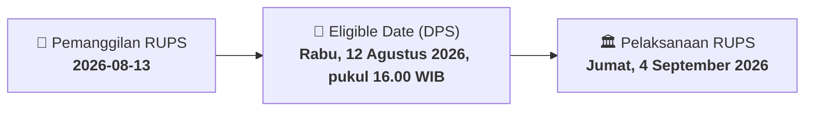

# ⚡ Laporan Intelijen Aksi Korporasi: [[MDLN]] - RUPS

⬅️ [[knowledge-base/daily-digests/Daily_Digest_20260813|Kembali ke Daily Digest]] | 📅 **2026-08-13** | 🎛️ [[Dashboard|Ke Dashboard Utama]]

> [!IMPORTANT]
> Laporan ini disusun secara otomatis oleh **Corporate Action Intelligence Agent** untuk memetakan implikasi strategis, rasio keuangan, alokasi dana, jadwal penting, dan panduan investor.

---

## 📌 1. Ringkasan Eksekutif & Katalis Strategis
- **Kode & Nama Emiten**: `[[MDLN]]`
- **Kategori Aksi Korporasi**: `RUPS`
- **Dokumen Resmi Bursa**: `Pemanggilan RUPS lamp2`
- **Ringkasan Inti Aksi**: PT Modernland Realty Tbk. mengundang pemegang saham untuk menghadiri RUPSLB pada 4 September 2026, dengan agenda persetujuan pengalihan aset lebih dari 50% kekayaan bersih dan perubahan Pasal 3 Anggaran Dasar terkait KBLI.

---

## 📊 2. Matriks Parameter Material & Angka Kunci
| Parameter Utama | Nilai / Keterangan Resmi |
| :--- | :--- |
| **Jenis Rapat** | `Rapat Umum Pemegang Saham Luar Biasa (RUPSLB)` |
| **Hari/Tanggal RUPSLB** | `Jumat, 4 September 2026` |
| **Waktu RUPSLB** | `Pk. 10.00 WIB – selesai` |
| **Tempat RUPSLB** | `Club House Jakarta Garden City, Jakarta 13910, Indonesia` |
| **Agenda 1** | `Persetujuan pengalihan/pemindahtanganan dan/atau menjadikan jaminan aset lebih dari 50% kekayaan bersih Perseroan` |
| **Agenda 2** | `Persetujuan perubahan Pasal 3 Anggaran Dasar tentang maksud dan tujuan serta kegiatan usaha untuk penyesuaian KBLI` |
| **Dasar Hukum Agenda 1** | `UU No. 40 Tahun 2007 tentang Perseroan Terbatas dan POJK No. 15/POJK.04/2020` |
| **Dasar Hukum Agenda 2** | `Peraturan Pemerintah No. 28 Tahun 2025 dan Peraturan Badan Pusat Statistik No. 7 Tahun 2025` |
| **Tanggal Pencatatan Pemegang Saham (Recording Date)** | `Rabu, 12 Agustus 2026, pukul 16.00 WIB` |
| **Batas Penerimaan Surat Kuasa** | `3 hari kerja sebelum RUPSLB` |
| **Alamat Kantor Perseroan** | `Green Central City, Jl. Gajah Mada No. 188, Jakarta Barat` |

---

## 📌 3. Detail Pelaksanaan RUPS / RUPSLB
- **Hari, Tanggal Pelaksanaan**: `Jumat, 4 September 2026`
- **Waktu Pelaksanaan**: `Pk. 10.00 WIB – selesai`
- **Lokasi / Tempat Pelaksanaan**: `Club House Jakarta Garden City, Jakarta 13910, Indonesia`
- **Batas Hak Suara (Eligible Date / Recording Date)**: `Rabu, 12 Agustus 2026, pukul 16.00 WIB`

## 📝 4. Matriks Agenda & Mata Acara Rapat
| No | Agenda / Mata Acara | Penjelasan & Sub-Acara |
| :-: | :--- | :--- |
| 1 | **Agenda 1** | Persetujuan pengalihan/pemindahtanganan dan/atau menjadikan jaminan aset lebih dari 50% kekayaan bersih Perseroan |
| 2 | **Agenda 2** | Persetujuan perubahan Pasal 3 Anggaran Dasar tentang maksud dan tujuan serta kegiatan usaha untuk penyesuaian KBLI |
| 3 | **Dasar Hukum Agenda 1** | UU No. 40 Tahun 2007 tentang Perseroan Terbatas dan POJK No. 15/POJK.04/2020 |
| 4 | **Dasar Hukum Agenda 2** | Peraturan Pemerintah No. 28 Tahun 2025 dan Peraturan Badan Pusat Statistik No. 7 Tahun 2025 |

## 🗓️ 5. Timeline Investor & Ketentuan Kehadiran

## 💡 6. Panduan Investor & E-Voting
- 👥 **Hak Suara**: Pemegang saham yang berhak hadir/memberikan suara adalah yang terdaftar dalam DPS pada **Eligible Date (Rabu, 12 Agustus 2026, pukul 16.00 WIB)**.
- 🗳️ **E-Voting eASY.KSEI**: Pemegang saham dapat memberikan kuasa/suara secara elektronik melalui sistem eASY.KSEI.

---

## 🔗 Hubungan Note Terkait (Knowledge Graph)
- [[knowledge-base/daily-digests/Daily_Digest_20260813|📄 Daily Digest 2026-08-13]]
- [[knowledge-base/trading-signals/Trading_Signals_20260813|🎯 Sinyal Cuan 2026-08-13]]
- [[Dashboard|🎛️ Kembali ke Dashboard]]