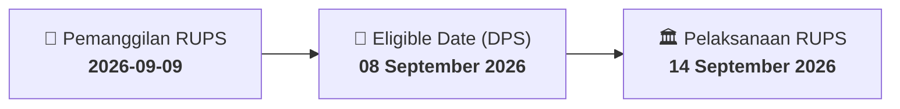

# ⚡ Laporan Intelijen Aksi Korporasi: [[MDLN]] - RUPS

⬅️ [[knowledge-base/daily-digests/Daily_Digest_20260909|Kembali ke Daily Digest]] | 📅 **2026-09-09** | 🎛️ [[Dashboard|Ke Dashboard Utama]]

> [!IMPORTANT]
> Laporan ini disusun secara otomatis oleh **Corporate Action Intelligence Agent** untuk memetakan implikasi strategis, rasio keuangan, alokasi dana, jadwal penting, dan panduan investor.

---

## 📌 1. Ringkasan Eksekutif & Katalis Strategis
- **Kode & Nama Emiten**: `[[MDLN]]`
- **Kategori Aksi Korporasi**: `RUPS`
- **Dokumen Resmi Bursa**: `Pemanggilan RUPS`
- **Ringkasan Inti Aksi**: PT Modernland Realty Tbk. (MDLN) mengumumkan pemanggilan Rapat Umum Pemegang Saham Luar Biasa (RUPSLB) yang merupakan koreksi atas pengumuman sebelumnya. RUPSLB akan diselenggarakan pada 14 September 2026 di Club House Jakarta Garden City, dengan agenda persetujuan pengalihan aset lebih dari 50% kekayaan bersih Perseroan. RUPS sebelumnya pada 04 September 2026 tidak mencapai kuorum.

---

## 📊 2. Matriks Parameter Material & Angka Kunci
| Parameter Utama | Nilai / Keterangan Resmi |
| :--- | :--- |
| **Nomor Surat Pemanggilan** | `041/MDLN-CORSEC/IX/26` |
| **Tanggal Surat Pemanggilan** | `09 September 2026` |
| **Jenis Rapat** | `Rapat Umum Pemegang Saham Luar Biasa (RUPSLB)` |
| **Tanggal Pelaksanaan RUPSLB** | `14 September 2026` |
| **Waktu Pelaksanaan** | `10:00 WIB` |
| **Lokasi Pelaksanaan** | `Club House Jakarta Garden City, Jakarta 13910, Indonesia` |
| **Tanggal Daftar Pemegang Saham (Recording Date)** | `08 September 2026` |
| **Hasil RUPS Sebelumnya (04 September 2026)** | `Tidak Kuorum` |
| **Agenda RUPSLB** | `Persetujuan atas rencana pengalihan atau pemindahtanganan dan/atau menjadikan jaminan aset atau kekayaan Perseroan yang merupakan lebih dari 50% jumlah kekayaan bersih Perseroan dalam 1 transaksi atau lebih` |

---

## 📌 3. Detail Pelaksanaan RUPS / RUPSLB
- **Hari, Tanggal Pelaksanaan**: `14 September 2026`
- **Waktu Pelaksanaan**: `10:00 WIB`
- **Lokasi / Tempat Pelaksanaan**: `Club House Jakarta Garden City, Jakarta 13910, Indonesia`
- **Batas Hak Suara (Eligible Date / Recording Date)**: `08 September 2026`

## 📝 4. Matriks Agenda & Mata Acara Rapat
| No | Agenda / Mata Acara | Penjelasan & Sub-Acara |
| :-: | :--- | :--- |
| 1 | **Agenda RUPSLB** | Persetujuan atas rencana pengalihan atau pemindahtanganan dan/atau menjadikan jaminan aset atau kekayaan Perseroan yang merupakan lebih dari 50% jumlah kekayaan bersih Perseroan dalam 1 transaksi atau lebih |

## 🗓️ 5. Timeline Investor & Ketentuan Kehadiran

## 💡 6. Panduan Investor & E-Voting
- 👥 **Hak Suara**: Pemegang saham yang berhak hadir/memberikan suara adalah yang terdaftar dalam DPS pada **Eligible Date (08 September 2026)**.
- 🗳️ **E-Voting eASY.KSEI**: Pemegang saham dapat memberikan kuasa/suara secara elektronik melalui sistem eASY.KSEI.

---

## 🔗 Hubungan Note Terkait (Knowledge Graph)
- [[knowledge-base/daily-digests/Daily_Digest_20260909|📄 Daily Digest 2026-09-09]]
- [[knowledge-base/trading-signals/Trading_Signals_20260909|🎯 Sinyal Cuan 2026-09-09]]
- [[Dashboard|🎛️ Kembali ke Dashboard]]