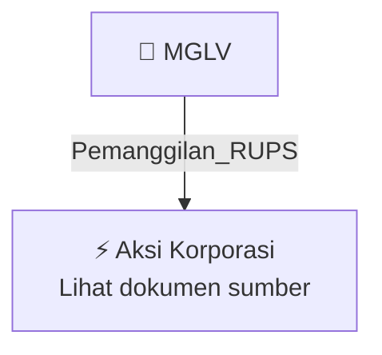

# 📢 Pemanggilan RUPS / RUPSLB — [[MGLV]]

⬅️ [[knowledge-base/daily-digests/Daily_Digest_20261007|Kembali ke Daily Digest]] | 📅 **2026-10-07** | 🎛️ [[Dashboard|Ke Dashboard Utama]]

> [!IMPORTANT]
> Laporan ini disusun secara otomatis oleh **Corporate Action Intelligence Agent** pada **2026-10-07**.
> Sumber dokumen: `20261006_MGLV_20261006_MGLV_Pengumuman RUPS_32163789_lamp1.pdf`

---

## 📌 1. Ringkasan Eksekutif & Tujuan Strategis

- **Kode & Nama Emiten**: `[[MGLV]]`
- **Kategori Aksi Korporasi**: `Pemanggilan_RUPS`
- **Dokumen Sumber**: `20261006_MGLV_20261006_MGLV_Pengumuman RUPS_32163789_lamp1.pdf`
- **Tanggal Laporan**: `2026-10-07`

[Analisis LLM tidak tersedia — isi manual]

---

## 📊 2. Fakta Material & Parameter Keuangan

| Parameter Utama | Nilai / Keterangan |
| :--- | :--- |
| **Nama Perseroan** | `PT NEXAI DIGITAL INFRASTRUKTUR TBK` |
| **Jenis Rapat** | `Rapat Umum Pemegang Saham Luar Biasa (RUPSLB)` |
| **Hari/Tanggal RUPSLB** | `Kamis, 12 November 2026` |
| **Tanggal Pemanggilan RUPSLB** | `Rabu, 21 Oktober 2026` |
| **Tanggal Daftar Pemegang Saham yang Berhak Hadir** | `Selasa, 20 Oktober 2026` |
| **Dasar Hukum** | `POJK 15/2020, POJK 14/2025, dan Anggaran Dasar Perseroan` |
| **Media Publikasi Pemanggilan** | `Situs web penyedia e-RUPS, situs web Bursa Efek Indonesia, dan situs web Perseroan` |
| **Bahasa Publikasi Pemanggilan** | `Bahasa Indonesia dan Bahasa Inggris` |
| **Batas Pengusulan Mata Acara RUPSLB** | `Paling lambat 7 hari sebelum tanggal Pemanggilan RUPSLB` |
| **Syarat Pemegang Saham Pengusul Mata Acara** | `1 atau lebih pemegang saham yang mewakili 1/20 atau lebih dari jumlah seluruh saham dengan hak suara` |
| **Batas Pemberian/Perubahan Kuasa Elektronik** | `Rabu, 11 November 2026, paling lambat 1 hari kerja sebelum penyelenggaraan RUPSLB` |
| **Mekanisme RUPS** | `RUPSLB dilaksanakan secara elektronik melalui fasilitas penyedia e-RUPS/e-GMS` |

---

## 👥 3. Struktur Kepemilikan, Pengendali & Pembeli Siaga

- **Emiten**: `MGLV` | Informasi kepemilikan mengacu pada dokumen resmi sumber.

---

## 🎯 4. Alokasi & Rencana Penggunaan Dana

- Informasi alokasi dana belum tersedia — lihat prospektus / dokumen resmi.

---

## 📅 5. Timeline & Jadwal Pelaksanaan

| Tahapan / Event | Tanggal |
| :--- | :---: |
| **Jadwal** | Lihat dokumen sumber. |

---

## 📈 6. Diagram Visual Flowchart (Mermaid)

---

## 💡 7. Rekomendasi Investor & Strategi Trading

[Analisis LLM tidak tersedia — isi manual]

---

## 🔗 8. Hubungan Note Terkait (Knowledge Graph)

- [[knowledge-base/daily-digests/Daily_Digest_20261007|📄 Daily Digest 2026-10-07]]
- [[knowledge-base/trading-signals/Trading_Signals_20261007|🎯 Sinyal Cuan 2026-10-07]]
- [[MGLV|🏬 Halaman Emiten MGLV]]
- [[Dashboard|🎛️ Kembali ke Dashboard Utama]]

---

*Laporan dibuat otomatis oleh Corporate Action Intelligence Agent · 2026-10-07*