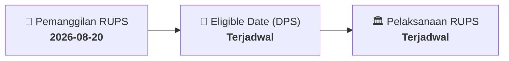

# ⚡ Laporan Intelijen Aksi Korporasi: [[MINE]] - RUPS

⬅️ [[knowledge-base/daily-digests/Daily_Digest_20260820|Kembali ke Daily Digest]] | 📅 **2026-08-20** | 🎛️ [[Dashboard|Ke Dashboard Utama]]

> [!IMPORTANT]
> Laporan ini disusun secara otomatis oleh **Corporate Action Intelligence Agent** untuk memetakan implikasi strategis, rasio keuangan, alokasi dana, jadwal penting, dan panduan investor.

---

## 📌 1. Ringkasan Eksekutif & Katalis Strategis
- **Kode & Nama Emiten**: `[[MINE]]`
- **Kategori Aksi Korporasi**: `RUPS`
- **Dokumen Resmi Bursa**: `Pemanggilan RUPS lamp1`
- **Ringkasan Inti Aksi**: PT Sinar Terang Mandiri Tbk mengumumkan pembatalan Rapat Umum Pemegang Saham Luar Biasa yang semula dijadwalkan pada 31 Agustus 2026, karena adanya penyesuaian dan kajian lebih lanjut terhadap mata acara RUPSLB.

---

## 📊 2. Matriks Parameter Material & Angka Kunci
| Parameter Utama | Nilai / Keterangan Resmi |
| :--- | :--- |
| **Nama Perseroan** | `PT Sinar Terang Mandiri Tbk` |
| **Jenis Rapat** | `Rapat Umum Pemegang Saham Luar Biasa (RUPSLB)` |
| **Tanggal Rapat Semula** | `31 Agustus 2026` |
| **Hari Rapat Semula** | `Jumat` |
| **Status Rapat** | `Dibatalkan` |
| **Alasan Pembatalan** | `Penyesuaian dan kajian lebih lanjut terhadap mata acara RUPSLB guna memastikan pemenuhan ketentuan peraturan perundang-undangan serta kebutuhan Perseroan` |
| **Tanggal Pengumuman** | `18 Agustus 2026` |
| **Tempat Pengumuman** | `Jakarta` |

---

## 📌 3. Detail Pelaksanaan RUPS / RUPSLB
- **Hari, Tanggal Pelaksanaan**: `Terjadwal`
- **Waktu Pelaksanaan**: `09.00 WIB s.d. selesai`
- **Lokasi / Tempat Pelaksanaan**: `Jakarta`
- **Batas Hak Suara (Eligible Date / Recording Date)**: `Terjadwal`

## 📝 4. Matriks Agenda & Mata Acara Rapat
| No | Agenda / Mata Acara | Penjelasan & Sub-Acara |
| :-: | :--- | :--- |
| 1 | **Agenda Utama RUPS** | PT Sinar Terang Mandiri Tbk mengumumkan pembatalan Rapat Umum Pemegang Saham Luar Biasa yang semula dijadwalkan pada 31 Agustus 2026, karena adanya penyesuaian dan kajian lebih lanjut terhadap mata acara RUPSLB. |

## 🗓️ 5. Timeline Investor & Ketentuan Kehadiran

## 💡 6. Panduan Investor & E-Voting
- 👥 **Hak Suara**: Pemegang saham yang berhak hadir/memberikan suara adalah yang terdaftar dalam DPS pada **Eligible Date (Terjadwal)**.
- 🗳️ **E-Voting eASY.KSEI**: Pemegang saham dapat memberikan kuasa/suara secara elektronik melalui sistem eASY.KSEI.

---

## 🔗 Hubungan Note Terkait (Knowledge Graph)
- [[knowledge-base/daily-digests/Daily_Digest_20260820|📄 Daily Digest 2026-08-20]]
- [[knowledge-base/trading-signals/Trading_Signals_20260820|🎯 Sinyal Cuan 2026-08-20]]
- [[Dashboard|🎛️ Kembali ke Dashboard]]