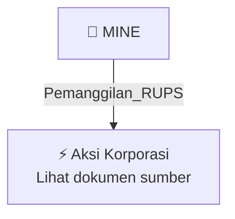

# 📢 Pemanggilan RUPS / RUPSLB — [[MINE]]

⬅️ [[knowledge-base/daily-digests/Daily_Digest_20260929|Kembali ke Daily Digest]] | 📅 **2026-09-29** | 🎛️ [[Dashboard|Ke Dashboard Utama]]

> [!IMPORTANT]
> Laporan ini disusun secara otomatis oleh **Corporate Action Intelligence Agent** pada **2026-09-29**.
> Sumber dokumen: `20260928_MINE_20260928_MINE_Pengumuman RUPS_32161535_lamp1.pdf`

---

## 📌 1. Ringkasan Eksekutif & Tujuan Strategis

- **Kode & Nama Emiten**: `[[MINE]]`
- **Kategori Aksi Korporasi**: `Pemanggilan_RUPS`
- **Dokumen Sumber**: `20260928_MINE_20260928_MINE_Pengumuman RUPS_32161535_lamp1.pdf`
- **Tanggal Laporan**: `2026-09-29`

[Analisis LLM tidak tersedia — isi manual]

---

## 📊 2. Fakta Material & Parameter Keuangan

| Parameter Utama | Nilai / Keterangan |
| :--- | :--- |
| **Uraian Kejadian** | `PENGUMUMAN RAPAT UMUM PEMEGANG SAHAM LUAR BIASA PT SINAR TERANG MANDIRI Tbk (“Perseroan”) ANNOUNCEMENT OF EXTRAORDINARY GENERAL MEETING OF SHAREHOLDERS PT SINAR TERANG MANDIRI Tbk (“Company”) PT Sinar Terang Mandiri Tbk Direksi / Board of Directors Dengan ini Direksi PT Sinar Terang Mandiri Tbk (“Perseroan”) menyampaikan pengumuman kepada pemegang saham Perseroan bahwa Perseroan akan menyelenggarakan Rapat Umum Pemegang Saham Luar Biasa (“RUPSLB”) yang akan diselenggarakan pada hari Rabu, tangga` |

---

## 👥 3. Struktur Kepemilikan, Pengendali & Pembeli Siaga

- **Emiten**: `MINE` | Informasi kepemilikan mengacu pada dokumen resmi sumber.

---

## 🎯 4. Alokasi & Rencana Penggunaan Dana

- Informasi alokasi dana belum tersedia — lihat prospektus / dokumen resmi.

---

## 📅 5. Timeline & Jadwal Pelaksanaan

| Tahapan / Event | Tanggal |
| :--- | :---: |
| **Jadwal** | Lihat dokumen sumber. |

---

## 📈 6. Diagram Visual Flowchart (Mermaid)

---

## 💡 7. Rekomendasi Investor & Strategi Trading

[Analisis LLM tidak tersedia — isi manual]

---

## 🔗 8. Hubungan Note Terkait (Knowledge Graph)

- [[knowledge-base/daily-digests/Daily_Digest_20260929|📄 Daily Digest 2026-09-29]]
- [[knowledge-base/trading-signals/Trading_Signals_20260929|🎯 Sinyal Cuan 2026-09-29]]
- [[MINE|🏬 Halaman Emiten MINE]]
- [[Dashboard|🎛️ Kembali ke Dashboard Utama]]

---

*Laporan dibuat otomatis oleh Corporate Action Intelligence Agent · 2026-09-29*